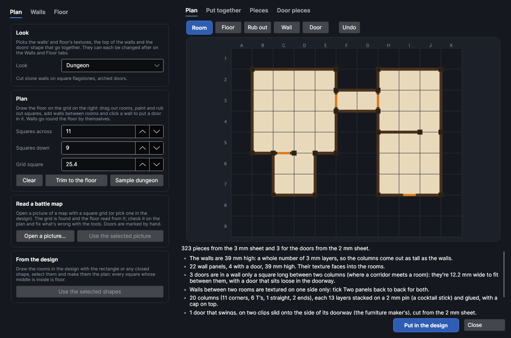
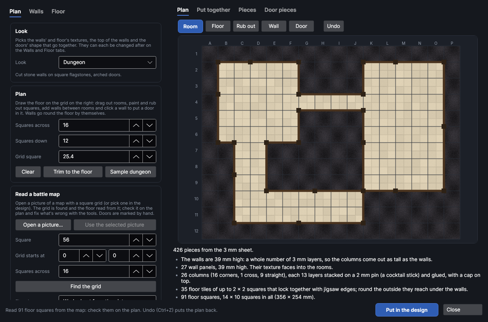
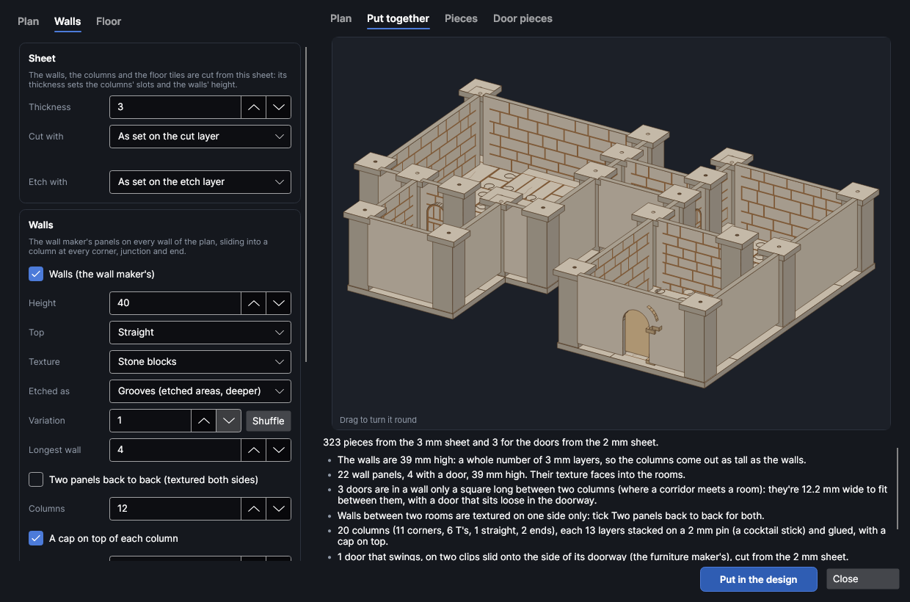

# Map to terrain

An add-on (Settings → Add-ons → **Map to terrain**): on when PhotonCanvas is installed, and can be
turned off. It needs the **Textured wall maker**, **Floor tile maker**, **Mini furniture maker** and
**Whole-building kits** add-ons, which make its pieces and show them. Its button is
**Mini-Designer → Town → Map to terrain**, and **Edit map terrain…** is on the right-click menu of the pieces
it made.

**Map to terrain** turns a floor plan into tabletop terrain you can cut and stand up: draw the rooms
on a square grid (or read them from a battle map picture, or from shapes in the design) and you get
every wall with its texture etched on and its doorways cut, the slotted columns the walls slide into
at every corner, junction and end, the doors, and floor tiles for every square that jigsaw together
and reach out under the walls. The walls are made the way the wall maker makes them
([Textured walls](walls.md)), the tiles the way the floor tile maker does ([Floor tiles](floortiles.md))
and the doors that swing the way the furniture maker does ([Mini furniture](furniture.md)).

> **Note:** The terrain has been checked on screen and in tests (every wall, column and tile is put
> together in 3D and checked for clashes, every column stands on the tiles and every floor square is
> covered), but not yet cut on the machine. Cut one column and the end of one wall first, check the
> wall slides into the slot, and change **Slot fit** on the **Walls** tab if it's too tight or too loose.

## The Map to terrain window
<!-- windows: MapWindow -->

Click **Map to terrain** on the **Mini-Designer** tab (in the **Town** group). The **Map to terrain** window
opens with a small dungeon to start from (or the last map you made). On the left are three tabs:
**Plan** (the look, the grid, reading a battle map), **Walls** (the sheet, the walls and the doors)
and **Floor** (the floor tiles). On the right, **Plan** is the floor plan you draw on, **Put
together** shows the terrain in 3D (drag it to turn it round; scroll to zoom in on a part, middle-drag or the arrow keys to move it, and press **F** or the first button in its corner to see it all again), and **Pieces** and **Door pieces**
show the pieces flat, one of each, with how many of each there are. Under them are the number of
pieces and notes: how it goes together, a red ✕ that has to be fixed before it can go in, a yellow !
worth a look.

Press **Put in the design** and every piece goes into the design, nested onto the bed, a page per
bed: first the walls, columns and tiles (all from one sheet), then the doors that swing (when
they're cut from a different sheet). To change it later, select any of its pieces, right-click and
choose **Edit map terrain…**, change the plan or the settings and press **Update in the design**:
the old pieces are replaced wherever they are.

## Drawing the plan

The plan is a grid of squares, lettered across and numbered down (the notes name squares that
way: *C4*). Set its size with **Squares across** and **Squares down**, and the size of one square
with **Grid square** (25.4 mm, an inch, suits 28–32 mm figures). Above the plan are the tools:

| Tool | What it does |
|---|---|
| **Room** | Drag out a rectangle of floor. With the right mouse button, rub one out. |
| **Floor** | Paint floor a square at a time (the right button rubs out). |
| **Rub out** | Rub out floor a square at a time. |
| **Wall** | Drag along the grid lines to add walls, between two rooms for example. Drag along a wall to take it away (an opening to the outside, or between rooms). The right button puts an edge back as it was. |
| **Door** | Click a wall to put a door in it; click the door to take it out again (the wall stays). |

Walls go round the floor by themselves: wherever a floor square meets one that isn't floor. The
plan shows them as they'll be made: dark lines for the walls, orange for the doors, a small square
for every column, and a dashed line where you took a wall away. **Undo** (or Ctrl+Z) takes back the
last change; **Clear** empties the plan, **Trim to the floor** cuts the grid down to the floor with
one square round it, and **Sample dungeon** starts again from the sample.

**Look** picks the textures and the doors' shape that go together: *Dungeon* (stone blocks on
square flagstones), *Castle* (brick with battlements on stone paving), *Ruins* (rough stone broken
away at the top, on cobbles), *Inn or house* (planks on floorboards), *Temple* (tiles on hexagons),
*Sci-fi* (metal panels with vents and hazard stripes on deck panels), *Cave* (rough cave rock on
uneven rock slabs), *Desert* (sandstone with battlements on sandstone slabs) or *Gothic* (stone
blocks on a chequered floor, pointed doors). These are the same textures the wall and floor tile
makers use in their themes. Each can be changed after on the other tabs.

## Reading a battle map

Under **Read a battle map**, press **Open a picture…** and pick a map with a square grid (a PNG or
JPG from a virtual tabletop, a scan, a photo taken straight on), or select a picture in the design
and press **Use the selected picture**. The window:

1. **Finds the grid**: how many pixels a square is (**Square**) and where the lines are (**Grid
   starts at**). A map with no grid lines needs **Squares across** typed in (the grid then starts at
   the picture's corner). **Find the grid** looks again after you've changed them.
2. **Reads the floor**: each square's middle is light or dark, split at the brightness that suits the
   picture best. **Floor is** *Worked out from the picture* takes the part that isn't round the edge
   of the map as the floor; pick *The lighter part* or *The darker part* if it gets it the wrong way
   round, or untick **Find the split by itself** and set **Split at** (0 black, 1 white).
3. **Finds walls drawn as lines** along the grid, between rooms or, on a line drawing (rooms drawn
   in black on white), all of them: then the squares outside the walls are left out.

Press **Read the map** to read it again with the settings changed. The picture stays under the plan
(untick **Show the picture under the plan** to hide it), so you can check what was read and fix it
with the tools. Doors aren't read from the picture: put them in with the **Door** tool.

## From shapes in the design

Draw the rooms in the design at their real size with the rectangle tool (or any closed shape),
select them and press **Use the selected shapes**: every square whose middle is inside them is
floor, on a grid of **Grid square** starting at their top left corner.

## Walls, columns and doors

On the **Walls** tab:

- **Thickness**: the sheet the walls, the columns and the floor tiles are cut from. Pick your
  material in **Cut with** to bring in its thickness, slot fit and kerf, and the texture's settings
  in **Etch with**.
- **Walls**: untick it for floor tiles alone. **Height** is rounded to whole layers of the sheet, so
  the columns, a stack of layers, come out exactly as tall as the walls. **Top**: *Straight*,
  *Battlements* or *Broken (ruined)*. **Texture**: the wall maker's textures, etched on the face that
  looks into the rooms; **Etched as** grooves or scored lines; **Variation** for a different layout.
- **Longest wall**: the longest panel, in squares. A longer wall is split into panels with a
  straight column between them; the splits are chosen so each panel has at most one door and the
  doors keep away from the columns.
- **Two panels back to back**: walls textured on both faces (twice as thick). Without it, a wall
  between two rooms is textured on one side only.
- **Columns**: how wide the columns are; **A cap on top of each column**; **Slot fit**: added to
  the wall's thickness for the columns' slots.
- **Doors**: *Hung on clips: they swing open* is the furniture maker's door for a wall, cut from the
  **Door sheet**, on two clips slid onto the side of the doorway; *Loose in the doorway* is the wall
  maker's door that just sits in it; *Just a doorway* leaves them open. Their **Shape**, **Width** and
  **Height**. A door sits in the middle of its square, or a little off it to keep clear of a column.

Where a corridor meets a room, the door is in a wall only one square long between two columns: there
isn't room there for the door's frame, so that doorway is made as wide as fits between the columns
(a note says how wide) and gets a door that sits loose in it. If even that doesn't fit (very wide
columns or small squares), the doorway is left open with a yellow ! saying so.

Each column is a stack of layers with a slot for every wall that meets it (an end, a straight join, a
corner, a T or a cross) and a hole up the middle: stack them on a 2 mm pin (a cocktail stick or a
piece of wire) and glue them. Walls that come out the same are cut together as one piece with
copies.

## Floor tiles

On the **Floor** tab, **Floor tiles** makes a tile for every floor square, cut from the walls'
sheet; untick it to stand the walls on a battle mat or a printed map. **Texture**: the floor tile
maker's textures. **Biggest tile**: the floor is cut into tiles of up to that many squares each
way (a block whose floor squares don't touch makes a tile for each part). **Joins**: *Jigsaw edges*
(the floor tile maker's tab and socket on every square where two tiles meet, so any tile fits its
neighbour), *Clips* (sockets and bowtie clips that bridge them) or *Plain edges*. **Tab size** is
the jigsaw tab's head or the clip's width. **Reach under the walls round the edge** makes the
tiles round the outside reach out far enough for the walls and the columns to stand on them, level.

## Putting it together

1. Jigsaw the floor tiles together (the tile names are the square at their top left corner).
2. Stack and glue the columns on their pins: the plan shows where each one goes.
3. Slide the walls into the columns' slots, the textured face into the room, a drop of glue in each
   slot if you want it to stay. Walls with a door go where the plan shows the doors.
4. Slide each door's clips onto the side of its doorway, one at the floor and one high up, and drop
   the door's pins into them; or stand the loose doors in their doorways.

## See also

- [Textured walls](walls.md): the wall maker, for single walls and other textures.
- [Floor tiles](floortiles.md): the floor tile maker, for loose tiles and boards.
- [Whole buildings](buildings.md): cottages, taverns and watchtowers with every piece.
