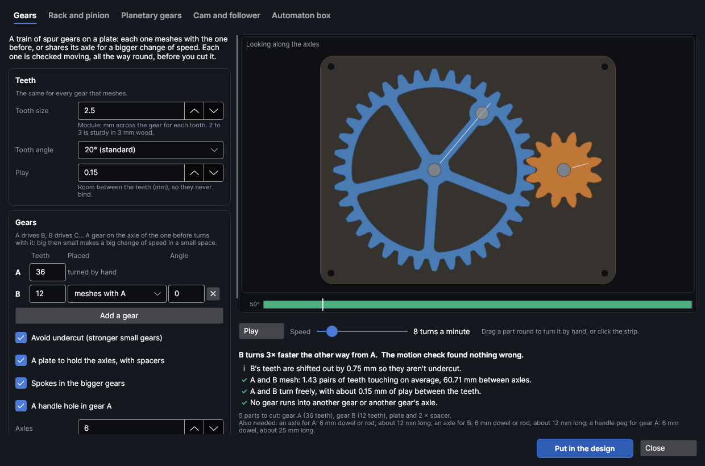
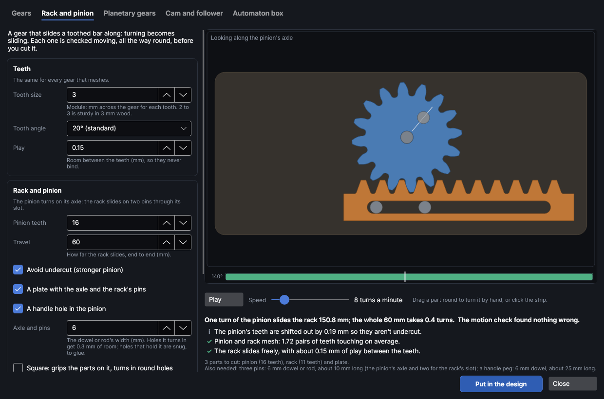
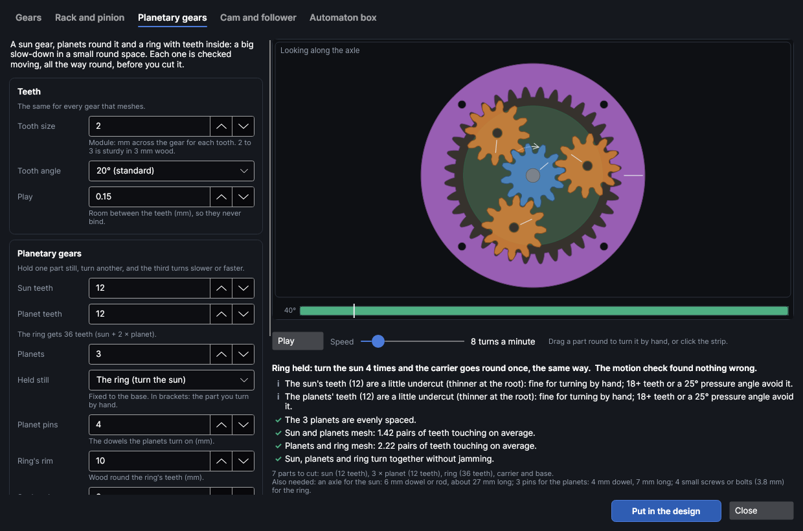
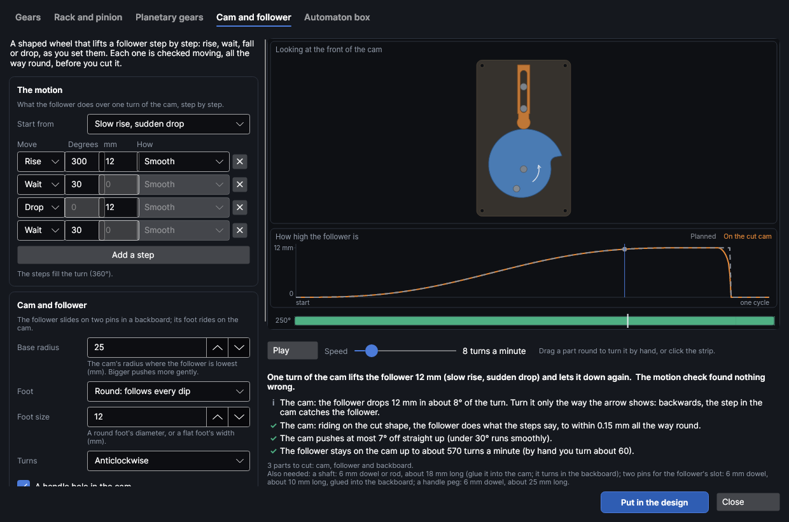
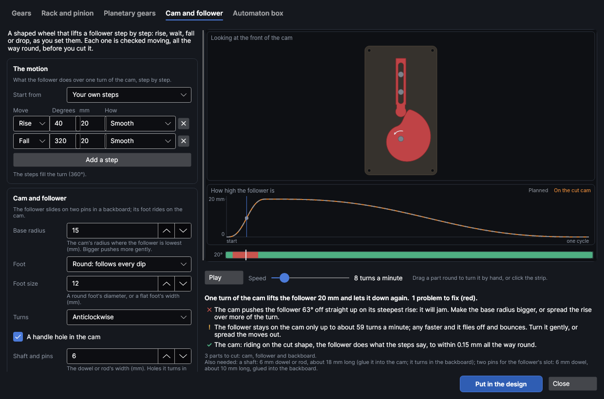
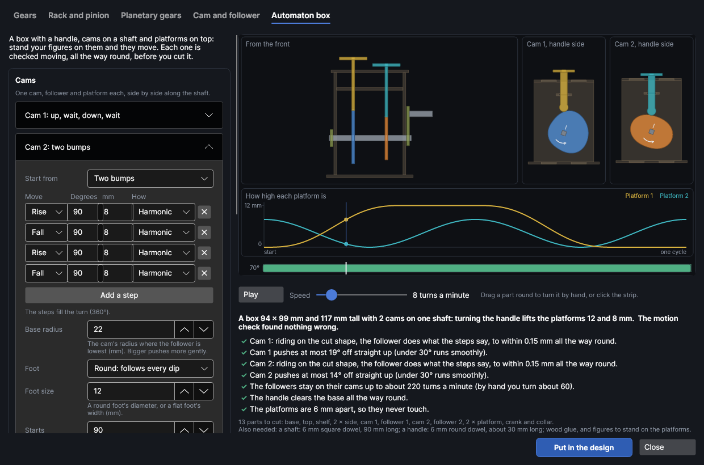

# Mechanisms

An add-on (Settings → Add-ons → **Mechanism maker**): on when PhotonCanvas is installed, and can be turned off. Its button is **Home → Draw → Mechanisms**, and **Edit mechanism…** is on the right-click menu of a mechanism's parts.

**Mechanisms** makes things that move, cut from sheet material: a train of gears, a rack and
pinion, planetary gears, a cam and follower, or an automaton box with a handle, cams and platforms
for your figures. You set it up, watch it move, and the motion check turns it all the way round
looking for trouble: teeth that jam or bind, a follower that can't follow its cam, parts that hit
each other, a part too big for the bed. Then it puts the parts in the design, named and marked,
on a cut layer with your material's kerf, ready to cut.

> **Note:** The mechanisms have been checked on screen and in tests, but not yet cut on the
> machine. Cut your first one in card or scrap plywood, and check the fit of the axles and teeth.

## The Mechanism maker window
<!-- windows: MechanismWindow -->

Click **Mechanisms** on the **Home** tab (in the **Draw** group). The **Mechanism maker** opens
over the program.

- **Top:** a tab for each kind: **Gears**, **Rack and pinion**, **Planetary gears**, **Cam and
  follower** and **Automaton box**. Each keeps its own settings while you look at the others.
- **Left:** its settings, and the **Material** it's cut from. Every change is checked again straight
  away.
- **Right:** the mechanism moving, seen as you'd look at it (an automaton from the front and each
  cam from the side). Charts under it show how things move over one cycle, and the strip along the
  bottom shows how the check came out at each point of the cycle.
- **Under that:** a one-line summary (how fast what turns), each thing the check found, the parts
  to cut and what else you need (dowels, pins, glue).
- **Put in the design** puts the parts in your design (see [Put it in the design](#put-it-in-the-design)).
  **Close** (or `Esc`) closes the window; your settings are kept for next time.

Watching it move:

- **Play** / **Pause** starts and stops it. **Speed** is how fast the part you turn goes, 1–60 turns
  a minute (default 8).
- Drag a part round with the mouse to turn it by hand: everything else moves with it. In a view
  without an axle to turn round (the automaton's front), drag sideways.
- Click or drag along the strip to go to that point of the cycle. The angle beside the strip is how
  far the part you turn has gone round.

## The motion check

The check moves the mechanism through its cycle in small steps and looks at the real cut shapes, not
just the numbers. (Gears are turned through a whole tooth at each place they mesh: every tooth is
the same, so that covers every tooth.)

- The strip is green where all is well, orange where something needs watching and red where it
  won't work. Parts that run into each other turn red in the picture at that point.
- Each finding has a mark: ✓ checked and fine, **i** good to know, **!** worth fixing (orange),
  ✕ a problem to fix (red). Problems come first, and say what to change.
- **Put in the design** still works with problems found: the line at the bottom then warns that it
  may not work as it is.

What it checks:

| Mechanism | Checked |
|---|---|
| Gears, rack and pinion, planetary gears | Each pair of gears turned through every tooth: that the teeth never overlap (jam), that the play between them is what you set, and how many pairs of teeth touch on average (the contact ratio: under 1 the teeth lose touch, under 1.2 they may click). That no gear runs into another gear or another gear's axle. Undercut teeth (thin at the root), tooth tips that come to a point, too little wood round an axle hole, and teeth too small for wood (under module 1.5 in sheet 2 mm or thicker). For planetary gears, that the planets are evenly spaced and don't touch each other. |
| Cam and follower, automaton | That riding on the cut cam, the follower does what the steps say, within 0.15 mm all the way round (more than 0.5 mm off is a problem). How hard the cam pushes sideways on the follower: under 30° off straight up runs smoothly, over 45° jams. That a flat foot is wide enough for where the cam touches it, and that the cam never hits the follower's side. How fast it can turn before the follower flies off and bounces (under 60 turns a minute is warned about). Sudden drops, and steps that can't be cut. |
| Automaton | Also that the handle clears the base all the way round and that the platforms never touch each other. |
| Every mechanism | That each part fits on the machine's bed (turned a quarter if need be), with 3 mm round it. |

## Gears

**Gears** makes a train of spur gears on a plate: gear **A** is the one you turn, **A** drives
**B**, **B** drives **C**, and so on. Big driving small speeds up; small driving big slows down and
turns harder.

| Setting | What it does |
|---|---|
| **Tooth size** | The module: mm across the gear (at the circle where it meets the next) for each tooth, 0.5–10, default 2.5. A gear with 36 teeth of module 2.5 is 90 mm there, about 95 mm over its teeth. 2 to 3 is sturdy in 3 mm wood. |
| **Tooth angle** | The pressure angle: **14.5° (old style)**, **20° (standard)** (the default) or **25° (stronger, fewer teeth)**. Gears that mesh must have the same; 25° makes stronger teeth and lets small gears have fewer teeth. |
| **Play** | Room between the teeth (backlash), 0–1 mm, default 0.15, so they never bind. It's shared between the two gears of each pair. |
| **Teeth** | Each gear's teeth, 6–200. Up to 8 gears (**Add a gear**, ✕ takes one away). The default is A with 36 teeth driving B with 12: B turns three times as fast, the other way. |
| **Placed** | **meshes with** the gear before it (at **Angle** from it: 0° to the right, 90° up), or **on** its **axle**, in the layer in front, glued to it face to face so they turn as one: big then small makes a big change of speed in a small space. |
| **Avoid undercut (stronger small gears)** | On by default. Gears with few teeth (under 17 at 20°) are cut thin at the root; this shifts their teeth outwards so they aren't, and moves their axles a little further apart. |
| **A plate to hold the axles, with spacers** | A plate under the gears with snug holes for the axles (glue them in) and a hole in each free corner to screw it down, and spacers to keep the gears off the plate. |
| **Spokes in the bigger gears** | Windows in gears big enough for them, to save material and weight. |
| **A handle hole in gear A** | A hole for a peg to turn A by, on a spoke in a round pad. A gear too small for one says so. |
| **Axles** | The dowel or rod's width, 2–25 mm, default 6. Holes a part turns in get 0.3 mm of room; holes that hold the axle (the plate's) are snug, to glue. **Square** is for square dowel: parts that hold it get square holes, so it can't turn in them; parts that turn on it get round ones. |

**Rack and pinion** turns turning into sliding: the pinion turns on its axle and slides the rack
on two pins through the slot in it. **Pinion teeth** 6–80 (default 16), **Travel** 10–500 mm (how far
the rack slides, end to end, default 60), and the same **Teeth** settings (default tooth size 3).
With **A plate with the axle and the rack's pins**, the pinion's axle and the two pins are glued
into a plate. In the picture the rack slides to one end and back.

**Planetary gears**: a sun gear in the middle, planets round it on a carrier, and a ring with teeth
inside round them all. Hold one still and turn another: the third turns slower or faster.

| Setting | What it does |
|---|---|
| **Sun teeth**, **Planet teeth** | 6–80 each, default 12 and 12. The ring gets sun + 2 × planet teeth (36). |
| **Planets** | 1–8, default 3. They're spread evenly when the teeth allow; otherwise as near evenly as they'll mesh. |
| **Held still** | Fixed to the base: **The ring (turn the sun)** (the default: the carrier goes round 4 times slower, the same way), **The carrier (turn the sun)** (the ring goes backwards, slower) or **The sun (turn the ring)** (the carrier follows, a little slower). The summary gives the exact speeds. |
| **Planet pins** | The dowels the planets turn on, 2–12 mm, default 4. |
| **Ring's rim** | Wood round the ring's teeth, 4–40 mm, default 10. |
| **Sun's axle** | As **Axles** above. |

The default tooth size is 2 for planetary gears.

## Cam and follower

A cam is a shaped wheel. As it turns, the follower riding on it is pushed up and comes down again,
step by step, as you set. The follower slides up and down on two pins in a backboard, and the cam
is glued onto a shaft that turns in the backboard.

**The motion** is a list of steps that together make one turn of the cam:

| Move | What the follower does |
|---|---|
| **Rise** | Goes up so many **mm** over so many **Degrees** of the turn. |
| **Wait** | Stays where it is for so many **Degrees**. |
| **Fall** | Comes down so many **mm** over so many **Degrees**. |
| **Drop** | Falls straight off a step in the cam (no degrees: as fast as it can fall). The cam then only works turning the way its arrow shows. A round foot drops; a flat foot slides down the step instead, over part of the turn. |

**How** each rise and fall moves: **Smooth** (starts and stops without a jolt, the default),
**Harmonic** (gentlest in the middle), **3-4-5** (like Smooth) or **Steady** (an even speed, with a
knock at each end). **Start from** gives ready-made motions: **Up and down**, **Up, wait, down, wait**
(the default), **Two bumps**, **Three bumps**, **Quick up, slow down**, **Wait, then hop** and **Slow
rise, sudden drop**. Change any step and it becomes **Your own steps**. Up to 16 steps (**Add a
step**, ✕ takes one away). When they don't add up to 360° they're squeezed or stretched to fill the
turn, and the line under them says so. The follower ends where it started: if the steps go up more
than they come down, the follower drops at the end of the turn; if they go down more, it would have
to jump up, which can't work (shown as a problem).

| Setting | What it does |
|---|---|
| **Base radius** | The cam's radius where the follower is lowest, 5–150 mm, default 25. Bigger pushes more gently (less sideways push) but makes a bigger cam. |
| **Foot** | **Round: follows every dip** (the default) or **Flat: can't get into dips**: a flat foot pushes straight and wears well, but it rides over hollows and slides down drops. |
| **Foot size** | A round foot's diameter or a flat foot's width, 4–80 mm, default 12. |
| **Turns** | **Anticlockwise** (the default) or **Clockwise**, looking at the front of the cam. It matters for drops. |
| **A handle hole in the cam** | A hole for a peg to turn it by. |
| **Shaft and pins** | As **Axles** under [Gears](#gears). |

The chart under the picture shows how high the follower is over one turn: **Planned** (the steps)
and **On the cut cam** (where it really is, riding on the cut shape). Where the two part, the cam
can't make the motion: usually a dip narrower than a round foot, or any dip for a flat one.

## Automaton box

An **Automaton box** is a box with a handle on its side and a shaft through it with a cam for each
figure. Each cam pushes a follower up through the top, with a round platform on it to stand a figure
on. Turn the handle and the figures go up and down, each in its own way.

**Cams**: one section for each (up to 6, **Add a cam**, **Take this cam away**), each with its steps
and **Base radius**, **Foot** and **Foot size** as for a single cam (default base radius 22), and:

- **Starts**: how far into its steps the cam is when the handle starts, 0–359° (the second cam's
  default is 90): puts the figures out of step with each other.

**The box**:

| Setting | What it does |
|---|---|
| **Platforms** | How wide each round platform is, 10–120 mm, default 30. |
| **Crank** | From the shaft to the handle, 10–120 mm, default 28. Too long and it hits the base at the bottom of its turn; the check says, and how short to make it. |
| **Handle turns** | **Anticlockwise** (the default) or **Clockwise**, looking at the handle's side. |
| **Shaft** | As **Axles** under [Gears](#gears); square by default, so the cams turn with it. Each cam's square hole is turned to set where it starts. |

The box is held together by tabs in slots: the slots are the sheet's **Thickness** plus **Slot fit**
(under **Material**). The followers slide in slots in the top and in a shelf under it.

## Material and kerf

| Setting | What it does |
|---|---|
| **Cut with** | Your material's cut settings from the material library, or **As set on the cut layer**. Picking one brings its thickness and, from the cut test, its kerf and slot fit, and puts those settings on the cut layer. |
| **Thickness** | The sheet's thickness, 0.5–25 mm, default 3: spacers, slots and axle lengths follow it. |
| **Slot fit** | For the automaton box: slots are the thickness plus this, −0.5 to +1 mm, default +0.1. + is looser. |
| **Engrave the parts' names and marks** | On by default: names, turning arrows and lines to line parts up, engraved lightly before the parts are cut out. |

The laser burns away a thin line as it cuts (the kerf), so a part cut on its line comes out smaller
by half the kerf all round: gears get more play and holes get bigger. With your material's cut
settings picked, the cut layer's **Kerf** moves each cut out by half of it, so parts come out at
their drawn size and the play is what you set. **Laser → Tests → Cut test** measures the kerf and the
slot fit and saves them with the material (see Materials and tests in the guide).

## Put it in the design

**Put in the design** adds the parts to your design:

- The outlines go on a **Cut** layer named **Mechanism · cut**, with the material's settings.
  Names and marks go on a **Score** layer named **Mechanism · marks**, at low power (15% at most),
  run before the cut while the sheet is still whole.
- Each part is grouped with its name and marks, and the parts are nested on the bed by their real
  shapes, 3 mm apart and 3 mm from the edge, turned a quarter where that helps.
- When the page already has something on it, the parts go on a new page named after the
  mechanism. Parts that don't fit on one bed go on more pages ("Gears 2" and so on), a bed each.
- `Ctrl+Z` undoes it in one step.

The parts list in the window says what to cut and what else you need, with lengths: dowels for
axles and pins, a handle peg, glue.

## Change it later

Every part remembers how it was made. Right-click any part of the mechanism and choose **Edit
mechanism…** (or select a part and click **Mechanisms**): the window opens with its settings. Change
them and click **Update in the design**: the old parts go (from every page they were on; pages they
leave empty go too) and the new ones are put on the page shown.

## Putting it together

- Glue the axles and pins into the plate, backboard or base (their holes are snug), and turn the
  gears, cams and followers on them (their holes have 0.3 mm of room). A drop of wax on the teeth
  and the follower's foot helps.
- Gears go on in their layers: a spacer, then the gear. Glue gears that share an axle to each
  other first, face to face, with the axle through both to line them up.
- The arrows engraved on cams and the carrier show which way they turn. On an automaton's cams, the
  short line points the way the crank points at the start: fit the crank, then put each cam on the
  shaft with its line pointing the same way, and the figures move in the order you set.
- Planetary gears: fix the part that's held still to the base, then fit the sun, the planets on the
  carrier's pins and the carrier.

## Tutorials

- [Make gears and watch them turn](tutorial:draw-mechanism-gears)
- [Make a cam that lifts and drops](tutorial:draw-mechanism-cam)
- [Build an automaton box](tutorial:draw-mechanism-automaton)
