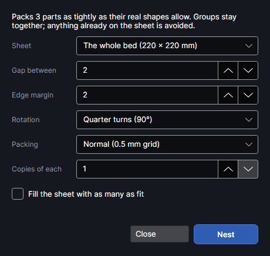

# Nest

An add-on (Settings → Add-ons → **Nest**): on when PhotonCanvas is installed, and can be turned off. Its button is **Arrange → Repeat → Nest**, and **Nest on material…** is on the right-click menu.

## Nest

<!-- windows: NestWindow -->

**Nest** (`Ctrl+Alt+N`) packs the selected parts onto the material as tightly as their real shapes allow, turning
them where it helps, and can add copies until the sheet is full. Use it to get the most parts out
of a board or an offcut. The top of the window says how many parts it will pack.

| Setting | What it does |
|---|---|
| **Sheet** | Where the parts go: **The whole bed (220 × 220 mm)**; a material outline ("Material · name · size", see below), chosen to start with when there is one, or **All N material outlines** when there are several; or any other closed shape on the page (not a text) that isn't being nested and whose box is bigger than 100 mm² ("name · size"). |
| **Gap between** | Space kept between parts, 0–50 mm, default 2. At least the cut width; more for fragile material. |
| **Edge margin** | Space kept from the sheet's edge, 0–50 mm, default 2. |
| **Rotation** | How parts may be turned: **Don't rotate**, **Quarter turns (90°)** (the default), **45° steps**, **15° steps (slower)** or **5° steps (slow)**. |
| **Packing** | The grid the parts are fitted on: **Normal (0.5 mm grid)** (the default), **Tight (0.25 mm grid, slower)** or **Quick (1 mm grid)**. A finer grid packs closer. |
| **Start from** | Where the first (biggest) part goes: **The middle, working outward** (the default), with the rest gathered round it, or **The top-left corner (leftover stays in one piece)**, which packs from the top left so the unused material is one piece along the right and bottom edges. |
| **Copies of each** | 1–500, default 1. 1 = just the parts you selected; more adds copies of each. |
| **Fill the sheet with as many as fit** | Keeps adding copies of each part in turn until nothing more fits (at most 500 new copies). **Copies of each** is then ignored. |

Click **Nest**. A bar shows while it works; **Close** stops it and closes the window. When it's
done, the line above the buttons says how many parts were placed, how many new copies were made
and roughly how much of the sheet they use. `Ctrl+Z` undoes it. The window stays open, so you can
change a setting and nest again.

How it works:

- The selected parts themselves are moved and turned; copies are added as new shapes.
- A group is one part and stays together. Pictures can be nested too.
- Each part's silhouette (its holes filled in, grown by the gap) is slid over the sheet, biggest
  part first, and put down where it touches nothing: as near the middle of the sheet as it can
  go, or, from the corner, at the first free place from the top left. Parts are never put inside
  another part's holes.
- From the middle, if not everything fits (or when filling the sheet), the corner packing is
  tried too; when it fits more, it's used instead, moved as a block toward the middle as far as
  the sheet allows.
- Shapes already on the sheet are kept clear of: shapes on visible layers that are sent to the
  laser. Shapes on layers whose output is off (guides, the material outline) don't count.
- Parts never go outside the work area, even when the sheet is bigger.
- Parts that don't fit are left where they were, and are selected afterwards.

The sheet can be a **material outline**: the board actually in the machine, drawn round or picked on the camera picture (see Arranging in the guide).

## Tutorials

- [Nest parts on the material](tutorial:arr-nest)
