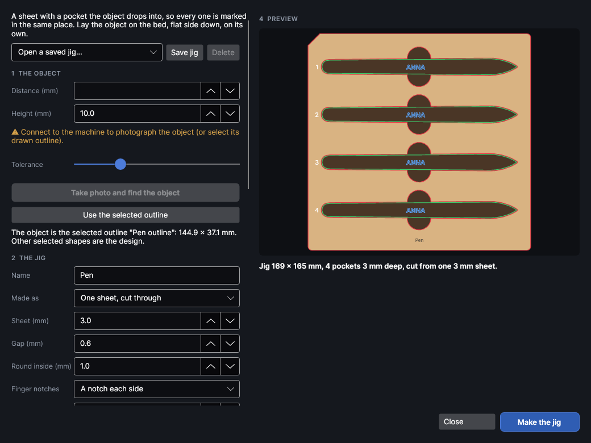
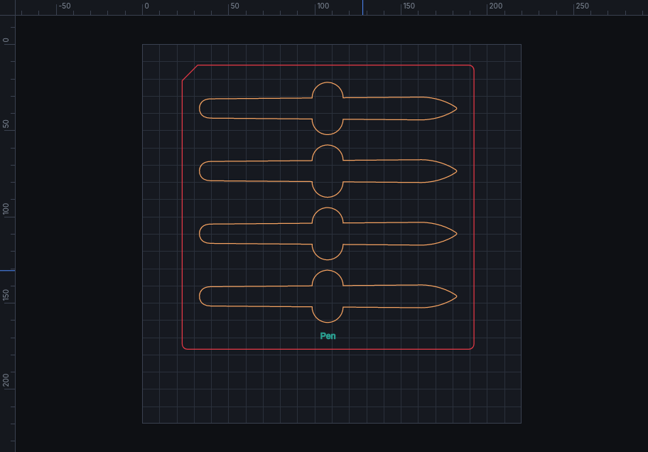
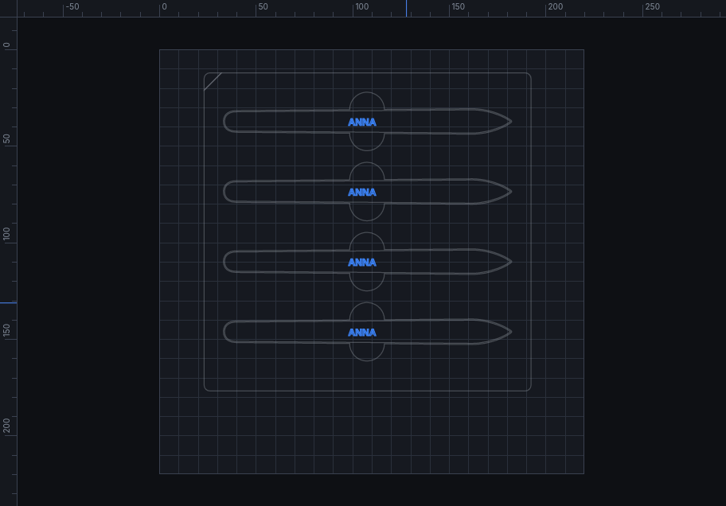

# Object jigs

A jig holds an odd-shaped object (a pen, a phone case, a knife handle, a lighter) in exactly the same
place every time, so the design lands in the same spot on every one. Lay the object on the bed, the
camera outlines it, and PhotonCanvas makes a sheet with a pocket the object drops into (or a grid of
pockets for a batch), plus a page with the design lined up on every pocket. Later, **Find the jig**
lets the camera find the jig wherever you lay it, so you can keep a jig and use it again.

The object jig maker is an add-on: turn it off in **Settings → Add-ons** if you don't use it. It
only uses the camera: it never moves the head or fires the laser. The jig and the objects are
marked with **Ship It**, as always. Not yet tried on the machine or on real photos.

## Object jig

<!-- windows: JigWindow -->

Click **Object jig** on the **Camera** tab (in **Place**). The window has the object on the left,
then the jig, then the design; the preview on the right shows the jig to scale with the objects in
it (green) and the design on each (blue). Nothing changes in the design until **Make the jig**.

### 1 The object

Lay the object on the bed, flat side down, on its own, away from the edges of the work area. A bed
of a different shade helps (a sheet of card or MDF under a dark object).

| Setting | Range | Default | What it does |
|---|---|---|---|
| **Distance (mm)** | 0 to 200 | the machine's last focus | From the laser to the bed the object lies on, as the machine's focus measures it. |
| **Height (mm)** | 0.5 to 200 | 10 | How tall the object is. The camera is lined up halfway up it (the distance less half the height), where the outline of most objects is widest. The camera must be calibrated near that height. |
| **Tolerance** | 3 to 60 | 18 | How different from the bed a colour must be to count as the object. Raise it if the honeycomb shows up; lower it if a pale or shiny object is missed. |

**Take photo and find the object** photographs the whole bed and outlines the biggest thing on it
(holes in it are filled in). Anything smaller is left out and counted in the message.

Already have the outline (drawn, or traced from a photo or a scan)? Select it before opening the
window, or click **Use the selected outline**: the biggest closed shape selected is the object, and
the other selected shapes are the design.

**Open a saved jig…** at the top brings back a jig you saved (below): its object and its settings.

### 2 The jig

| Setting | Range | Default | What it does |
|---|---|---|---|
| **Name** | | empty | Names the jig's pages ("Pen jig · cut") and the saved jig, and is engraved on the jig. |
| **Made as** | | One sheet, cut through | **One sheet, cut through**: the pockets go right through one sheet, and the objects stand on the bed inside it. **Stacked sheets on a solid base**: several sheets cut the same, glued onto a solid base sheet. **Stacked sheets, no base**: several sheets with the objects standing on the bed. |
| **Sheet (mm)** | 0.5 to 30 | 3 | The thickness of one sheet. Picking a material in **Cut with** fills it in from the library. |
| **Depth (mm)** | 0.5 to 100 | 6 | Stacked sheets only: how deep the object sits, rounded up to whole sheets. About half the object's height holds it well; it's suggested when you change the height. |
| **Gap (mm)** | 0 to 10 | 0.6 | Room round the object, each side, so it drops in without rattling. 0.5 to 1 mm suits a camera outline; less for a carefully drawn one. The cut's kerf makes the pocket a little bigger still. |
| **Round inside (mm)** | 0 to 10 | 1 | Inside corners and narrow slots this size are rounded off and filled: the laser can't cut a slot thinner than its beam, and the object drops in more easily. |
| **Finger notches** | | A notch each side | Round notches across the object's middle, to lift it out: **A notch each side**, **One notch, at the front** (the side towards the front of the bed), or **No notches**. |
| **Notch size (mm)** | 0 to 60 | 18 | The notch's diameter. 15 to 20 mm fits a fingertip. |
| **Lay the object straight (long side left to right)** | on, off | on | Turns the object so its long side runs across the bed. Off keeps it at the angle it lay. |
| **Across**, **Down** | 1 to 50 | 1, 1 | Pockets side by side and rows of them: one jig for a batch. |
| **Wall (mm)** | 0 to 100 | 6 | Wood left between two pockets. Under 3 mm is warned about: thin walls burn through or break. |
| **Margin (mm)** | 2 to 200 | 10 | Wood round the pockets. |
| **Corners (mm)** | 0 to 50 | 3 | The jig's corner radius. |
| **Cut-off corner (mm)** | 0 to 60 | 10 | The back-left corner is cut off at 45°, so the jig only goes one way round, and the camera can tell which way it lies. Keep it for **Find the jig**; 0 makes the corner square. |
| **Dowel holes (mm)** | 0 to 12 | 3 | Stacked sheets only: holes in three corners of every sheet (not the cut-off one). Push dowels or cocktail sticks through them to line the stack up while the glue sets. 0 = none. |
| **Engrave the name on the jig** | on, off | on | The name goes under the pockets, in **Name size (mm)** letters (2 to 30, default 5). |
| **Put the jig where the object lay** | on, off | on | The jig's middle goes where the object lay (kept on the work area). Off: type its middle in **Middle X (mm)** and **Middle Y (mm)**. |
| **Cut with**, **Engrave with** | | default settings | Laser settings from your material library: the cut for the sheets, the engrave for the name and for the objects' outlines on the base sheet. |

The summary under the preview gives the jig's size, the pockets and their depth. Warnings say when
the jig won't fit the bed, the pockets are much deeper or shallower than the object, the walls are
thin, or a corner or dowel hole runs into a pocket.

### 3 The design

Select the design before opening the window. It's marked on every object; texts and codes with
fields (serial numbers, spreadsheet rows) count up from one pocket to the next, in the order the
preview numbers them (back to front, then left to right).

| Setting | Default | What it does |
|---|---|---|
| **Put the design** | Where it is on the canvas | **Where it is on the canvas**: as you placed it over the object (its camera picture, or its outline), so you choose the spot by eye. **In the middle of the object**: its middle on the object's middle. |
| **Turn it along the object** | on | In the middle only: the design's left to right runs along the object's long side. |
| **Size it to fit inside the object** | off | In the middle only: the design is made as big as fits inside the object's outline, **Fit margin (mm)** (default 2) in from its edge. |
| **Make the jig's pages (untick when you have this jig already)** | on | Off: only the objects page is made, for a new design on a jig you already have. |

With nothing selected, the objects page still has each object's outline to design on.

### What it makes

**Make the jig** adds pages after the one on screen, all at the same place on the bed, and shows the
first. `Ctrl+Z` undoes it.

- One sheet: **"Name jig · cut"**: the name engraved first, then the pockets, then the outline (so
  the sheet hasn't moved when the pockets are cut).
- Stacked: **"Name jig · top sheet"** (with the name), **"Name jig · sheets (cut N)"** for the other
  sheets when there are more, and **"Name jig · base"** (the outline, the dowel holes, and a light
  score of where each object goes).
- **"Name jig · objects"**: the design on every object, on the page's own copies of your layers,
  and the jig drawn in grey on the **Jig (guide, not marked)** layer (never marked).

To use it:

1. Cut the jig page with the sheet on the bed. For a one-sheet jig, **leave it where it is**: push
   the waste out of the pockets.
2. Put the objects in the pockets.
3. Show the objects page, measure the focus on the top of an object, frame, and **Ship It**.

A stacked jig (or a jig picked up and put back later) has moved: use **Find the jig** before
marking.

### Saved jigs

**Save jig** keeps the object's outline and the jig's settings (not the laser settings or the
design) under a name. **Open a saved jig…** brings it back with **Make the jig's pages** unticked, so
**Make the jig** only makes the objects page for the new design; then lay the jig on the bed and use
**Find the jig**. **Delete** removes the saved jig picked in the list (jigs already made in designs
aren't touched).

## Find the jig

<!-- windows: FindJigWindow -->

**Find the jig** (Camera tab, **Place**) is for a jig's objects page (the one with the jig drawn in
grey). Lay the jig anywhere on the bed, any way round, with nothing touching it; the objects can be
in it. Measure the focus on the jig's top.

| Setting | Range | Default | What it does |
|---|---|---|---|
| **Distance (mm)** | 0 to 200 | the machine's last focus | From the laser to the top of the jig. The window says how tall the jig is. |
| **Tolerance** | 3 to 60 | 18 | How different from the bed a colour must be to count as the jig. |

**Take photo and find the jig** photographs the bed (0.4 mm per pixel). The biggest thing on it is
taken as the jig; its shape gives a first guess at where it is and which way round (the cut-off
corner settles that), then the jig's drawn edges (outline and pockets) are fitted to the photo to
well under a millimetre. The preview shows what the camera saw (orange) and where the jig will be
(green); the message says how far it moved and turned, and warns when the edges or the cut-off
corner didn't show clearly.

**Apply** moves everything on the page (the design and the grey jig) onto the jig, as one undo
step. Measure the focus on an object's top before **Ship It**.

> **Tip:** Shiny, dark or pale objects show best on a bed of the opposite shade. If the jig is found
> the wrong way round, check the cut-off corner is clear of other things.
