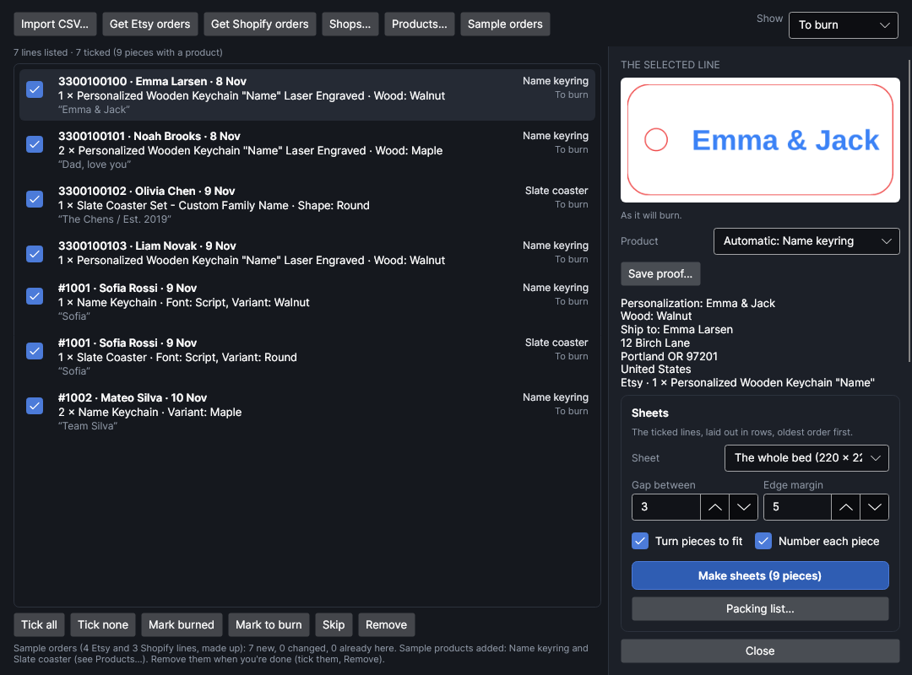
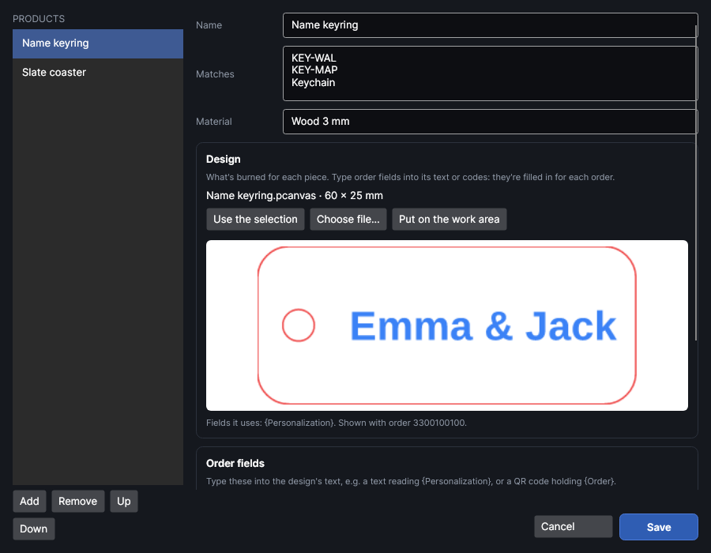
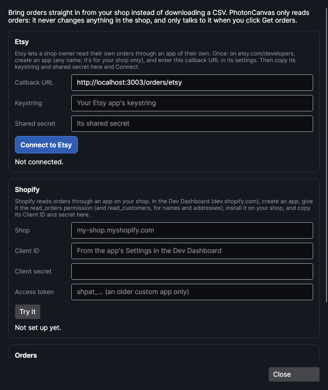
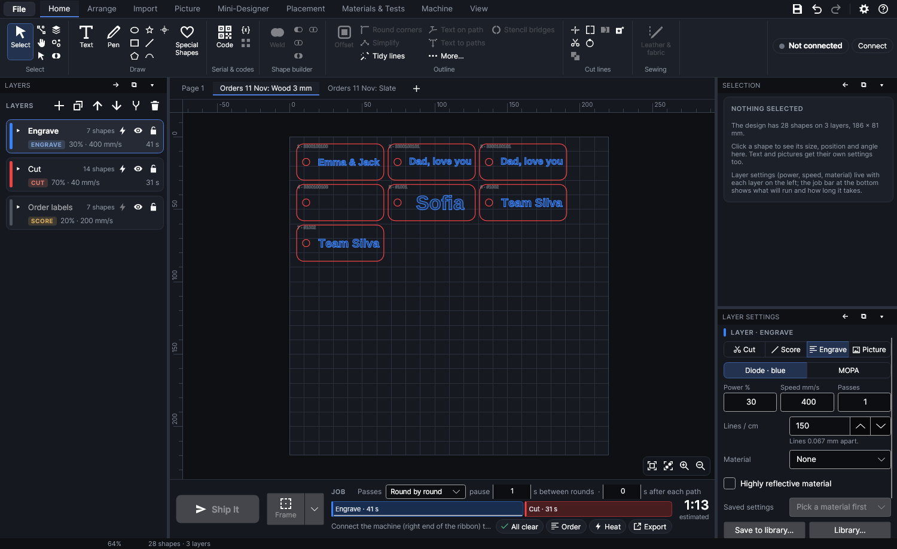
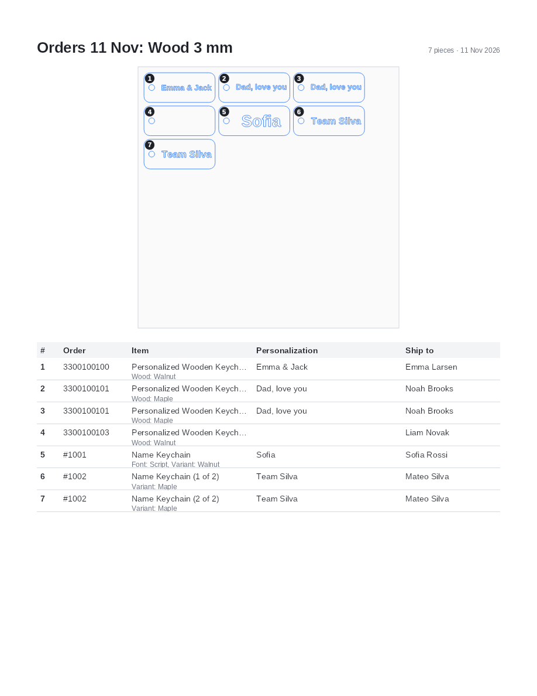

# Orders to sheet

An add-on (Settings → Add-ons → **Orders to sheet**): on when PhotonCanvas is installed, and can be
turned off. Its button is **Import → Orders → Orders**; **Orders to sheet…** is also in the command
search.

## Orders

<!-- windows: OrdersWindow -->

**Orders** turns the orders from your shop into sheets ready to burn. Bring the orders in (a CSV
file the shop gives you, or straight from Etsy or Shopify), tell it once which design each product
is made from, and it lays out one copy per piece on a sheet with each customer's name or words
written into it. It also makes a proof to send a customer, and a packing list that says which piece
on the sheet goes in which parcel. Nothing is sent to the machine: you check each sheet and use
**Ship It** as usual.

The window lists the order lines (one line is one product in an order, in some quantity). Each line
shows the order number, the buyer and the date; what was ordered, how many and the options; the
customer's words in quotes; and on the right the product it's made as (**No product** when none
matches yet) and how far it has got.

| Setting | What it does |
|---|---|
| **Show** | Which lines are listed: **To burn** (not on a sheet yet), **On a sheet**, **Burned**, **Skipped** or **All**. |

Tick the lines to work on. Lines to burn that have a product are ticked to start with. Click a line
(not its tick) to see it on the right.

- **Tick all** and **Tick none** tick every listed line, or none.
- **Mark burned** marks the ticked lines as made. This happens by itself when the sheet they're on
  finishes on the machine (see [When a sheet finishes](#when-a-sheet-finishes)).
- **Mark to burn** puts them back to be made: a reprint, or a sheet that went wrong.
- **Skip** marks lines you won't make here (made another way, a gift card, cancelled).
- **Remove** takes the ticked lines out of the list. Bringing the same orders in again brings them back.

The list is kept in the add-on's own folder (orders.json), so it's there the next time you open
the window, in any design.

## Bring orders in

Bringing the same orders in again never doubles them: each line is known by its order and line
number, so a second import only adds what's new and updates what changed (a corrected name, a new
address), keeping how far each line has got. An order brought in from a CSV file and later straight
from the shop is the same order.

Normally only orders still to be sent are brought in: lines already shipped, fulfilled or cancelled
are left out (the message says how many). To make one again, tick **Also bring in orders already
shipped** in **Shops…**.

### Import CSV…

**Import CSV…** reads one or more CSV files:

- **Etsy**: on Etsy, Shop Manager → Settings → Options → **Download Data**, and download
  **Order Items** (not "Orders", which doesn't say what was ordered). The personalization and
  each option (Wood, Colour, Size…) are read from its Variations column.
- **Shopify**: Orders → **Export**, as a CSV for Excel or Numbers. An order with several products
  has one row per product; the buyer, address and notes are on its first row and are carried to
  the others. The personalization comes from the order's note attributes (a name such as
  *Engraving* or *Personalization*); Shopify's export doesn't include line item properties, so
  getting the orders straight from Shopify gives more.
- **Any other spreadsheet** with a row per item: columns named like *Order*, *Customer*,
  *Product*, *Quantity* and *Engraving* (or *Personalization*, *Text*) are understood, and every
  other column becomes a field of its own by its heading, such as `{Font}` or `{Line 2}`.

### Get Etsy orders

**Get Etsy orders** reads your Etsy shop's paid orders that haven't shipped. Connect the shop first
in **Shops…** (once). It only reads orders; nothing in the shop is changed.

### Get Shopify orders

**Get Shopify orders** reads your Shopify shop's open orders, the lines not yet fulfilled, with the
customer's line item properties (what a personalization app collects). Set the shop up first in
**Shops…** (once). If the app may not see customers' details, the orders still come in, without
names and addresses, and the message says so.

### Sample orders

**Sample orders** brings in a few made-up Etsy and Shopify orders, and two sample products with
designs (a name keyring on *Wood 3 mm* and a round slate coaster), so you can try everything
without a shop. Remove them afterwards: show **All**, tick them and **Remove**.

## The selected line

Clicking a line shows it on the right: a picture of the piece as it will burn, with the customer's
words in it (the product's design, filled in), everything the order says (personalization, options,
note, where it's shipped), and:

| Setting | What it does |
|---|---|
| **Product** | The product this line is made as. **Automatic** uses the first product that matches it (see [Products](#products)); pick another to make this one line as that. |

- **Save proof…** saves the picture as a PNG at 300 dpi, to send the customer before you burn, so
  they can check the spelling.
- **New product from this…** (when no product matches) opens **Products** with a new product named
  after the item, matching its SKU (or its name when it has none).

Under the picture it says which of the design's fields are empty for this order, such as a missing
`{Personalization}`.

## Products

<!-- windows: ProductsWindow -->

**Products…** opens the list of what you sell. Each product says which ordered items it is, what
it's made on and what's burned for each piece. You set this up once; after that every order of it
is ready to go.

| Setting | What it does |
|---|---|
| **Name** | What you call it. Shown beside each line it matches. |
| **Matches** | Which ordered items it is, one per line: a SKU (matched exactly), or words found in the item's name or its options (*Keychain*, *Walnut*). `*` matches anything no other product matches. |
| **Material** | What it's made on, such as *Walnut 3 mm*. Products with the same material share sheets; each material gets sheets of its own. Empty: the product has its own sheets. |

A line is matched to the first product that lists its SKU; if none does, to the first product with
words in its name, then in its options. **Up** and **Down** change the order products are tried in;
**Add** and **Remove** add and remove one.

### Design

The design is an ordinary PhotonCanvas design, on its own layers with their settings (cut, engrave,
score…). Where the customer's words go, type a field into a text or a code (QR, barcode, Data
Matrix): `{Personalization}` in a text is replaced by what each customer asked for. Give that text a
**Fit W** (and **Fit H**) in its settings, so long names shrink to fit.

- **Use the selection**: draw the design on the work area (behind the window), select it, and
  click this. It's saved, with the layers it's on, as this product's design in the add-on's
  folder (designs).
- **Choose file…** uses a design file (.pcanvas) you saved yourself.
- **Put on the work area** puts a copy of the design on the page on screen, to change it. Then
  select it and **Use the selection** again.

The picture shows the design (filled in with the order you had selected, if any), and under it the
fields it uses.

### Order fields

| Field | What it holds |
|---|---|
| `{Personalization}` | What the customer asked to have engraved (all its lines). |
| `{Personalization 1}`, `{Personalization 2}`… | Its first line, second line… (empty when there are fewer). |
| `{Buyer}` | The buyer's name. |
| `{Ship name}` | Who it's shipped to. |
| `{Order}` | The order number. |
| `{Order date}` | The day it was ordered. |
| `{Item}` | The product's name as listed in the shop. |
| `{SKU}` | Its SKU. |
| `{Options}` | Every option picked, on one line. |
| `{Note}` | The buyer's note or gift message. |
| `{Piece}` | Which piece of the quantity, such as *2 of 3* (empty when there's one). |
| `{Colour}`, `{Font}`… | Each option the shop gives, by its name. |

Add `:upper`, `:lower`, `:title` or `:first` for capitals, small letters, Each Word Capitalised or
only the first word: `{Buyer:first}`. The program's own `{serial}`, `{date}` and `{time}` work beside
them (see [Fields: serial numbers, dates and spreadsheets](drawing.md#fields-serial-numbers-dates-and-spreadsheets)).

## Shops

<!-- windows: ShopsWindow -->

**Shops…** connects your shops, so **Get Etsy orders** and **Get Shopify orders** can read them.
PhotonCanvas only reads orders: it never changes anything in a shop, and only talks to it when you
click one of those buttons. Secrets are kept in the add-on's folder, locked to your Windows account.

### Etsy

Etsy lets a shop owner read their own orders through an app of their own:

1. On etsy.com/developers, sign in and create an app (any name; it's only for your shop).
2. In the app's settings, add the **Callback URL** shown here exactly: `http://localhost:3003/orders/etsy`.
3. Copy the app's **Keystring** and **Shared secret** here.
4. Click **Connect to Etsy**. Etsy opens in your browser: allow it to read your shop. The browser
   then says you can close it, and the window says which shop it's connected to.

| Setting | What it does |
|---|---|
| **Callback URL** | Where Etsy sends the browser back to, on this computer. Enter it in your Etsy app's settings. |
| **Keystring** | Your Etsy app's keystring (its API key). |
| **Shared secret** | The secret shown beside it. |

While it waits for the browser, **Connect to Etsy** reads **Stop waiting**. The connection lasts
for months; if Etsy stops accepting it, connect again. **Disconnect** forgets it.

### Shopify

Shopify reads orders through an app installed on your shop:

1. In the Shopify Dev Dashboard (dev.shopify.com), create an app.
2. Give it the **read_orders** permission (and **read_customers**, for names and addresses).
3. Install it on your shop.
4. Copy its **Client ID** and **Client secret** here, with your shop's address.

| Setting | What it does |
|---|---|
| **Shop** | Your shop's address: *my-shop.myshopify.com* or just *my-shop*. |
| **Client ID** | The app's Client ID, from its settings in the Dev Dashboard. |
| **Client secret** | Its secret. Each time orders are read, a token for the day is asked for with these. |
| **Access token** | Only for a custom app made in the shop's admin before 2026: its Admin API access token (*shpat_…*). Leave it empty to use the Client ID and secret. |

**Try it** reads the open orders once and says how many lines are waiting, to check it's set up.

### For every shop

| Setting | What it does |
|---|---|
| **Also bring in orders already shipped (for a reprint)** | Normally only orders still to be sent come in. Tick to bring in shipped ones too. |
| **Paper** | The paper the packing list is laid out for: US Letter or A4. |

## Make sheets

**Make sheets** puts one copy of each ticked line's design on sheets, one per piece of its quantity,
with the order's words written into it. Lines without a product, or whose product has no design,
are left out (the message says which).

| Setting | What it does |
|---|---|
| **Sheet** | Where the pieces go: the whole bed, or the material outlined on the page (outline the board, then right-click it: Use as material outline). The box round the outline is used. |
| **Gap between** | Space between pieces, mm (3 to start with). At least the cut width. |
| **Edge margin** | Space kept from the sheet's edge, mm (5 to start with). |
| **Turn pieces to fit** | A piece is turned a quarter when it only fits that way, or when turned it fits into the row. |
| **Number each piece** | A small number and the order on each piece, on the *Order labels* layer, which isn't burned. The packing list uses the same numbers. |

How the sheets are made:

- Each material gets its own sheets. Pieces go in rows, left to right and back to front, the oldest
  order first; when a sheet is full, the next one starts.
- Each sheet is a new **page** of the project, named after the day and the material, such as
  *Orders 11 Nov: Wood 3 mm 1 of 2*. If the project was empty, the first sheet takes the empty page.
  Otherwise the sheets go after the page on screen, and your own pages aren't touched.
- The designs' layers come with them, with their settings. Products whose layers are the same
  (name and every setting) share them.
- Each piece is one group: move it, or use Nest on a sheet to pack it tighter, and its number and
  its line in the packing list go with it.
- The customer's words are written into the text itself, so you can still fix one piece by hand
  (double-click its text). The program's own fields, such as `{serial}`, still fill in when the job
  is sent.

The message says what was made, and any piece that's bigger than the sheet or whose fields are
empty for its order.

The lines put on a sheet show **On a sheet** with the sheet's name. `Ctrl+Z`
takes the sheets away again.

Before you burn, look at each sheet (the page tabs switch between them), check the layers' settings
for the material, and frame it.

## Packing list

**Packing list…** saves a PDF of every order sheet in the project:

- For each sheet, a map of it with each piece numbered as on the work area, and a table of whose
  each piece is: the order, the product and its options, the customer's words and who it's
  shipped to.
- Then a packing slip for each order: where it goes, a box to tick for each product, which sheet and
  pieces it's on, and the buyer's note.

The list is read from the sheets as they are now, so it's still right after you move pieces or nest
a sheet.

## When a sheet finishes

When a job sent from this session finishes on the machine, the order pieces on the page that was
on screen are marked **Burned** (with the time and the sheet). A job stopped part-way marks
nothing. Use **Mark burned** for pieces made another way.

## Tutorials

- [Turn your orders into a sheet](tutorial:orders-to-sheet)
