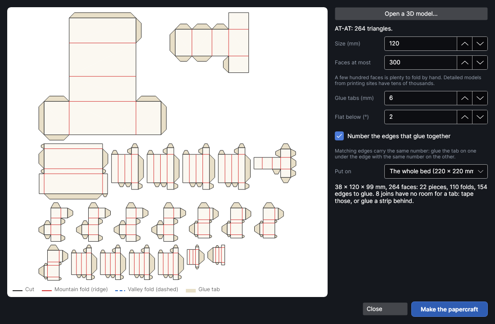

# Fold-up papercraft

**3D to papercraft** unfolds a 3D model into flat pieces that you cut from card (or thin veneer),
fold along the scored lines and glue back up into the model. It reads STL, OBJ and STEP files, makes
the model as simple as you ask, unfolds it into as few pieces as fit on the bed, and puts every piece
on the work area with its cut outline, its fold lines, glue tabs and numbered edges.

This is an add-on: turn it on or off in **Settings → Add-ons** (it's under **Make**).

> **Note:** Papercraft hasn't been tried on the machine yet. Score settings that fold cleanly without
> cutting through depend on your card: try a small model (a cube) in scrap card first.

## Open the papercraft window
<!-- windows: PapercraftWindow -->

Click **3D to papercraft** on the **Import** tab (in the **3D & maps** group). The **Fold-up papercraft**
window opens.

- **Left:** the unfolded pieces as they'll come out: solid red lines are mountain folds, dashed blue
  lines valley folds, black lines are cut, and the beige flaps are glue tabs.
- **Right:** the model and the settings. The summary under them says how many pieces, folds and
  glued edges you'll get, and warns about anything that won't work.
- **Make the papercraft** puts the pieces on the work area. **Close** (or `Esc`) closes the window.

Every change unfolds the model again, in the background, a moment after you stop changing things.

## Settings

| Setting | What it does |
|---|---|
| **Open a 3D model…** | Pick an STL, OBJ or STEP file. |
| **Size (mm)** | The finished model's longest side. Everything else follows in proportion. |
| **Faces at most** | Makes the model simpler until it has no more than this many flat faces (0 = use it as it is). Fewer faces mean fewer, bigger pieces and less folding; more faces mean a rounder model. A few hundred is plenty to fold by hand; models from 3D printing sites often have tens of thousands. |
| **Glue tabs (mm)** | How deep each glue tab is. One edge of each glued pair gets a tab. Where a full tab would overlap the piece it's made smaller, or put on the other edge instead. 0 = no tabs. |
| **Flat below (°)** | Neighbouring faces that bend less than this are treated as one flat face, so there's no fold line between them (a box's sides are made of two triangles each, for example). |
| **Number the edges that glue together** | Marks a small number just inside every cut edge. The two edges that glue together carry the same number. Bigger pieces also get their own number (**P1**, **P2**…). |
| **Put on** | The whole bed, or a sheet of material you've outlined on the work area. Pieces are kept small enough to fit it. |

## How it unfolds

Each piece starts from the biggest face not yet used and grows across its neighbouring edges, flat
joins first and then the longest edges, as long as the new face doesn't overlap the piece and the
piece still fits the bed. When nothing more can be added, a new piece starts. Every face keeps its
exact shape and size.

Where two faces are folded apart, the fold is:

- a **mountain fold** (a ridge on the model's outside, like the corner of a box): scored on the top
  of the card, it folds away from you;
- a **valley fold** (a dip on the outside): scored as a dashed line, so it folds towards you as well.

The side facing up on the bed is the model's outside, so print or engrave anything you want on the
outside before you cut.

## What goes on the work area

Each piece is a group, laid out bed by bed: if they don't all fit, more pages are added ("Papercraft
2", …). The pieces use four layers, all run before the cut so the card is still held flat:

| Layer | Mode | For |
|---|---|---|
| **Papercraft · numbers** | Score, low power | The edge and piece numbers. |
| **Papercraft · mountain folds** | Score | Ridges, and the folds along the glue tabs (tabs fold back behind the face they're glued to). |
| **Papercraft · valley folds** | Score, perforated (3 mm on, 1.5 mm off) | Valleys. Turn it into a Cut layer with the same perforation for card that's too stiff to fold towards a score. |
| **Papercraft · cut** | Cut | The outline of every piece, tabs included. |

Set each layer for your card before you send the job: the fold layers should only dent the surface,
never cut through. A line test on a scrap of the same card finds the right power.

## Putting it together

1. Cut the pieces and push them out.
2. Fold every scored line before gluing anything: mountain folds away from you, dashed valleys
   towards you.
3. Glue a tab under the edge that has the same number, starting from the middle of the model and
   working outwards. Leave the last few joins of a closed model for the end, and press them from the
   inside with a pencil where you can.

## Tips

- Low-poly models (faceted animals, gems, buildings) look best and are quickest to build.
- If the summary says a join has no room for a tab, tape that join from the inside, or glue a thin
  strip of card behind it.
- Holes in the model's surface stay open, and edges where more than two faces meet are cut and left
  unnumbered: the summary counts both.
