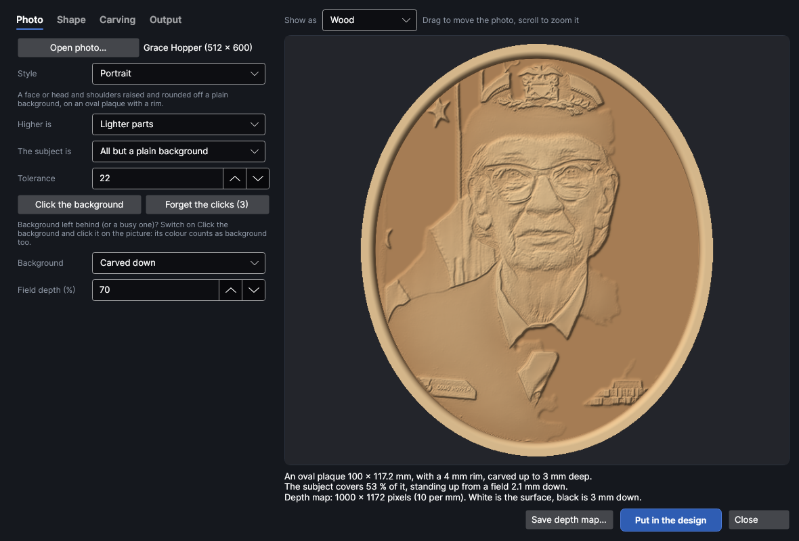
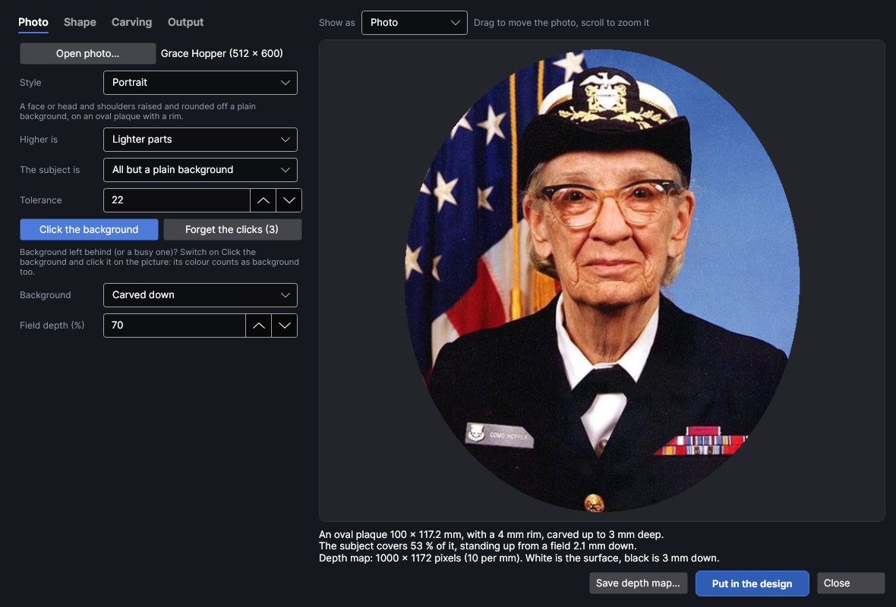
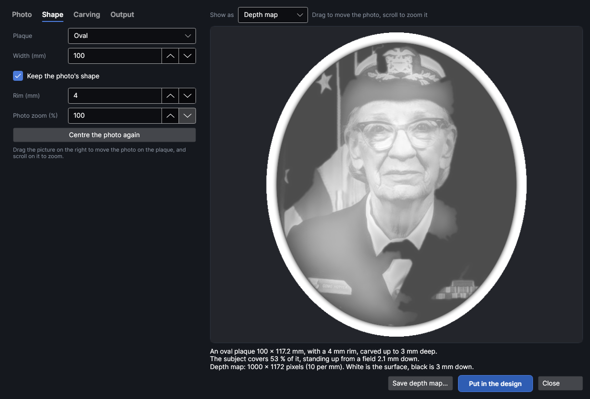
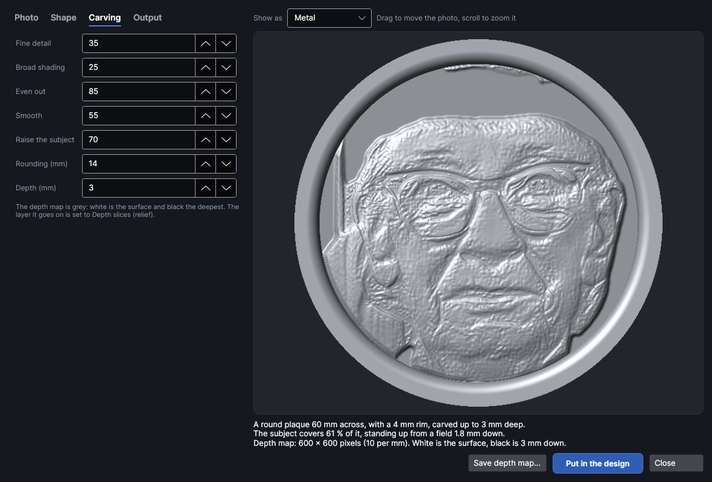
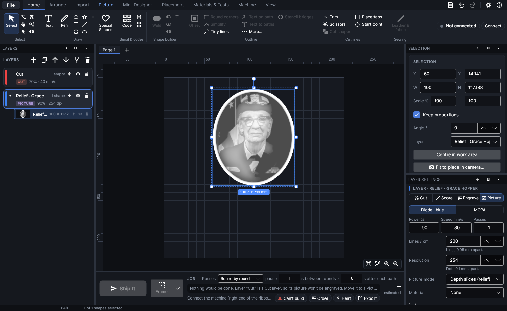

# Photo to relief

An add-on (Settings → Add-ons → **Photo to relief**): on when PhotonCanvas is installed, and can be turned off. Its button is **Import → 3D & maps → Photo relief**. On the right-click menu, **Make a relief from this photo…** opens it on a picture you've selected, and **Edit photo relief…** opens it again on a relief it made.

**Photo relief** turns a photo into a carved relief: a portrait or a pet raised and rounded off its
background like a cameo, a coin or medal, a landscape, a puffy logo, or a sunk relief cut into the
surface. You pick a photo and a style, see it lit as carved wood or metal, move and zoom the photo
on an oval, round or square plaque with a rim, and put it in the design as a depth map (a greyscale
picture, white the surface and black the deepest) on its own Picture layer set to **Depth slices
(relief)**, ready to carve.

> **Note:** The reliefs have been checked on screen and in tests, but carving them as depth slices
> hasn't been tried on the machine yet. Carve a small one on scrap first and measure how deep it goes.

## How it works

A photo's brightness on its own makes a poor carving: dark hair carves as a pit, a shadow down one
side of a face as a cliff, and the subject sinks into its background. So Photo relief does what a
carver does:

1. **Finds the subject.** Against a plain wall, sheet or sky, the background's colours are read
   from the top and upper sides of the photo (shoulders and bodies usually run off the bottom, so
   the bottom edge doesn't count), and everything of those colours joined to an edge is background.
   You can click more background colours yourself. Nothing is sent anywhere and no AI is used.
2. **Raises it as one rounded shape**, highest in the middle and rounded down to its outline, so
   the subject stands up off its background as a whole.
3. **Adds the detail on top.** The photo is split into sizes of detail, from fine texture to the
   big light and dark areas. In each size, big jumps between light and dark are flattened far more
   than small ones (**Even out**), and each size is weighted (**Fine detail**, **Broad shading**),
   then they're added back up. The features stay crisp but nothing carves as a cliff.
4. **Puts it on a plaque**: the background becomes a flat field below the subject, and a rim can go
   round the edge.

It works best on a clear, well-lit photo of a subject against a plain background, lit from the
front rather than the side.

## The Photo to relief window
<!-- windows: PhotoReliefWindow -->

Select a photo in your design and click **Photo relief** on the **Import** tab (in the **3D & maps**
group), or click it with nothing selected and use **Open photo…** in the window.

- **Left:** four tabs. **Photo** picks the photo, the style and what the subject is, **Shape** the
  plaque and where the photo sits on it, **Carving** how it's carved, and **Output** the depth
  map's detail.
- **Right:** the relief as it will carve. **Show as** shows it as **Wood** (darker the deeper it's
  burned, as on wood), **Metal**, the **Depth map** itself, or the **Photo** as it sits on the
  plaque. Drag the picture to move the photo on the plaque, and scroll on it to zoom the photo.
- Under it, a summary: the plaque's size, how deep it's carved, how much of it the subject covers
  and how far down the field is, and the depth map's size in pixels. Warnings are in orange (bigger
  than the work area, a busy background, a photo too small for the size).
- **Save depth map…** saves the depth map as a PNG picture.
- **Put in the design** puts it in your design (see [Put it in the design](#put-it-in-the-design)).
  **Close** (or `Esc`) closes the window. The settings you last used are kept for next time (not the
  photo, or where it sat).

## Photo

- **Open photo…** picks a photo file (JPEG, PNG, BMP, WebP, GIF). Big photos are worked on at up to
  2400 pixels a side, plenty for a carving.
- **Style** is a starting point. Picking one sets everything on the Photo, Shape and Carving tabs
  except the size and where the photo sits:
  - **Portrait**: a face or head and shoulders raised off a plain background, on an oval plaque with a rim.
  - **Pet**: the same with more fur detail kept, on a rounded plaque.
  - **Coin or medal**: a low, rounded profile on a round medal with a rim: little detail, strong shape.
  - **Landscape or building**: the whole photo as a relief, on a rectangle.
  - **Logo or clip art**: flat-coloured artwork made puffy, each shape rounded up and the background carved away.
  - **Sunk relief**: the subject carved down into the surface and rounded inside its outline, the background left untouched.
  - **Straight brightness**: height straight from brightness, nothing evened out or raised (how most programs do it).
- **Higher is**: **Lighter parts** (usually right: a lit face, a pale pet) or **Darker parts** (a
  dark subject on a light background).
- **The subject is**:
  - **All but a plain background**: the subject found against a plain background, as above.
  - **The whole photo**: everything is carved as one relief.
  - **Its see-through parts**: a photo whose background is already see-through (for example after
    Remove background on the Picture tab).
- **Tolerance** (0 to 100, default 22): how different a colour may be from the background's and
  still count as background. Raise it if bits of background are left; lower it if the subject's
  edges are eaten into.
- **Click the background**: while it's on, a click on the picture marks that place's colour as
  background too (it switches **Show as** to **Photo** so you can see what you're clicking). Use it
  for a busy background or one with two colours. **Forget the clicks** takes them all away.
- **Background**: **Carved down** makes a flat field round the subject, so the subject stands up out
  of it; **Not carved (sunk)** leaves the background as the surface and carves the subject down into
  it.
- **Field depth (%)** (default 70): how far down the field is, as a share of the whole depth; 100
  carves it to the bottom. With **The whole photo** there's no background, so these two are hidden
  and the relief uses the whole depth (a rim's inner edge falls to the bottom).

## Shape

- **Plaque**: **No plaque (just the picture)**, **Rectangle**, **Rounded rectangle**, **Oval** or
  **Circle**. Outside an oval, circle or rounded plaque nothing is carved (the depth map is
  see-through there).
- **Width (mm)** (a circle's **Diameter (mm)**), and **Height (mm)** unless **Keep the photo's
  shape** is ticked. The F2 Ultra's work area is 220 mm square.
- **Corner radius (mm)**: a rounded rectangle's corners.
- **Rim (mm)**: a raised rim this wide round the plaque's edge, flat on top and rounded down to the
  field. 0 = none.
- **Photo zoom (%)** (100 to 800): 100 = the photo just fills the plaque; more crops in closer, on a
  face for example. Drag the picture to move the photo on the plaque, and scroll on it to zoom.
  **Centre the photo again** puts it back as it was.

## Carving

- **Fine detail** (0 to 100): hair, fur, wrinkles and texture. 50 is as in the photo; more makes it
  crisper, less softer.
- **Broad shading** (0 to 100): the big light and dark areas. 50 is as in the photo. Lower it when
  one side of a face is in shadow, so it doesn't carve lopsided.
- **Even out** (0 to 100): big jumps between light and dark (dark hair on a pale face, a shadow) are
  flattened so they don't carve as cliffs or pits, while small detail is kept. 0 keeps every jump as
  it is.
- **Smooth** (0 to 100): smooths skin, film grain and noise but keeps the edges.
- **Raise the subject** (0 to 100): how much of the depth goes to raising the subject as one rounded
  shape, like a cameo. The rest is its detail.
- **Rounding (mm)**: how far in from the subject's outline it takes to round up to full height. Big
  is a soft pillow, small a crisp steep edge, 0 a flat-topped step.
- **Depth (mm)**: how deep you mean to carve the deepest part. It's used for the preview and the
  summary only: the depth-slices layer's slices, power and passes set how deep it really goes.

## Output

- **Pixels per mm** (1 to 40, default 10, which is 254 dpi): the depth map's detail. More makes a
  bigger file and a slower job. It's lowered by itself if the map would be over 6000 pixels a side.
- **A cut line round the plaque**: a cut line round an oval, circle or rounded plaque, on the Cut
  layer, to cut it out after carving.
- **Replace the photo with its relief** (when you started from a picture in your design): the photo
  is taken out and the relief put where it was. It isn't lost: the relief keeps it, and Undo brings
  it back.

## Put it in the design

**Put in the design** makes the depth map at full detail and puts it on a new Picture layer called
**Relief ·** and the photo's name, set to **Depth slices (relief)** (200 lines per cm, turning 37°
each slice), and makes that layer active. It goes where the photo was, or in the middle of the work
area. Set the slices, power and passes on that layer ([Layer settings](layer-settings.md)), and
carve a test on scrap first.

The photo and settings are kept with the relief: right-click it and choose **Edit photo relief…**
to change it, then **Update in the design** replaces it in the same place, on the same layer.

## Tutorials

- [Carve a portrait from a photo](tutorial:photo-relief)
