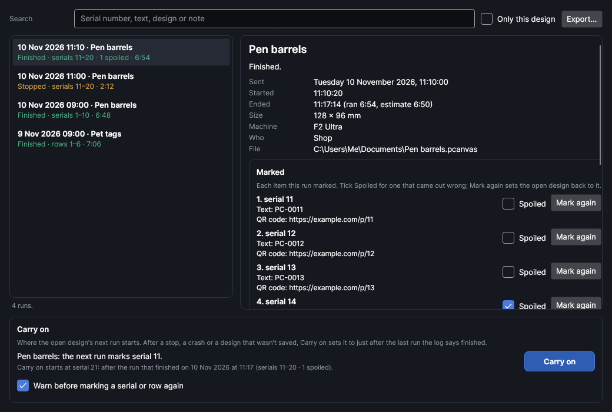

# Production log

An add-on (Settings → Add-ons → **Production log**): on when PhotonCanvas is installed, and can be
turned off. Its button is **Machine → Job → Production log**; **Production log…** is also in the
command search.

## Production log

<!-- windows: ProductionLogWindow -->

**Production log** writes down every job sent to the machine from PhotonCanvas: when it was sent,
started and ended, whether it finished or was stopped, and for designs with
[fields](drawing.md#fields-serial-numbers-dates-and-spreadsheets) exactly what each item got: its
serial number, its spreadsheet row and the text and codes marked on it. The layers' settings are
written down too. Use it to:

- find when a part was marked and with which settings (search for its serial number);
- carry on serial marking after a stop, a crash or a design that wasn't saved, without marking a
  number twice or skipping one;
- keep a record for a customer or an order, and export it as a spreadsheet.

The log keeps going while the window is closed: it's written as each job is sent, starts and ends,
one line at a time, so nothing written before a crash is lost. Nothing in the log moves the head or
fires the laser.

### The runs

The left side lists the runs, newest first: when the job was sent, the design (its file name), how
it ended and what it marked (*serials 41–45 · rows 3–7*), and how long it ran.

| Status | Means |
|---|---|
| *Waiting for start* | Uploaded; the machine waits for its start button. |
| *Running* | Started and still running. |
| *Finished* | It ran to the end. Its items count as marked. |
| *Stopped* | Stopped before the end. The serial number and row didn't move on, so the next run marks them again. |
| *Not run* | Never started: another job was sent in its place, or PhotonCanvas closed first. |
| *No end recorded* | It started, but PhotonCanvas closed, or lost the machine, while it ran. Look at the pieces before marking them again. |

**Search** finds runs by serial number, the text or code marked, a spreadsheet cell, the design,
a setting or the note (several words: runs with all of them). **Only this design** shows only the
runs of the design that's open. The list shows the latest 300 matches.

**Export…** saves the runs that match as a spreadsheet (CSV): one line per item marked (one per
run when nothing varied), with the times, status, design, serial number, row and its cells, what
was marked, whether it was spoiled, how long it ran, the machine, the settings and the note.

### What a run marked

Click a run to see it on the right: its times (with the estimate beside how long it really ran),
size, machine, who was signed in to the computer, and the design's file.

**Marked** lists each item: its serial number and row, each text and code as it was marked, and the
spreadsheet row's cells. A run marks one item, or one per copy numbered with
[Number copies](drawing.md#number-copies).

- **Spoiled**: tick it for an item that came out wrong. The log then doesn't count it as marked, so
  marking it again isn't warned about. Spoiled items show in the export.
- **Mark again**: sets the open design's serial number and row back to this item, so the next run
  marks it again (one undo step, `Ctrl+Z` goes back). Only for runs of the design that's open. A run
  marks as many items as the design has copies, so with numbered copies the ones after it are
  marked again too. Afterwards, **Carry on** goes back to where you were.

**Settings** shows each layer that ran: its mode, power, speed and passes, the laser (MOPA pulse
and frequency) and its material, as they were when the job was sent. **Note** is kept with the run
and searched: an order number, a customer, what went wrong.

### Carry on

The bottom of the window says what the open design's next run marks. **Carry on** sets its
**Next number** and **Row to mark next** (see
[The Variables window](drawing.md#the-variables-window)) to just after the last run of this design
the log says finished, and says which run that was before you click. It's one undo step.

Use it when the design's numbers didn't move on as they should: PhotonCanvas closed before the
design was saved after a run, an older copy of the design was opened, or you marked an item again
with **Mark again**. Carry on follows the last run that finished, so if you started a new batch
from 1 on purpose, it would take you back to the old batch: check what it says first.

The log finds a design's runs by its file name, so save a design before relying on Carry on.

### Warnings before marking again

With **Warn before marking a serial or row again** ticked (it is to start with), the job's checks
(the job bar, and **Ship It**'s confirmation) warn when the log says a serial number or spreadsheet
row the next run marks was already marked in a finished run of the same design (not spoiled). It's
a warning, not a refusal: the job still sends. Untick it when you re-mark numbers on purpose.

A job sent in parts (sections of a design bigger than the work area, or one layer at a time) counts
its items as marked once the last part finishes.

### What isn't logged

- Jobs started from the machine's own screen, or from the phone, that weren't sent from here.
- Jobs for GRBL machines (they're streamed from their own window).
- Framing and test runs that aren't sent as jobs.

The log is kept in the add-on's data folder (`production-log.jsonl`), and kept when the add-on is
turned off or removed.
