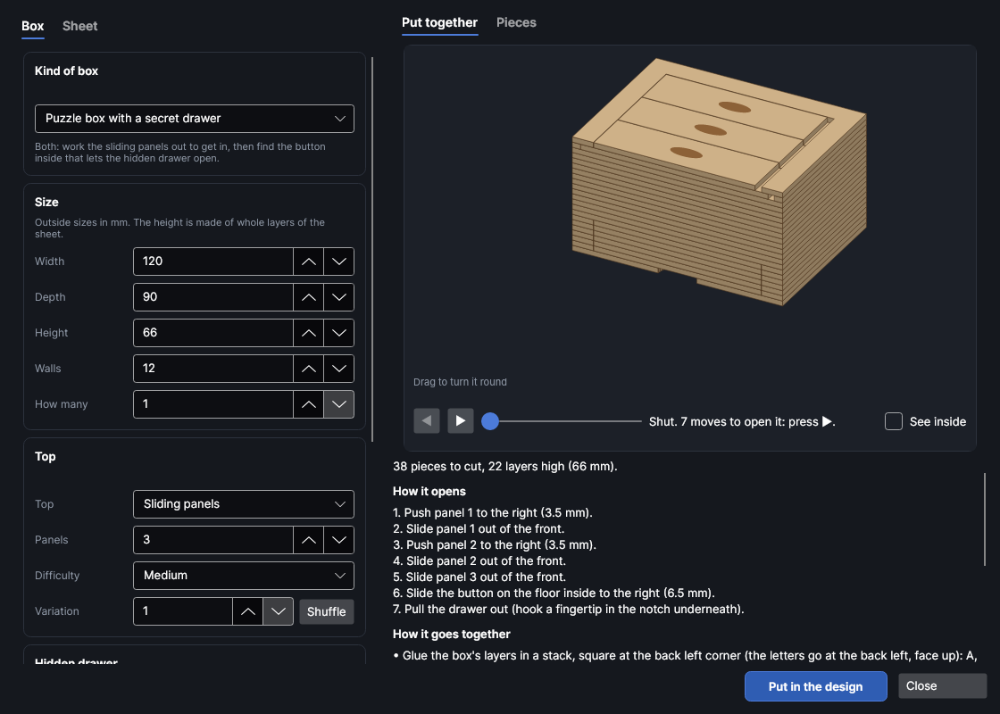
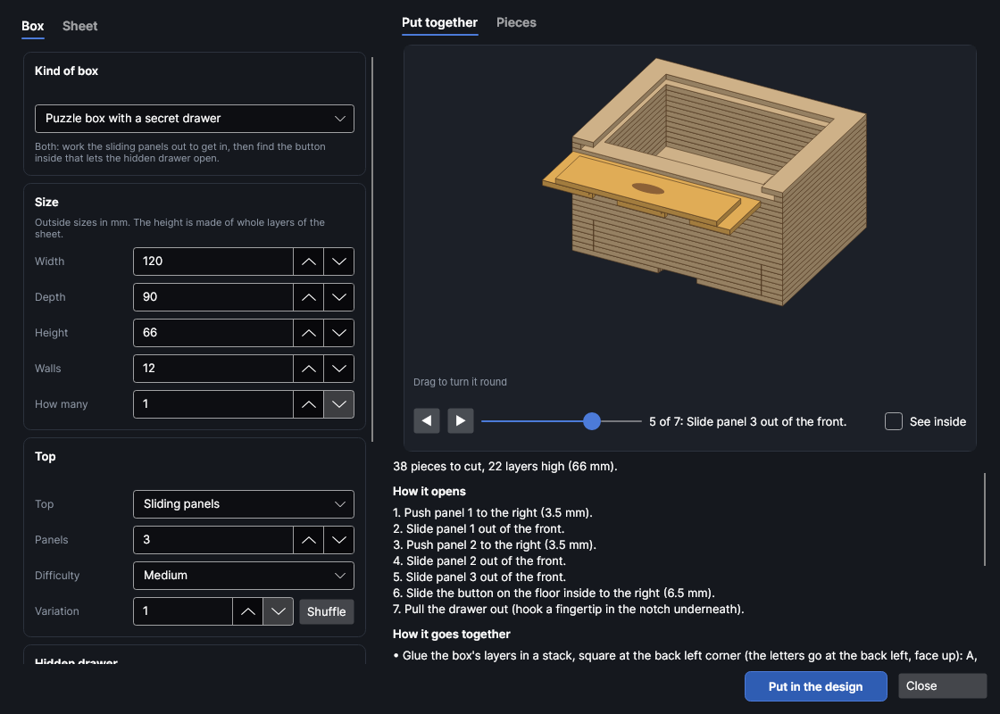
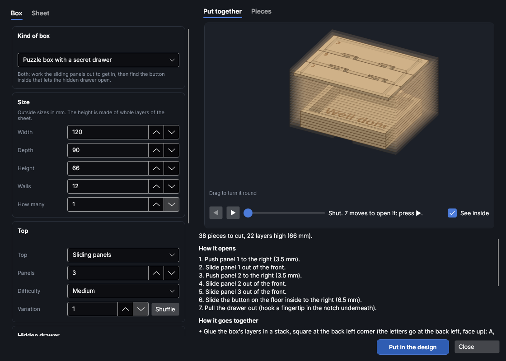
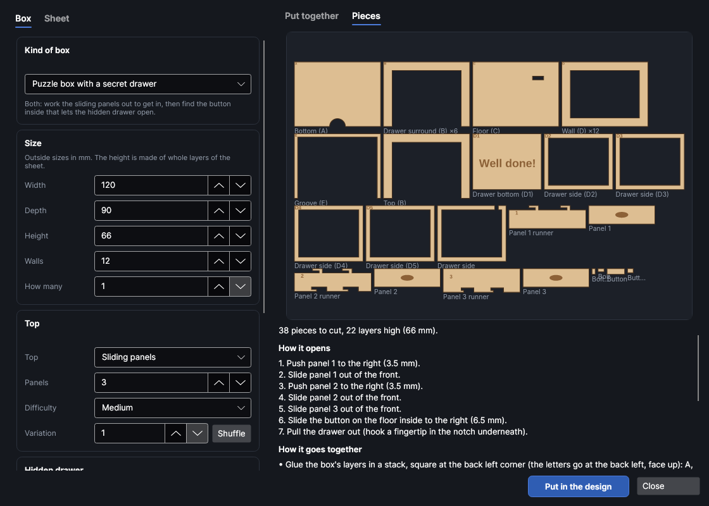
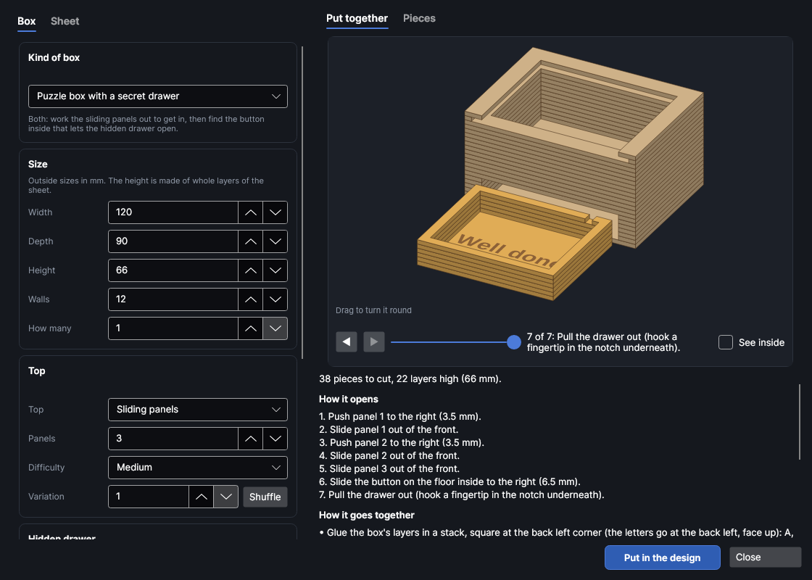

# Puzzle boxes

An add-on (Settings → Add-ons → **Puzzle box maker**): on when PhotonCanvas is installed, and can be turned off. Its button is **Home → Draw → Puzzle box**, and **Edit puzzle box…** is on the right-click menu of the pieces it made.

**Puzzle box** makes boxes with secrets, glued up from layers of sheet: a **sliding-panel puzzle
box** whose top only comes apart in the right order, a **secret drawer box** whose drawer is hidden
in its bottom layers and stays locked until you find the button inside, both together, or a **hidden
drawer block** that looks solid. Every box is played through before it goes in the design: the maker
tries every move a person could make, finds the shortest way to open it, and lists it, so you know
it opens, and that it doesn't open any sooner.

> **Note:** The boxes have been checked on screen and in tests (every piece is put together in 3D,
> checked for overlaps and played through), but not yet cut on the machine. The fits depend on your
> sheet and kerf: cut a small sliding-panel box first and change **Sliding fit** if the panels are
> stiff or rattle.

## The Puzzle box window
<!-- windows: PuzzleBoxWindow -->

Click **Puzzle box** on the **Home** tab (in the **Draw** group). The **Puzzle box** window opens. On
the left, the **Box** tab has the kind of box, its size, its top, the hidden drawer and a message;
the **Sheet** tab has the sheet it's cut from. On the right, **Put together** shows the box in 3D
(drag it to turn it round) and **Pieces** shows every piece flat, with how many of each there are.
Under them: how many pieces and layers, **How it opens** (every move, in order), **How it goes
together**, and notes: a red ✕ has to be fixed before the box can go in, a yellow ! is worth a look.

Press **Put in the design** and every piece goes on a page of its own, nested onto the bed (more
pages if they need more than one bed). To change it later, select any of its pieces, right-click and
choose **Edit puzzle box…**, change the settings and press **Update in the design**: the old pieces
are replaced wherever they are.

### Stepping through opening it

Under the 3D view, **▶** and **◀** step through **How it opens** one move at a time (or drag the
slider): each move is shown with the piece that moves picked out in orange, and a piece just taken
out is shown clear of the box. **See inside** makes the box's own layers and the tops faint, so the
hooks under the panels, the drawer and its bolt show.

## Kinds of box

Pick one in **Kind of box**: it sets the top, the drawer and the height (the size and the sheet
stay). Change any of them and the kind says **Your own**.

| Kind | What it is |
|---|---|
| **Sliding-panel puzzle box** | See [Sliding panels](#sliding-panels). |
| **Secret drawer box** | A box with a lift-off lid (with a lip that sits in the opening, and a finger notch in the front of the top layer to lift it) and a [hidden drawer](#hidden-drawers) locked by a button inside. |
| **Puzzle box with a secret drawer** | Sliding panels to get in, then the button inside unlocks the hidden drawer. |
| **Hidden drawer block** | A solid-looking block (no way in from the top) with a drawer hidden in it. |

## Size

| Setting | Range (default) | What it does |
|---|---|---|
| **Width** | 30 to 1000 mm (120) | Left to right, outside. |
| **Depth** | 30 to 1000 mm (90) | Front to back, outside. |
| **Height** | 5 to 500 mm (66) | Bottom to top, outside: rounded to whole layers of the sheet (the notes say how many). |
| **Walls** | 3 to 60 mm (12) | How thick the walls are: the width of each layer's ring. Sliding panels need about 10 mm or more (their runners run in a groove in the wall). |
| **How many** | 1 to 50 (1) | How many of the box to cut. |

## Sliding panels

The top is **Panels** side by side, front to back, flush with the top of the box. Each is a top
piece glued onto a runner under it whose edges run in a groove under the box's top layer, so it
can't be lifted out, only slid out of the front, and it can shift a few millimetres left or right.
Underneath, each runner has L-shaped hooks into the next one's runner: a hook only comes out of its
pocket when the two panels are shifted the right way relative to each other. Some pockets also only
let a panel sit to one side of the next, so a panel can't be shifted until its neighbour has been.
So to open it you push the right panels sideways, in the right order, and pull them out front first.

- **Panels**: 1 to 8 (3). One is a plain sliding lid. More panels need a deeper box (each needs room
  for its hooks; the notes say how many fit).
- **Difficulty**: *Easy*, *Medium* or *Hard*. The maker tries different hooks and keeps one that
  takes fewer (*Easy*) or the most (*Hard*) moves to open.
- **Variation**: which way the hooks point and where they sit; each number gives a different
  puzzle, and **Shuffle** picks the next one. The same settings always make the same puzzle.

Each panel has a shallow thumb grip etched on top to push it with. Shut, every panel sits to the
left.

## Hidden drawers

**A drawer hidden in the bottom layers** is cut from the same layers as the walls, so its front is
flush with the wall and its seams look like the layers'; only two fine upright lines at its sides
give it away. **Drawer height** is its outside height, in whole layers.

- **Locked until the button inside is slid**: a small button with a knob sits on the floor inside
  the box. Under it, through a slot in the floor, a bolt carries a tooth that hangs down into the
  drawer just in front of its back, so the drawer can't come out. Slide the button across and the
  tooth lines up with a gap in the drawer's back: the drawer pulls out past it. The button covers its
  slot whichever way it's slid, and the tooth is longer than the slot is wide, so it can't be lifted
  out. Only for boxes with a way in from the top.
- **Finger notch underneath to pull it**: a notch in the bottom under the drawer's front, for a
  fingertip. Without it, tip the box forward to slide the drawer out.

The bolt's tooth takes the top layer of the drawer at the back: keep what's in the drawer below it.

## Message

Type a message to etch inside, and pick **Where**: *In the drawer* (on its bottom) or *On the floor
of the box*. Leave it empty for none.

## The sheet

| Setting | Range (default) | What it does |
|---|---|---|
| **Thickness** | 0.5 to 12 mm (3) | Every layer is one sheet. 3 mm plywood suits most boxes. |
| **Sliding fit** | 0.05 to 1.5 mm (0.25) | The gap round everything that slides, each side. More is looser. |
| **Letter the pieces** | On | Letters on the faces that get glued over, at the back left corner: the box's layers A, B, C… from the bottom (the same letter for layers that are the same), the drawer's D1, D2…, and the panels' runners 1, 2…. |
| **Font** | Arial | For the letters and the message. |
| **Cut with** | As set on the cut layer | Cut settings from your material library. Their kerf goes on the cut layer, so the sliding parts come out the size they're drawn, and the material's thickness is filled in. |
| **Etch with** | As set on the etch layer | Engrave (fill) settings from your library for the letters, the thumb grips and the message. |

## Putting it together

**How it goes together** under the preview lists the layers in order by letter. In short:

1. Glue the box's layers in a stack, square at the back left corner, letters face up.
2. Glue the drawer's layers the same way (D1 at the bottom), checking it slides before the glue sets.
3. With a locked drawer: before the floor goes on, put the bolt in the floor's slot from above and
   glue the tooth under it, and the button and its knob on top; put the drawer in, then glue the
   floor on with the tooth hanging into the drawer at the back.
4. Glue each panel's top onto its runner, lined up at the front and the left, then slide the panels
   in from the front, the back one first, each shifted the way it came out (the opening steps,
   backwards), and push them all to the left. Or glue the lid's lip under the lid.

## Layers and order

The pieces go on two layers, run in this order: **Puzzle box · etch** (the letters, thumb grips and
message, a Fill layer) first, while the sheet is whole, then **Puzzle box · cut**. Each piece is
named for what it is (*Wall (D)*, *Panel 2 runner*), so you can tell them apart on the bed.

## Try it

- [Make a puzzle box with a secret drawer](tutorial:make-a-puzzle-box)
