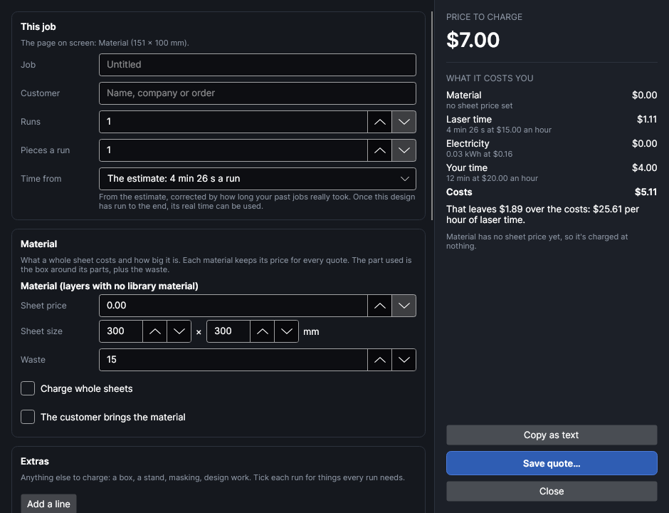

# Quote and cost

An add-on (Settings → Add-ons → **Quote and cost**): on when PhotonCanvas is installed, and can be turned off. Its button is **Laser → Job → Quote**; **Quote and cost…** is also in the command search.

## Quote

<!-- windows: QuoteWindow -->

**Quote** works out what the design on screen costs you to make, and the price to charge for it:
the material, the laser's time, the electricity, your own time and any extras, with your markup
on top. Then it copies the quote as text for an email, or saves it as a one-page PDF to print or
send. Nothing is sent to the machine.

The left side is what goes in; the right side updates as you type: the **price to charge** (with
the tax, and the price of one piece when there are several), **what it costs you** line by line,
and what that leaves over the costs, per hour of laser time.

### This job

| Setting | What it does |
|---|---|
| **Job** | What the quote calls it. Empty: the design's file name. |
| **Customer** | Who the quote is for (a name, company or order number). Printed under *For*. |
| **Runs** | How many times the job is run on the machine. One run is the whole page once. |
| **Pieces a run** | How many finished pieces one run makes, so the quote can give the price of one piece. |
| **Time from** | Where a run's time comes from: **The estimate** (the same estimate as the job bar, corrected by how long your past jobs really took compared with their estimates), or **Last real run**, how long this design really took the last time it ran to the end. The last real run is offered when a finished job with the design's file name had an estimate within 15% of today's (so a design that was changed a lot doesn't use an old time). |

The time is worked out when the window opens, with your saved job settings (passes over the whole
job or path by path, pauses, fan); the job is built as **Ship It** would build it, but nothing is
sent. If the job can't be made (for example nothing is on a layer that goes to the laser), the
window says why, and the laser time counts as nothing.

A quote covers the page on screen. The window remembers this job's settings (job, customer, runs,
pieces, material choices and extras) in the design itself, so the next time you open it they're
still there; closing the window keeps them as one step you can undo (*Quote details*).

### Material

Each material the job uses is listed once: the library material set on each layer that goes to
the laser (Layer settings → Material), and **Material** for layers without one. For each, enter
what a whole **Sheet price** is and the **Sheet size** in mm. Prices are kept for every quote, per
library material.

- The material used is the box around that material's parts, times the runs, plus the **Waste**
  (%, 15 to start with) for offcuts, edges and the odd spoiled piece. It's charged as that share
  of a sheet's price.
- **Charge whole sheets** charges every sheet you start instead, rounded up.
- **The customer brings the material** charges no material.
- A material with no sheet price is charged at nothing, and a note under the price says so. A
  note also says when the parts are bigger than the sheet.

### Extras

**Add a line** for anything else to charge: a gift box, a stand, masking, design work. Give it a
name and an amount; tick **each run** for things every run needs (charged once per run). **✕** takes
a line off.

### Your rates

The same for every quote, kept in the add-on's own folder.

| Setting | What it does |
|---|---|
| **Machine / hour** | What running the machine costs you per hour of laser time: its wear, the laser source's life, paying the machine off. 15 to start with. |
| **Power draw (W)** | What the machine, the exhaust and the purifier draw together while a job runs. 350 W is only a rough guess: a plug-in power meter tells you. |
| **Price / kWh** | What you pay for electricity, from your bill. |
| **Your time / hour** | What your time is worth. |
| **Set-up (min)** | Your time once per order: the design, a test piece, talking to the customer. |
| **Each run (min)** | Your time each run: putting the material in, taking the pieces out, cleaning them. |

### Price

The price is the costs plus the **Markup (%)**, at least the **Minimum** (0 = none), rounded up to
a multiple of **Round up to** (0.50 to start with; 0 = to the cent). The **Tax** (its name, and its
rate in %) is added on top as its own line; 0 = no tax line. **Currency** is the symbol in front of
every amount ($ to start with); nothing is converted.

### On the quote

**Business**, **Contact** (one item per line) and the **Note** at the foot of the page (how long
the quote is valid, payment, delivery) are printed on every quote. With **Show what the price is
made of**, the quote lists material, laser time, set-up and handling, and each extra, with your
markup spread over them so they add up to the price; without it, the job is one line. **Paper** is
US Letter or A4. **Next number** is the number the next saved quote gets (Q-0001, Q-0002…).

### Copy or save

- **Copy as text** puts the quote on the clipboard, ready to paste into an email or a message.
- **Save quote…** saves it as a PDF: your details, the quote's number and date, who it's for, a
  picture of the parts that go to the laser, the lines, the tax and the total, and your note.
  Then **Next number** goes up by one, and **Open it** opens the PDF.

Your rates and details are kept whenever you copy, save or close the window.

## Tutorials

- [Price a job and send a quote](tutorial:job-quote)
