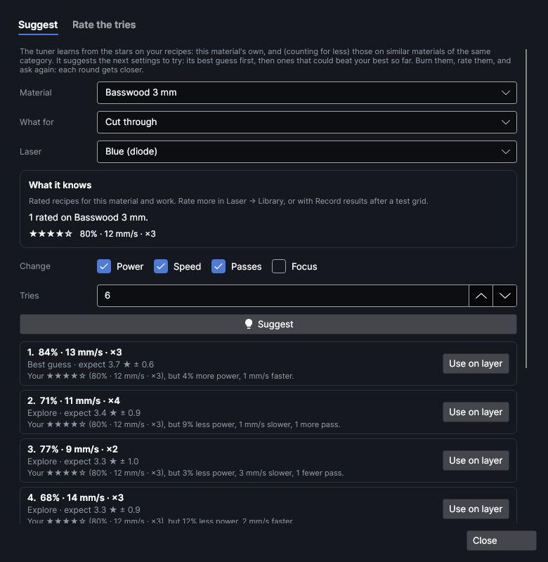
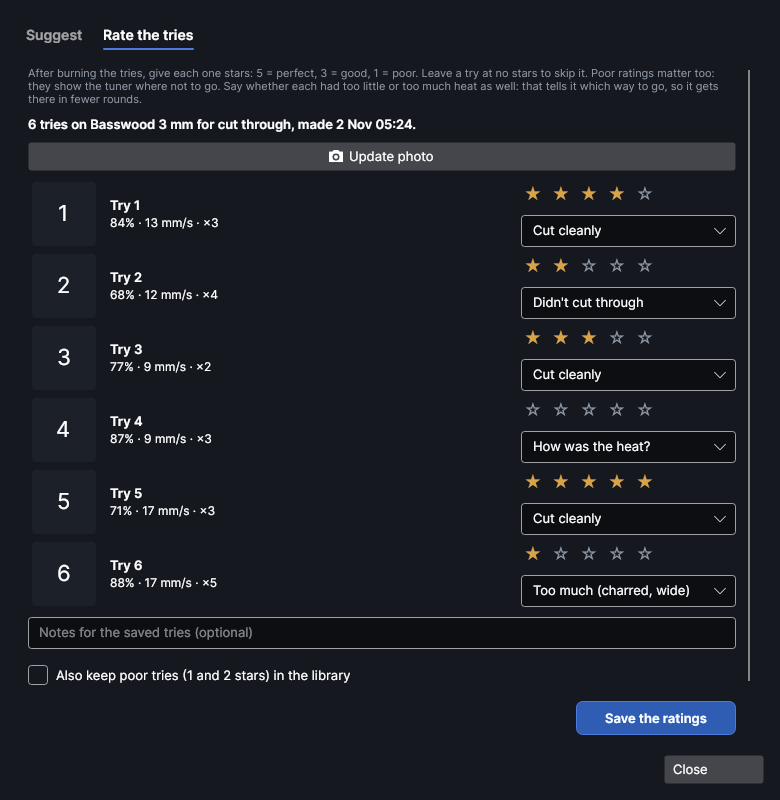

# Recipe tuner

An add-on (Settings → Add-ons → **Recipe tuner**): on when PhotonCanvas is installed, and can be turned off. Its button is **Laser → Materials → Recipe tuner**, and **Recipe tuner…** is in the command search.

## Recipe tuner

<!-- windows: RecipeTunerWindow -->

The **Recipe tuner** suggests the next settings to try on a material. It learns from the stars on
your recipes: the material's own, and, counting for less, those on similar materials. You burn a
small round of its suggestions, give each one stars, and ask again. Each round gets closer to the
best settings, usually in two to five rounds, without burning a whole test grid each time.

Use it when a test grid got you close but not quite there, when a material needs a balance of
several settings (power, speed and passes together), or to start a new material from what worked on
a similar one.

The tuner only ever puts tries in the design. Nothing is burned until you send them with **Ship It**,
and it never moves the head.

### Suggest

| Setting | What it does |
|---|---|
| **Material** | A material from your library. It starts on the active layer's material. |
| **What for** | **Cut through**, **Score (a line on the surface)**, **Engrave (fill)**, **Mark (metal, fill)** or **Picture**. It starts on the active layer's kind. Engrave and Mark learn from each other. |
| **Laser** | **Blue (diode)** or **Red (MOPA fiber)** (shown when the machine has a fiber laser). |
| **What it knows** | How many rated recipes it found for this, and which similar materials it borrows from, with the best of your own. |
| **Change** | The settings the tuner may change: **Power**, **Speed**, **Passes**, **Lines per cm** (engrave and mark), **Dots per inch** (pictures), **Frequency** and **Pulse width** (fiber), and **Focus**. Unticked ones stay as in the best recipe so far. Fewer settings find their best sooner. |
| **Tries** | How many settings to suggest in a round, 2–12, default 6. |
| **Size (mm)** | How big each try is, 3–40 mm, default 10. |

Click **Suggest** to work it out again (it also does when you change a setting). Each suggestion
shows its settings, what kind it is, how many stars the tuner expects (± how sure it is) and why:
which of your results it is near and how it differs ("Your ★★★★☆ (70% · 40 mm/s · ×8), but 5 mm/s
slower, 1 fewer pass").

- **Best guess**: the settings most likely to come out well. Always first.
- **Fine-tune**: close to what worked, to find out whether a small change is better.
- **Explore**: somewhere it knows little about that could turn out better than your best.
- **Spread**: nothing is rated yet, so the round spreads around the starting point, about a step
  each way.

**Use on layer** puts a suggestion's settings on the active layer (one undo step), with the material
set on the layer.

**Add the tries to the design** adds one square per try (for pictures, a small copy of the selected
picture), each on its own layer named **Test tune 1**, **Test tune 2** … with those settings, and
numbers on a light **Test labels** score layer that is marked first. They go in a free part of
the bed, clear of the rest of the design. An earlier round's tries are taken out first. Burn them
with **Ship It**; when the job finishes, the tuner opens on **Rate the tries** by itself.

### Rate the tries

For each try, click its stars (5 = perfect, 3 = good, 1 = poor; no stars skips it) and choose how its
heat was: **Didn't cut through** / **Cut cleanly** / **Too much (charred, wide)** for cuts, **Too
faint** / **About right** / **Too deep or burnt** for scores, and **Too light** / **About right** /
**Too dark or burnt** for engraving, marking and pictures. The heat answer is optional, but it tells
the tuner which way to go, so it finds the settings in far fewer rounds; give it whenever a try
isn't right.

- **Update photo** takes a fresh camera photo of the bed (nothing moves), so each row shows its try.
- **Save the ratings**: tries with 3 stars or more go into the material as tested recipes (with a
  photo of the try, the focus distance and your notes). Poor ones (1 and 2 stars) are kept by the
  tuner only, unless **Also keep poor tries (1 and 2 stars) in the library** is ticked: they still
  count, without cluttering your recipe lists. Saving again replaces the round's earlier ratings.
- **Suggest the next round** goes back to **Suggest** with the new ratings counted.
- **Take the tries out of the design** removes the tries, their layers and their numbers (`Ctrl+Z`
  brings them back).

The tries are ordinary layers: **Laser → Record results** reads them too.

### How it learns

- **What counts**: every recipe with stars for the same kind of work, laser and machine. The
  material's own count fully. Materials of the same category count for less: about half at a similar
  thickness (within 25%), less the more the thickness differs, a little more for the same name.
  Other categories don't count. Recipes without stars (xTool's own settings, for example) don't
  count, but the tuner starts from one when there's nothing better.
- **Where it starts**: your best result so far, else the best on a similar material, else the
  material's own recipe for this, else the program's default settings.
- **The model**: it compares settings in steps (15% power, 1.5 × speed, 1.7 × passes, 1.4 × lines per
  cm or dots per inch, 1.8 × frequency, two pulse widths, 1 mm of focus), and also by roughly how
  much heat they put in (power × passes ÷ speed, times the line density for fills). From your
  ratings it predicts how many stars any other settings would get, and how sure it is (a Gaussian
  process). The first suggestion is the safest good one; each next one is the one expected to gain
  the most over your best, counting the ones already picked as if they came out as predicted, so
  the round spreads out instead of repeating itself.
- **Heat answers**: a try with too little heat means less heat is worse still, so the tuner looks
  further toward more heat, and keeps to more heat than that try had (too much heat: the other way).
  With both answers it keeps between them.
- **Limits**: suggestions stay inside the machine's limits (power 1–100%, its speed range, the
  fiber's pulse widths and the frequencies each allows, and out of the protected range on highly
  reflective materials). Settings you have already tried on the material aren't suggested again, and each try differs from them by at least a third of a step (about 5% power or 15% speed), enough to see.
- The same question gets the same answer, so you can close the window and come back.

The tuner's own tries are kept in its data folder (`tries.json`), so they stay when the add-on is
turned off or updated.

## Tutorials

- [Tune a recipe in rounds](tutorial:mat-recipe-tuner)
