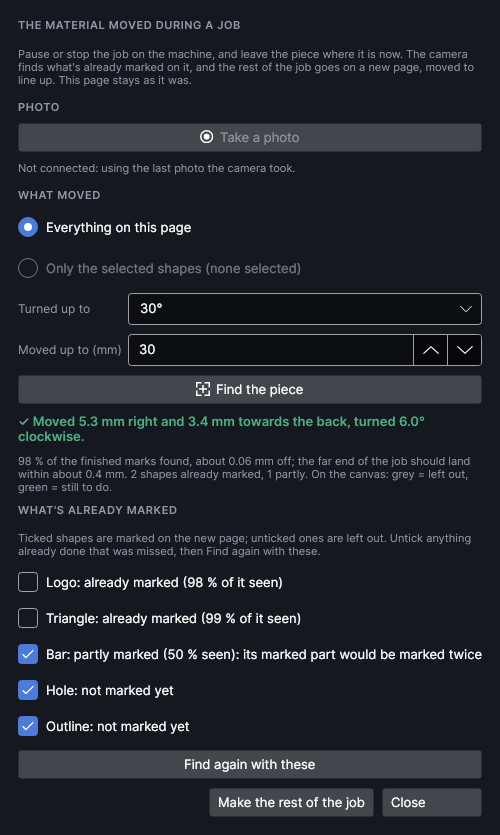
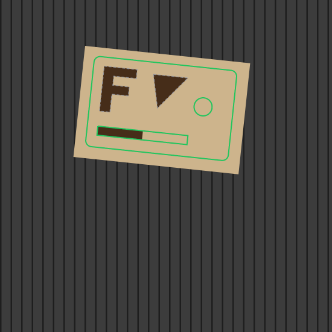

# Knocked piece

<!-- windows: RecoveryWindow -->

When the material gets bumped halfway through a job, the half-finished piece is usually scrap:
the rest of the job would land in the wrong place. **Knocked piece** finds the piece again from a
camera photo, by the marks already burnt on it, works out how far it moved and turned, and puts
the rest of the job on a new page, moved to line up. You check it over the camera picture and send
it with **Ship It** as usual.

It's an add-on: turn it on or off in **Settings → Add-ons**. While it's on, its button is on the
**Placement** tab, in the **Onto pieces** group.

| Needs | Why |
|---|---|
| The camera calibrated near the material's height | The photo has to be true to the bed (see [Camera](camera.md#calibrate-the-camera)). |
| The machine connected | To take a new photo. Without it, the last photo the camera took is used. |
| The design still where it was when the job was sent | The marks are looked for near where the design says they are. |

> **Safety:** Pause or stop the job on the machine before you touch the piece or take a photo.
> Nothing in this window moves the head or fires the laser; the rest of the job only runs when you
> send it and press the machine's button.

## Finding the piece

1. Pause or stop the job on the machine. Leave the piece exactly where it is now: don't push it
   back.
2. Click **Knocked piece** on the **Placement** tab.
3. Click **Take a photo**. The machine's lights are off while a job runs, so pause or stop it
   first or the photo comes out dark.
4. Choose **What moved**, and how far it may have gone. Then click **Find the piece**.

| Setting | Choices | Default | What it does |
|---|---|---|---|
| **What moved** | **Everything on this page**, **Only the selected shapes** | Everything | Which shapes were on the piece that moved. Choose the selected shapes when several pieces were on the bed and only one was knocked. |
| **Turned up to** | 10°, 30°, 90°, Any angle | 30° | How far the piece may have turned either way. A smaller search is quicker and harder to fool. |
| **Moved up to (mm)** | 2 to 150 | 30 | How far the piece may have moved. |

The camera looks for the edges of what's already burnt, not for the edges of the material, so it
works on an offcut of any shape. Each of the bigger shapes is tried on its own; the place where the
most shapes turn up at once is where the piece went. Shapes that aren't marked yet (and the grain
they might land on) can't pull it off.

## What it found

The line under **Find the piece** says how far the piece moved and turned. Under it:

- **…of the finished marks found**: how much of the already-marked lines lie on an edge in the
  photo, and how far off they are on average. Over 50 % is a good find.
- **The far end of the job should land within about … mm**: the fit's spread, plus how much a
  small error in the turn grows over the size of the job. The overview camera sees 0.2 mm per
  pixel, so engraving lines up well; for a cut that must meet earlier work exactly, expect a few
  tenths of a millimetre.
- **Warnings** in orange: when too little of the marks was found, or when the marks look the same
  turned another way (a circle, a ring, a square at 90°). Then the turn can't be told from the photo.

While the window is open, the canvas shows where the design lands on the piece: **green** for what's
still to do, **grey dashed** for what's left out. Check the grey lines sit on the burnt marks in the
camera picture.

### What's already marked

Every shape the job marks is listed with what the photo shows of it:

| Shown as | Means | Ticked? |
|---|---|---|
| **already marked** | Its marks show all round. | No: left out of the rest of the job. |
| **partly marked** | Some of it shows: it was being marked when the piece moved, or it is faint. | Yes: it's marked again in full, so the part already done is marked twice. |
| **not marked yet** | Nothing of it shows. | Yes. |

Tick or untick any shape to change what goes in the rest of the job. **Find again with these**
fits the piece again using only the unticked shapes (the ones you say are already marked): use it
when the list got a shape wrong, or when a shape that isn't round helps tell the turn.

> **Note:** A cut outline that lies exactly on the edge of a pre-cut blank can show as already
> marked when it isn't: the blank's own edge is there. Tick it if it still needs cutting.

## Making the rest of the job

**Make the rest of the job** adds a new page after this one, named after it with **– rest after
the knock**, and shows it:

- everything that moved is moved onto the piece;
- unticked shapes go on a grey **Already marked** layer that is shown but never sent, so you can
  still see them over the camera picture;
- the page you started from is kept exactly as it was, for the next piece.

Check the new page over the camera picture, then **Ship It**. `Ctrl+Z` takes the new page away
again. The rest of the job is a new job: it starts from the beginning of what's left, with all its
layer settings.

## Tips

- Take the photo as soon as you notice the knock, before anything else moves.
- On dark or shiny material, turn the fill lights up (Settings → Machine → Camera lights) so the
  marks stand out.
- A job knocked in its first seconds has little to find. If nothing is found, put the piece back
  by hand under the design with **Fit to piece**, or start again.
