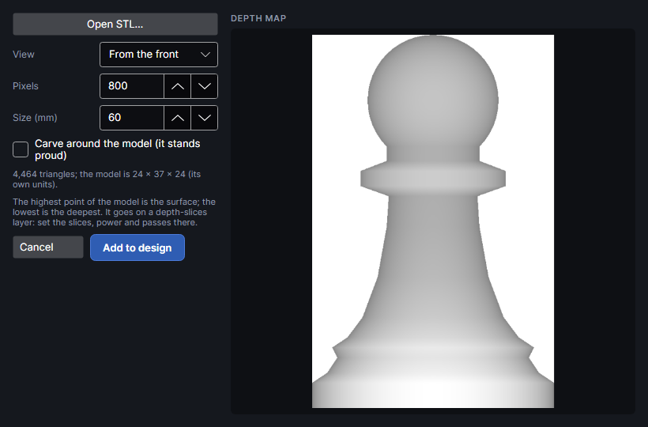
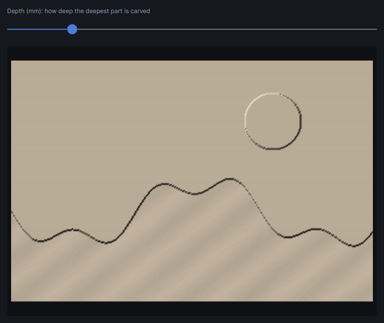

# 3D model relief

This add-on adds the Picture tab's **Relief** group: **3D model** brings in an STL file as a depth map to carve as a relief, and **Relief preview** shows a depth map as the lit relief it makes.

## 3D model relief
<!-- windows: StlWindow -->

**3D model** turns a 3D model into a depth map, to carve it as a relief: the highest point is the
surface, the lowest the deepest.

1. **Open STL…** picks the model: STL (binary or text), OBJ or STEP.
2. **View:** **From the top**, **From the front** or **From the side**.
3. **Pixels** (100 to 4000, default 800): pixels along the map's longer side. 10 per mm is plenty
   for most reliefs.
4. **Size (mm)** (2 to 220, default 60): how big the relief is on the work area, along its longer
   side.
5. **Carve around the model (it stands proud)**: off, the area round the model is left as the
   surface; on, it's carved to the bottom.

The preview shows the depth map, and a line gives the number of triangles and the model's size in
its own units. **Add to design** puts it in the middle of the work area on a new Picture layer,
**Relief ·** and the model's name, with the same depth-slice settings as a depthmap, and makes that
layer active.
Set the slices, power and passes there ([Layer settings](layer-settings.md)). For cutting a model
into stacked sheets instead, see 3D models and stacked slices.

Carving depth slices hasn't been tried on the machine yet.

## Relief preview
<!-- windows: ReliefPreviewWindow -->

**Relief preview** shows the selected depth map as the relief it will carve: a surface lit from the
top left, light parts high and dark parts deep. **Depth (mm): how deep the deepest part is carved** (0.2
to 5, default 1) only changes how steep the light makes it look; the real depth comes from the
layer's settings. The window can stay open while you work.

## Tutorials

- [A relief from a 3D model](tutorial:pic-3d-model)
