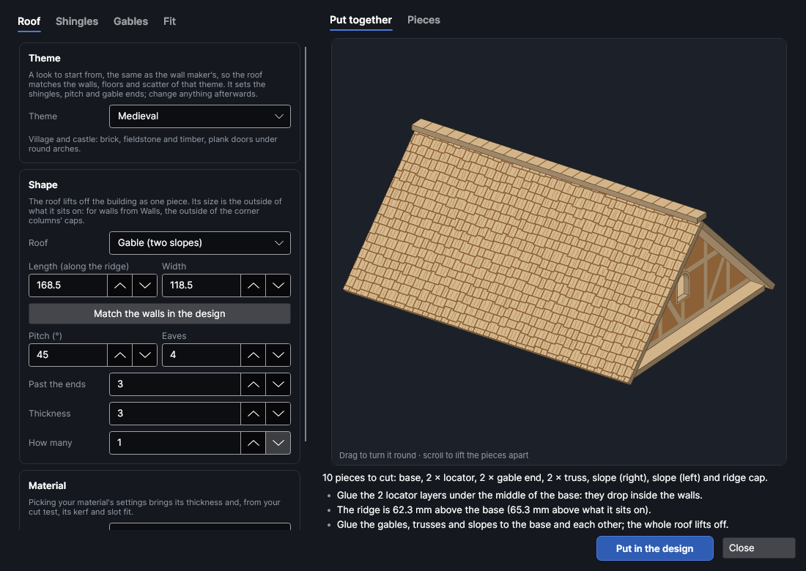
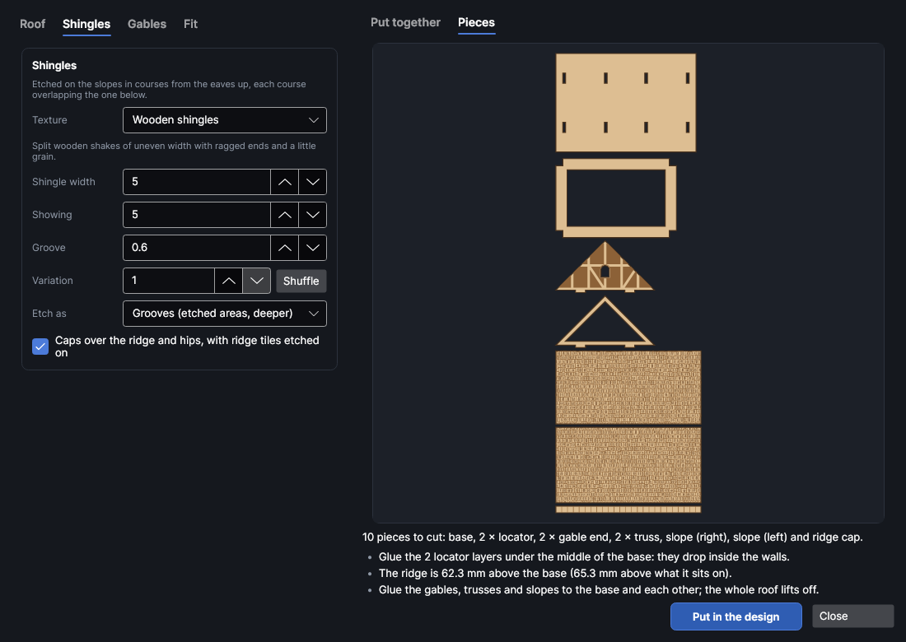
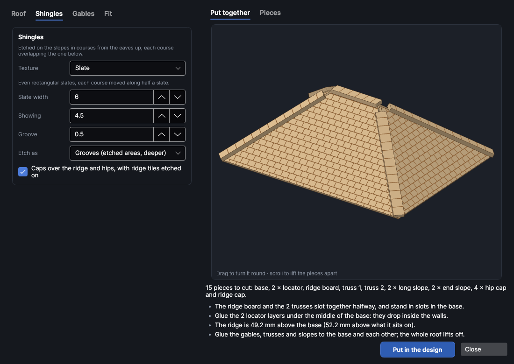
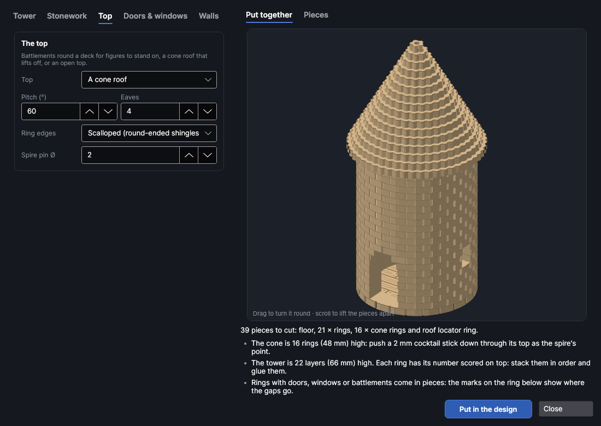
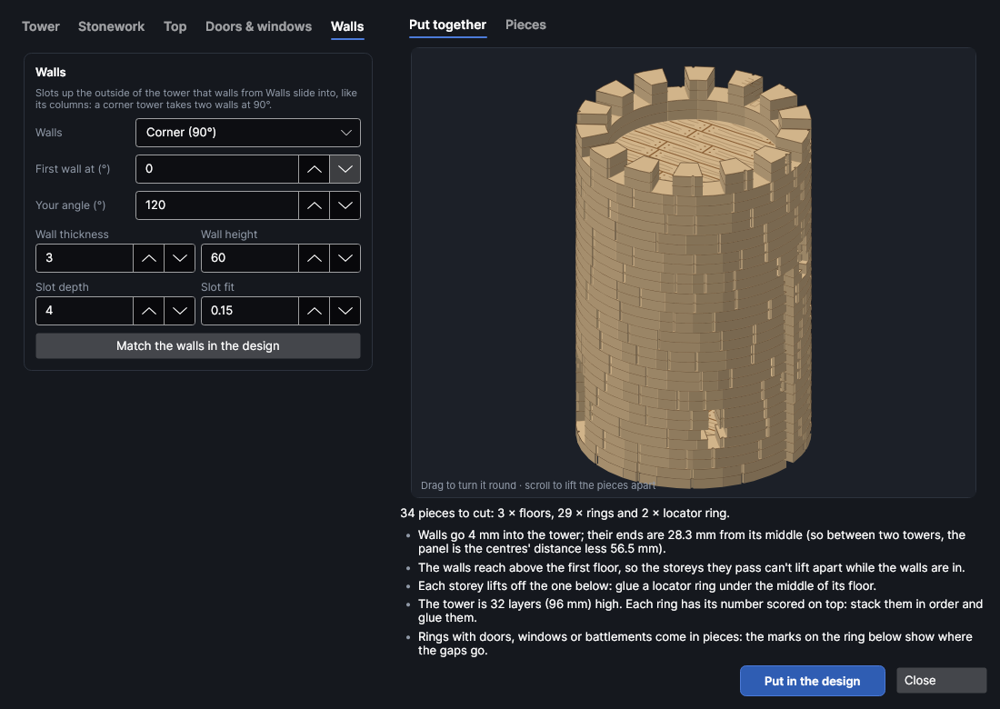

# Roofs and towers

An add-on (Settings → Add-ons → **Roofs and towers**): on when PhotonCanvas is installed, and can be turned off. It works with the wall maker ([Textured walls](walls.md)), which has to be on too. Its buttons are **Home → Draw → Roofs** and **Home → Draw → Towers**, and **Edit roof or tower…** is on the right-click menu of the pieces it made.

**Roofs** makes roofs for tabletop buildings and models, cut from sheet with shingles, slates,
tiles or thatch etched on: gable roofs with two slopes, hipped roofs with four (a pyramid on a
square building), lean-to roofs with one, and cone roofs for round towers. Each roof lifts off in one
piece, so figures can go inside, and **Match the walls in the design** makes it to fit a room built
with **Walls**.

**Towers** makes round towers stacked from rings of the same sheet: stonework on the outside, storeys
that lift apart with a floor in each, a door, windows, battlements round a deck or a cone roof, and
slots up the side that the wall maker's walls slide into, as they do into its columns.

> **Note:** The roofs and towers have been checked on screen and in tests, but not yet cut on the
> machine. Cut a gable and the base first and try the tabs in their slots (change **Slot fit** if
> they're too tight or loose), and cut two or three rings of a tower before the whole stack.

## The Roofs window
<!-- windows: RoofsWindow -->

Click **Roofs** on the **Home** tab (in the **Draw** group); **Towers**, beside it, opens the same
window for a tower. The settings are on the left in tabs. On the right, **Put together** shows the
roof or tower in 3D (drag to turn it, scroll to lift the pieces apart and see inside) and **Pieces**
shows every piece flat at the same scale. Under them are the number of pieces and notes: a red ✕
has to be fixed before it can go in, a yellow ! is worth a look, and a grey • is for your information.

Press **Put in the design** and the pieces go on a page of their own, nested onto the bed (more pages
if they need more than one bed). To change it later, select any of its pieces, right-click and choose
**Edit roof or tower…**, change the settings and press **Update in the design**.

When the design already has walls from **Walls**, a new roof or tower is made to fit them as the
window opens; **Match the walls in the design** does it again after you've changed things.

## Themes

**Theme**, at the top of the first tab for both roofs and towers, is a look to start from, the same as
the wall maker's, so a roof or tower matches the walls, floors and scatter made in that theme. Change
anything afterwards.

| Theme | Roof | Tower |
|---|---|---|
| Medieval | Slate at 45°, round attic windows, gables in brick | Stone blocks, arrow slits |
| Dungeon | Slate at 50°, arched attic windows, gables in dungeon blocks | Big stone blocks, arrow slits |
| Cave | Wooden shingles at 40°, no attic window, gables in cave rock | Fieldstone, a rough doorway and rough windows |
| Sci-fi | Corrugated metal at 20°, angled attic windows, gables in sci-fi panels | Corrugated metal, an angled door and wide angled windows |
| Desert | Clay tiles at 25°, square attic windows, gables in adobe plaster | Long sandstone blocks, small square windows |
| Gothic | Slate at 60°, pointed attic windows, gables in fine stone | Fine stone blocks, tall pointed windows and a steep cone roof |

A cone roof keeps its pitch; its edge becomes scallops, slates or smooth to suit.

## Roofs

### Shape

| Setting | Range (default) | What it does |
|---|---|---|
| **Roof** | Gable | *Gable* (two slopes meeting at a ridge, with a triangular gable at each end), *Hipped* (four slopes; on a square building it comes to a point like a pyramid), *Lean-to* (one slope, rising from the front to a back wall), or *Cone* (for a round tower). |
| **Length** | 20 to 2000 mm (128.5) | The outside of the building along the ridge (along the front for a lean-to). |
| **Width** | 16 to 2000 mm (128.5) | The outside of the building across the ridge; a lean-to's depth, front to back; a cone's tower diameter. |
| **Match the walls in the design** | | Reads the walls made with **Walls** (the selected ones first): the room's outside, the sheet, the fit, how the roof sits on the walls and the walls' texture for the gables. Two sets of walls of different lengths make a rectangular room, the longer along the ridge. |
| **Pitch (°)** | 10 to 80 (45) | How steep the slopes are: 45 for a cottage, about 30 for a barn, 60 for a steep roof. A cone is usually 55 to 65. |
| **Eaves** | 0 to 50 mm (4) | How far the slopes reach past the walls at the bottom, along the slope. |
| **Past the ends** | 0 to 50 mm (3) | How far a gable or lean-to roof reaches past each end. |
| **Thickness** | 0.5 to 20 mm (3) | Your sheet's thickness. |
| **How many** | 1 to 50 (1) | How many roofs like this to cut. |
| **Cut with**, **Etch with** | As set on the layers | Settings from your material library. The cut settings' kerf goes on the cut layer, so slots come out the size they're drawn, and the material's thickness and slot fit are filled in. |

The size is the outside of what the roof sits on. For a room built with **Walls** that's the
outside of the corner columns' caps: the columns' centres apart, plus a column, plus 4 mm for the
caps' lip. A room of four 100 mm walls with 16 mm columns is 128.5 mm square.

### Shingles

Pick one in **Texture**; its sizes change with it. The courses run along the eaves, each overlapping
the one below so only its lower part shows.

| Texture | Sizes (defaults) | What it looks like |
|---|---|---|
| Slate | width 6, showing 4.5 mm | Even slates, each course moved along half a slate. |
| Wooden shingles | width 5, showing 5 mm | Split shakes of uneven width with ragged ends and a little grain. |
| Fish scale | width 6, showing 4.5 mm | Round-ended shingles. |
| Clay tiles | width 6, showing 6 mm | Half-round tiles in straight columns. |
| Thatch | course 8 mm | Straw in ragged courses, scored with straw lines. |
| Wood planks | width 5, length 35 mm | Boards running down the slope. |
| Corrugated metal | pitch 2.5 mm | Ridges running down the slope. |
| Plain | | No texture. |

- **Groove**: how wide the etched gaps between shingles are. **Variation** (with **Shuffle**) lays
  uneven shingles and thatch out differently; the same number always gives the same roof.
- **Etch as**: *Grooves* etches the gaps as areas (deeper, the most real); *Lines* scores round each
  shingle instead, much quicker. Grain and straw are always scored, on a light **Roofs · lines** layer.
- **Caps over the ridge and hips**: strips that lie along the ridge (and a hipped roof's hips),
  with the joints between ridge tiles etched across. On a hipped roof they cover the joints where the
  slopes meet; on a pyramid they stop a little short of the point: glue a bead or a cocktail stick
  on top as a finial.

A cone is stacked from rings instead (see [Cone roofs](#cone-roofs)), so the Shingles tab asks for its
**Ring edges**, **Shingle width**, **Ring width** and **Spire pin Ø** instead.

### Gables

The triangles at the ends of a gable roof, and a lean-to's sides and back wall, have one of the wall
maker's textures etched on their outside, so they carry on from the walls under them. **Match the
walls in the design** picks the walls' own texture and sizes (your own textures too).

- **Texture** and its sizes, **Groove** and **Variation**: as in [Textured walls](walls.md).
- **Window**: an attic window in each gable: round, round arch, square, pointed arch or angled
  corners (sci-fi), **Window width** wide, with a smooth frame round it. If it doesn't fit, the notes say so.

A hipped or cone roof has no gables.

### Fit

How the roof is held together and how it sits on the walls.

- The roof is built on a **base** plate the size of the building. The gables, the **trusses** between
  them (**Trusses every**, about 60 mm apart; 0 = none) and a hipped roof's **ridge board** stand on it
  with tabs in slots. A hipped roof's ridge board and trusses slot together halfway, as a cross. The
  slopes rest on the gables and trusses: glue everything, and the whole roof lifts off.
- **Slot fit**: added to the sheet's thickness for the slots. With your material's cut settings
  picked, the kerf is allowed for too.
- Under the base, a **locator** frame drops inside the walls so the roof can't slide off. **Walls
  inside** is from the outer edge to the inside face of the walls (0 = no locator), **Wall thickness**
  the walls' (the gables stand over their middle), **Column corners** the square corners the locator
  keeps clear of (the columns and their caps), and **Rests above walls** how far the column caps
  stand above the walls' tops: the locator is stacked deep enough to reach 2 mm below the tops. **Match
  the walls in the design** fills all four in.

### Cone roofs

A cone is stacked from rings, each a step smaller than the one below, so the steps follow the
**Pitch**. Their edges are shaped so the steps read as courses of shingles:

- **Ring edges**: *Scalloped* (round-ended shingles), *Notched* (slates) or *Smooth*.
- **Shingle width**: how wide each scallop or slate is round the edge.
- **Ring width**: the rings are hollow, this wide, until they get small; the top ones are solid.
- **Spire pin Ø**: a hole down the top for a cocktail stick or wire as the spire's point (0 = none).

For a cone on a tower, **Width** is the tower's diameter and **Walls inside** its wall's thickness: a
locator ring under the cone drops into the tower. **Towers** makes a tower with its cone in one go.

## Towers

### The tower

| Setting | Range (default) | What it does |
|---|---|---|
| **Diameter** | 16 to 1000 mm (60) | Across the tower. |
| **Height** | 10 to 2000 mm (100) | From the ground to the top of the battlements, or to where a cone roof sits. |
| **Thickness** | 0.5 to 20 mm (3) | Your sheet's thickness: each ring is one layer. |
| **Ring width** | 2 to 100 mm (8) | How thick the tower's wall is. |
| **Storeys** | 1 to 20 (2) | Storeys that lift apart, each with a floor. Battlements add a deck on top. |
| **How many** | 1 to 50 (1) | How many towers like this to cut. |

Every ring has its layer number scored on its top face, where it's hidden once stacked: stack them
in order (1 at the bottom) and glue them. Each floor is a disc with floorboards etched on (**Floorboards
etched on the floors**), and each storey above the ground has a **locator ring** glued under its floor
that drops into the storey below, so the storeys lift apart to put figures inside.

### Stonework

A laser can't etch round a tower, so the stonework is cut into the rings' edges: a small notch at
each joint between blocks, the joints moving along from one course to the next, while the layers'
edges make the courses.

- **Texture**: Stone blocks, Brick, Fieldstone (rough stones that stand out unevenly), Tiles, Wood
  planks (upright), Corrugated metal or Plain.
- **Block length**: how long the blocks are round the tower. **Course height**: how tall a course is,
  rounded to whole layers (6 mm is two 3 mm rings with the same joints). **Groove**: how wide the
  notches are. **Variation** lays stone blocks and fieldstone out differently.

### The top

- **Battlements round a deck**: a deck (the top floor) with a parapet round it, **Parapet** high
  (merlons and all; about 15 mm hides a 28 mm figure to the chest), with gaps cut in its top
  **Merlon height**. **Merlon width** and **Gap width** set the blocks and gaps round the top.
- **A cone roof**: a cone stacked from rings (as in [Cone roofs](#cone-roofs)), **Pitch** steep and
  reaching **Eaves** past the tower's wall, that lifts off.
- **Open (no top)**.

### Doors and windows

- **A doorway at the bottom**: **Door shape** (square top, round arch, pointed arch, angled corners or
  a rough cave mouth), **Door width**,
  **Door height**, and **Faces (°)**: which way it faces, in degrees round the tower seen from above
  (270 is towards you in the preview).
- **Per storey**: how many windows each storey has, spread evenly round it, clear of the door and the
  walls, and turned a little from one storey to the next. **Window shape** (square top, round arch,
  pointed arch, round, arrow slit, angled corners or rough), its width and height, and **Sill height** above the storey's floor.

Doors, windows and battlements are cut right through the rings, so those rings come as a C or in
pieces. Short marks scored on the layer below show where each gap goes.

### Walls

**Walls** cuts slots up the outside of the tower for walls from **Walls** to slide into, the way they
slide into its columns: *Corner (90°)* for a corner tower, *Straight (180°)* for a tower in the
middle of a wall, a T, a cross, one wall (*End cap*) or **Your angle**. **First wall at (°)** turns the
slots round the tower. **Wall thickness**, **Wall height**, **Slot depth** and **Slot fit** should be
the walls' own: **Match the walls in the design** fills them in, with the sheet and the texture.

The notes say how far a wall's end is from the tower's middle, so you can space two towers for a
wall: the panel is the centres' distance less twice that. The storeys the walls pass can't lift
apart while the walls are in.

## Layers and order

The pieces go on three layers, run in this order: **Roofs · lines** (light scoring: grain, straw,
ring numbers and marks) and **Roofs · etch** (the shingles, gable textures and floorboards, a Fill
layer) first, while the sheet is whole, then **Roofs · cut**. Set the etch layer's power and speed
for the depth you want (Laser → Tests → Material test helps).

## Try it

- [Make a roof for a room of walls](tutorial:make-roof)
- [Make a round castle tower](tutorial:make-tower)
