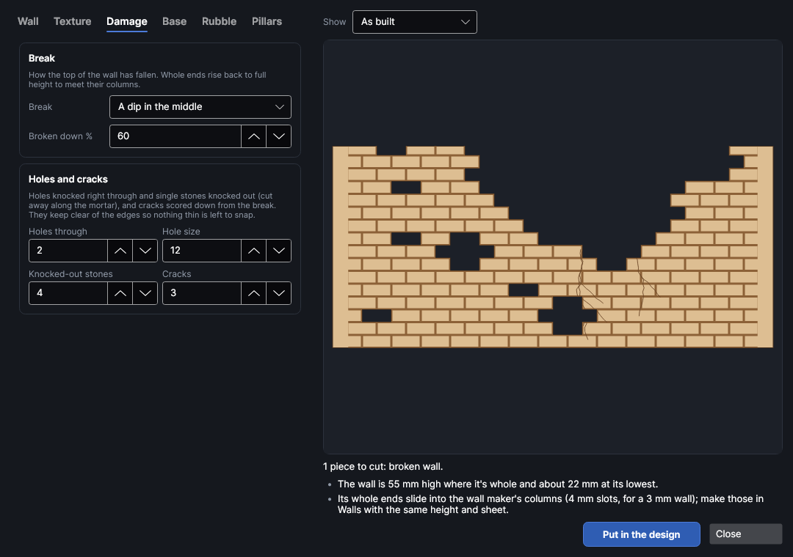
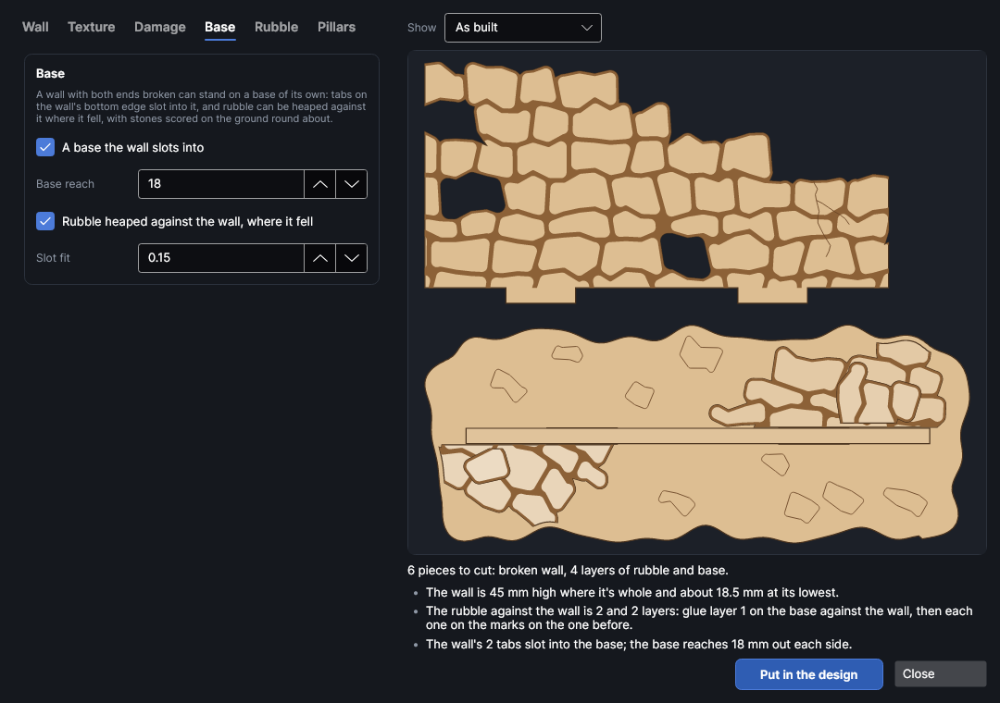
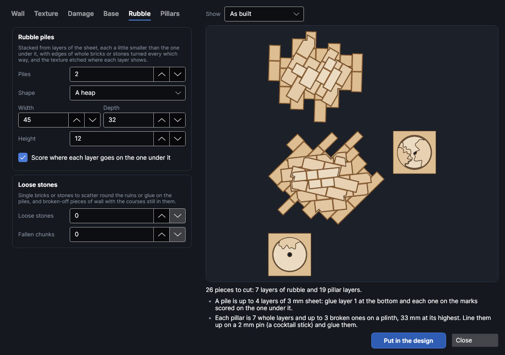

# Ruins and rubble

An add-on (Settings → Add-ons → **Ruins and rubble maker**): on when PhotonCanvas is installed, and can be turned off. Its button is **Designer → Terrain → Ruins**, and **Edit ruins…** is on the right-click menu of the pieces it made.

**Ruins** makes broken scenery for tabletop games, dioramas and model buildings, cut from sheet
material: sections of wall broken down from the top, with holes knocked through, stones missing and
cracks; rubble piles stacked from layers of the sheet; loose bricks and stones; broken-off chunks of
wall; and broken pillars. They use the same textures as the wall maker (**Designer → Buildings → Walls**):
brick, stone, wood and metal, at the same sizes, so ruins stand beside whole walls and match them.
A broken wall can keep whole ends that slide into the wall maker's columns, or crumble at both ends
and stand on a base of its own.

> **Note:** The ruins have been checked on screen and in tests, but not yet cut on the machine. Cut
> one wall and a small pile first, and check the fit of the base's slots before cutting a whole set;
> change **Slot fit** if it's too tight or too loose.

## The Ruins and rubble window
<!-- windows: RuinsWindow -->

Click **Ruins** on the **Designer** tab (in the **Terrain** group). The **Ruins and rubble** window opens.
The settings are on the left in tabs; the preview on the right updates as you change things. **Show**
picks what it shows: **As built** shows the wall's face, and each pile, base and pillar from above
with its layers stacked (higher layers lighter); **Pieces to cut** shows one of each piece, flat. Under
it are the number of pieces and any problems: a red ✕ has to be fixed before the ruins can go in, a
yellow ! is worth a look, and a grey • is just for your information.

Press **Put in the design** and the pieces go on a page of their own, nested onto the bed (more pages
if they need more than one bed). To change a set later, select any of its pieces, right-click and
choose **Edit ruins…**, change the settings and press **Update in the design**: the old pieces are
replaced wherever they are.

## The wall

| Setting | Range (default) | What it does |
|---|---|---|
| **Make a broken wall** | on | Untick it to make only rubble, stones, chunks and pillars. |
| **Length**, **Height** | 100 × 50 mm | The wall section's size; the height is where it's whole. |
| **Two panels back to back** | off | Cuts a mirror-image second panel to glue to the back, so both faces are textured. |
| **How many walls** | 1 | How many walls like this one to cut. They're all the same; change **Variation** for a different one. |
| **Left end**, **Right end** | Whole (fits a column) | *Whole*: the end is straight and full height, to slide into a column made with Walls. *Broken*: the end crumbles away, a brick or stone missing here and there. |
| **Slot depth** | 4 mm | How deep the columns' slots are, as set in the wall maker: whole ends are kept straight that far. |
| **Keep whole ends smooth** | on | No texture where whole ends go into the columns, so they slide in at full thickness. |
| **Thickness** | 3 mm | Your sheet's thickness: every piece is cut from it. |
| **Cut with**, **Etch with** | As set on the layer | Settings from your material library for the cut and for the texture. The cut settings bring the material's thickness, kerf and slot fit. |

**Match the walls in the design** takes the sheet thickness, height, texture, its sizes, **Wear %**,
**Detail size** and **Variation** from walls made with **Walls** (the ones selected, or else the first in the design).
With the same variation the bricks or stones of a ruin are laid exactly as on those walls, so a broken
wall slid into a column beside a whole one lines up with it course for course. A first ruin does this
by itself when there are walls in the design.

## The texture

The wall maker's textures, at the same sizes: Brick, Stone blocks, Fieldstone, Tiles, Wood planks
(upright or across), Timber frame, Corrugated metal, Metal plates, Hexagons, Dungeon blocks, Cave
rock, Sci-fi panels, Sandstone, Adobe and Plain, and your own texture if the walls you matched used
one. See the wall maker's page for what each looks like.

**Theme**, at the top of the **Texture** tab, is a look to start from, the same as the wall maker's:
it sets the texture and its sizes and the pillars' shape, so a ruin matches whole walls of that theme.

| Theme | Texture | Pillars |
|---|---|---|
| Medieval | Brick | Round |
| Dungeon | Dungeon blocks | Square |
| Cave | Cave rock | Round |
| Sci-fi | Sci-fi panels | Square |
| Desert | Sandstone | Round |
| Gothic | Fine stone blocks | Eight-sided |

How the wall breaks depends on the texture:

- **Bricks, stones, tiles, plates, hexagons and the theme textures** (dungeon blocks, cave rock,
  sci-fi panels, sandstone and adobe's bricks) break along the joints, a whole brick or stone at a
  time, so the broken edge steps up and down the courses like a real ruin.
- **Upright planks** snap off board by board, each at its own height, to a splintered point.
- **Planks across** and **corrugated metal** tear in a jagged line.
- **Timber frame**, **Plain** and your own textures break in steps.

**Variation** changes where the wall breaks, how the stones lie and how the rubble falls; each number
gives a different ruin and the same number always the same one. **Shuffle** picks the next one.
**Wear %** and **Detail size** age the texture as the wall maker's do: 0 is new and crisp, 50 the
usual look, 100 ancient and battered (nicked edges, knocked corners, pits, cracks and scratches), and
the detail size is how big the smallest of those marks are, in mm.
**Etch as** etches the gaps as grooves (deeper) or scores lines round each brick or stone (much
quicker), or carves them as a **Relief**: a greyscale depth map on a **Ruins · relief** picture layer,
carved in depth slices, with every brick or stone at its own height and its edges rounded into the
mortar, as in the wall maker (the most real, and much the slowest).

## Damage

| Setting | What it does |
|---|---|
| **Break** | *A dip in the middle*, *Falls away to the left* or *to the right*, *Two gaps*, or *A low stump* broken down all along. Whole ends rise back to full height to meet their columns. |
| **Broken down %** | How far down the wall is broken where it's lowest, as a share of its height. |
| **Holes through**, **Hole size** | Holes knocked right through the wall below the break, along the mortar. A hole is only made where it leaves the wall in one piece with nothing thin enough to snap; the list says if fewer fit. |
| **Knocked-out stones** | Single bricks or stones missing, cut right through, clear of the edges and of each other (textures of bricks, stones, tiles or plates). |
| **Cracks** | Cracks scored down the face from low points of the break, on the **Ruins · lines** layer. |

## Base

A wall with both ends broken stands on its own on a base. Tick **A base the wall slots into**: the
wall gets tabs on its bottom edge, and a base with a lumpy edge has slots for them.

- **Base reach**: how far the base reaches out in front of and behind the wall.
- **Rubble heaped against the wall, where it fell**: a heap of stacked layers against the front of
  the wall below where it's broken lowest, and a smaller one behind, both with a straight back that
  sits against the wall. Stones are scored on the ground round about.
- **Slot fit**: added to the tabs' size for the slots: more is looser.

## Rubble

**Rubble piles** are stacked from layers of the sheet, each a little smaller than the one under it,
like a mound. Each layer's edge follows whole bricks or stones, turned every which way from layer to
layer as fallen stones lie, and the texture is etched where each layer shows.

| Setting | What it does |
|---|---|
| **Piles** | How many piles; each one is a little different. |
| **Shape** | *A heap* stands on its own. *Against a wall* has a straight back to push up to a wall. *In a corner* has two straight sides at a right angle. |
| **Width**, **Depth** | The bottom layer's size. |
| **Height** | How high the pile is: the number of layers is the height over the sheet's thickness. Small upper layers that would come out too small to cut are left off. |
| **Score where each layer goes** | The outline of the next layer is scored on each layer, so you can see where to glue it. |
| **Loose stones** | Single bricks or stones of the texture, to scatter or glue on the piles (pieces the same size are counted together). Textures without stones make rough chips. |
| **Fallen chunks** | Broken-off pieces of wall with the courses still in them and the texture on top, to lay on the ground. |

Glue a pile's layer 1 at the bottom, then each layer on the marks on the one before. The layers are
named in order in the design (*Rubble pile layer 1*, *layer 2*, …).

## Pillars

**Broken pillars** are stacks of layers on a pin: whole at the bottom, the top few broken away more
and more, each still sitting on the one under it. Each pillar is broken differently.

- **Shape**: round, square or eight-sided. **Width**: across the pillar. **Height**: how high it
  stands at its highest, without the plinth.
- **Pin hole Ø**: a hole up the middle of each layer for a cocktail stick or wire that lines the stack
  up while the glue sets (it's left out of broken layers where too little is left round it). 0 = none.
- **A wider square plinth at the bottom**: a square layer 2 mm bigger all round under the pillar.

## Layers and order

The pieces go on three layers, run in this order: **Ruins · lines** (light scoring: cracks, glue
marks, grain and stones on the base) and **Ruins · etch** (the texture, a Fill layer) first, while
the sheet is whole, then **Ruins · cut**. Set the etch layer's power and speed for the depth you want.

## Try it

- [Make a broken wall and a rubble pile](tutorial:make-ruins)
