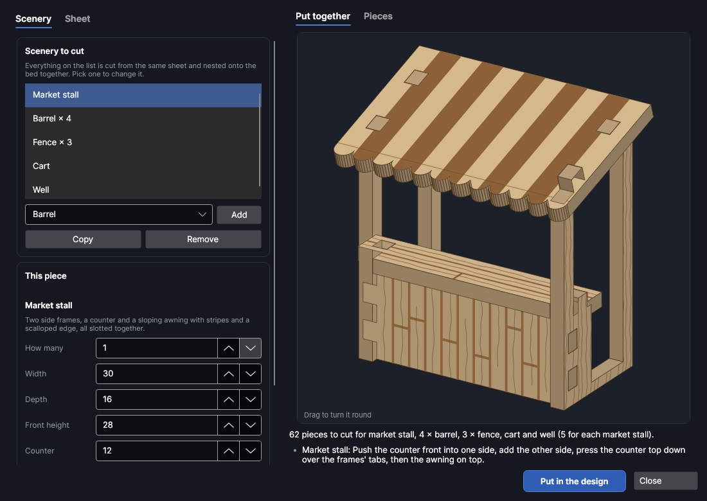
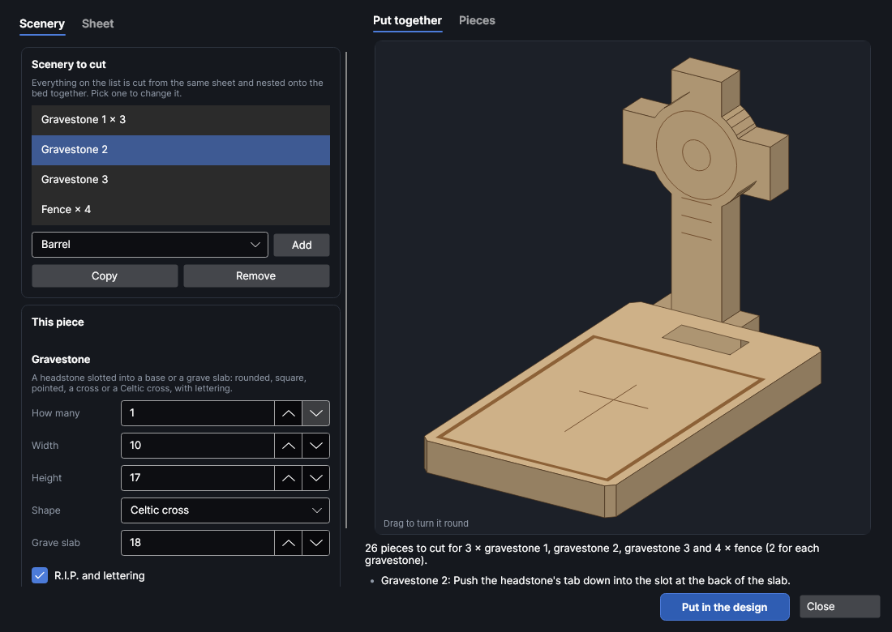
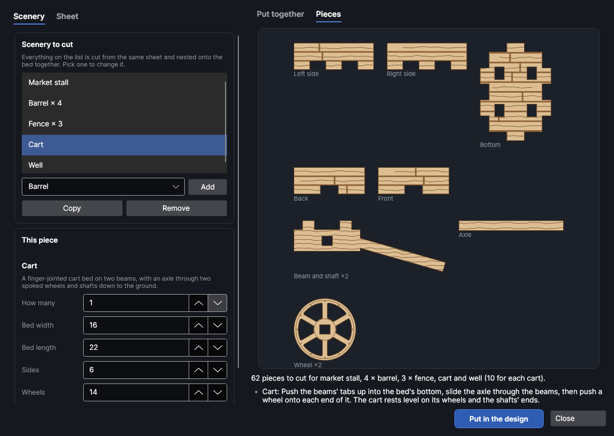
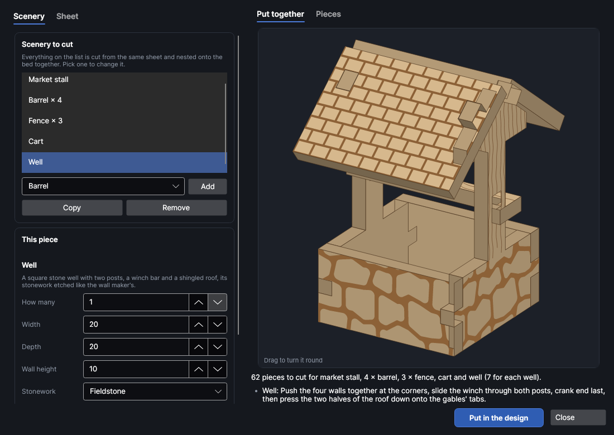

# Scatter terrain

An add-on (Settings → Add-ons → **Scatter terrain maker**): on when PhotonCanvas is installed, and can be turned off. Its button is **Home → Draw → Scatter**, and **Edit scatter terrain…** is on the right-click menu of the pieces it made.

**Scatter** makes the small scenery that fills a tabletop: barrels, fences, carts, market stalls,
wells and gravestones, cut from one sheet. The pieces slot together with tabs, finger joints and
halving joints, so they go together square without tools (a drop of glue keeps them that way). Wood
grain and planks, stonework, awning stripes, roof shingles and lettering are etched and scored on
the faces that show. It goes with the wall maker (**Home → Draw → Walls**) and the furniture maker
(**Home → Draw → Furniture**): the same 28 mm sizes, and a well's stonework is laid out like the wall
maker's texture of the same name.

> **Note:** The scenery has been checked on screen and in tests (every piece is put together in 3D
> and checked for clashes, empty slots and pieces that don't join), but not yet cut on the machine.
> Cut one small piece first, a fence or a gravestone, and check how the tabs go into the slots
> before cutting a whole village; change **Slot fit** if they're too tight or too loose.

## The Scatter terrain window
<!-- windows: ScatterWindow -->

Click **Scatter** on the **Home** tab (in the **Draw** group). The **Scatter terrain** window opens.
On the left, the **Scenery** tab has the list of what to cut and the settings of the one picked; the
**Sheet** tab has the sheet it's all cut from. On the right, **Put together** shows the piece picked
in 3D (drag it to turn it round) and **Pieces** shows its pieces flat, one of each, with how many of
each there are. Under them are the number of pieces and notes: how it goes together, a red ✕ that has
to be fixed before it can go in, a yellow ! worth a look.

Press **Put in the design** and every piece of everything on the list goes on a page of its own,
nested onto the bed (more pages if they need more than one bed). To change it later, select any of
its pieces, right-click and choose **Edit scatter terrain…**, change the settings and press **Update
in the design**: the old pieces are replaced wherever they are.

## The list

Everything on the list is cut together. Pick a kind under the list and press **Add**; **Copy** adds
another like the one picked (a second size or style), and **Remove** takes the one picked off.
**How many** sets how many of each to cut: a row of barrels is one line, *Barrel × 6*.

New scenery comes in at a size to suit the figures chosen on the **Sheet** tab (28 mm unless you
change it). All sizes are in mm and are the outside of the piece as it stands.

| Kind | What it is | Sizes (defaults for 28 mm) |
|---|---|---|
| **Barrel** | Discs stacked up, wider in the middle than at the ends, on a hidden **core** (a strip through the middle discs that lines them up). **Raised hoops** makes two discs a little wider; **Open at the top, with water inside** puts a rim on top and ripples on the water. The lid has its staves scored on. How many discs depends on the sheet: the note says. | 10 across, 12 high |
| **Fence** | One section, its posts, rails and boards cut in one piece. **Fence**: *Pickets*, *Posts and rails*, *Planks* or *Wattle* (woven). **Feet, so it stands up on its own** adds a foot under every post, slotted across it. Long sections get a post every 30 mm or so. | 40 long, 14 high |
| **Cart** | A finger-jointed open bed on two beams, an axle that slides through the beams and the hubs of two spoked wheels, and **Shafts down to the ground** (otherwise a short leg at the front), so it stands level. **Wheels** sets their diameter; big wheels have their spokes cut out, small ones etched. | bed 16 × 22, sides 6, wheels 14 |
| **Market stall** | Two side frames (a post at the front, a taller one at the back), a counter top and a counter front, and a sloping awning on top. **Counter** is its height, **Back higher by** how much the awning slopes. **Stripes on the awning** and **A scalloped edge along the front**. | 30 wide, 16 deep, 28 at the front, counter 12 |
| **Well** | Four finger-jointed walls with **Stonework** etched on (*Fieldstone*, *Stone blocks*, *Brick* or *Plain*). **A roof and a winch**: the side walls rise as posts with a gable on top, a winch bar with a crank slides through both posts, and two roof halves with **Shingles on the roof** lie on the gables. **Top** is the height of the roof's ridge. | 20 × 20, wall 10, top 34 |
| **Gravestone** | A headstone that slots into a base. **Shape**: *Rounded*, *Square*, *Pointed*, *Cross* or *Celtic cross*. **Grave slab** puts a slab that long in front of it (0 = just a small base). **R.I.P. and lettering** scores a border, R.I.P. and lines of words on; **Weathered: chips and cracks** chips the edges and scores cracks. | 9 wide, 13 high |

If a size is too small for the sheet (a slot that would cut a piece in two, a tab with nothing round
it, too few discs for a barrel), the list under the preview says what to change and it can't go in
until it's fixed.

## The sheet

| Setting | Range (default) | What it does |
|---|---|---|
| **Thickness** | 0.3 to 20 mm (2) | The sheet's thickness. Every slot and tab is sized from it, and a barrel has as many discs as fit its height. Thin sheet (1.5 to 2 mm) looks best at 28 mm; at 15 mm use 1 mm or less. |
| **Slot fit** | −0.5 to 2 mm (0.1) | Added to the thickness for the slots: more is looser. 0.1 is a snug fit to glue. |
| **Figures** | 15, 28, 32 or 54 mm (28) | The size of figures the scenery is for. Changing it scales every size on the list, and the stonework, shingles and lettering with them. |
| **Wood** | Planks and grain | *None*, *Wood grain* (scored lines along each piece) or *Planks and grain* (etched grooves between boards as well). Stonework, stripes, shingles and lettering are etched whatever is chosen. |
| **Variation** | 1 to 9999 (1) | Grain, stones, chips and cracks are laid out at random; each number gives a different layout, and **Shuffle** picks the next one. |
| **Cut with** | As set on the cut layer | Cut settings from your material library. Their kerf goes on the cut layer, so the slots come out the width they're drawn, and the material's thickness and slot fit from your cut test are filled in. |
| **Etch with** | As set on the etch layer | Engrave (fill) settings from your library for the stonework, stripes and grooves. |

## Layers and order

The pieces go on three layers, run in this order: **Scenery · lines** (light scoring for the grain,
lettering and staves) and **Scenery · etch** (stonework, stripes, shingles and grooves, a Fill layer)
first, while the sheet is whole, then **Scenery · cut**. Each piece is named for what it is
(*Cart: wheel*), so you can tell them apart on the bed.

## Putting it together

The notes under the preview say how each one goes together:

- **Barrel**: glue the core upright in the middle of the bottom disc, thread the discs on over it in
  order (the pieces are named *Layers 2 and 5* and so on, counting from the bottom), then the lid.
- **Fence**: slide a foot up into the slot under each post.
- **Cart**: push the beams' tabs up into the bed's bottom, slide the axle through the beams, then a
  wheel onto each end.
- **Market stall**: the counter front into one side, the other side on, the counter top down over
  the frames' tabs, then the awning.
- **Well**: the four walls together at the corners, the winch through both posts (crank end last),
  then the two halves of the roof onto the gables' tabs.

Etched faces point outwards. A tiny drop of wood glue (or superglue) in each joint keeps it square.

## Try it

- [Make a village's scatter terrain](tutorial:make-scatter)
