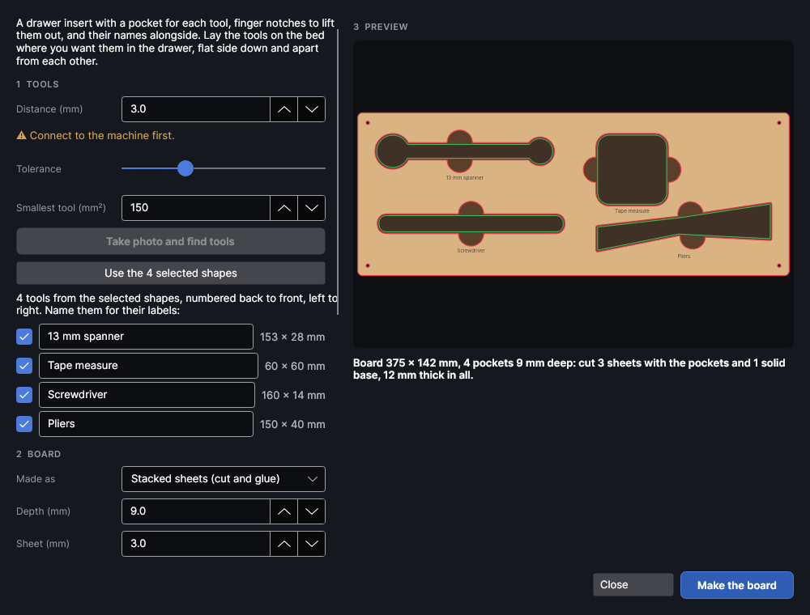

# Shadow boards

<!-- windows: ShadowBoardWindow -->

A shadow board is a drawer insert (or a wall board) with a pocket shaped like each tool, so every
tool has its place and a missing one shows at a glance. Lay the tools on the bed, the camera outlines
them, and PhotonCanvas makes the board: a pocket for each tool with room round it, finger notches to
lift the tools out, and each tool's name engraved by its pocket.

The shadow board maker is an add-on: turn it off in **Settings → Add-ons** if you don't use it.

## Before you start

- The camera must be calibrated (**Camera** tab → **Calibrate**) near the height the tools lie at.
- Lay the tools where you want them in the drawer, flat side down, at least a finger's width apart.
  The board is built round them where they lie, so the layout on the bed is the layout in the drawer.
- A plain, even background helps: lay the tools on a sheet of card or MDF the opposite shade to them.
  Shiny tools reflect the lights; a matt sheet under them and the lid's lights on work best.
- The camera sees the tools from above, so tall tools come out a little bigger than they are. The
  **Gap** covers that.

## Find the tools

Open **Shadow board**. Enter the **Distance (mm)** from the laser to the surface the tools lie on
(the machine's last focus distance is filled in), then click **Take photo and find tools**. Only the
camera is used: the head doesn't move and the laser stays off.

Each tool found is listed with its size. Type its name: that's the label engraved by its pocket
(leave it empty for no label). Untick anything that isn't a tool, such as a shadow or a scrap.

- **Tolerance**: how different from the background a colour must be to count as a tool. Raise it if
  the honeycomb or a pattern shows up as tools; lower it if pale or shiny tools are missed.
- **Smallest tool (mm²)**: crumbs and reflections smaller than this are ignored.

Holes in a tool (a spanner's ring, scissor handles) are filled in, so no loose bits are left in the
cut sheets.

Already have the outlines (traced from a photo or a scan, or drawn)? Select them before opening the
window, or click **Use the selected shapes**: each shape's name becomes its label.

## The board

**Made as** chooses how it's built:

| Choice | What you get |
|---|---|
| **Stacked sheets (cut and glue)** | Sheets of plywood, MDF or acrylic: the top sheets have the tools cut right through, the base sheet is solid. Glue them in a stack. Fast to make, and the pockets have straight walls and a flat floor. |
| **One board, pockets engraved** | The pockets are engraved down into one thick board, a pass at a time. Slow for deep pockets, but one piece with no glue. Uses the **Depth a pass (mm)** from an etch-rate test of the board. |

| Setting | What it does |
|---|---|
| **Depth (mm)** | How deep the tools sit. About two thirds of the thickest tool holds them without hiding them. With sheets it's rounded up to whole sheets. |
| **Sheet (mm)** | The thickness of one sheet (stacked sheets). |
| **Depth a pass (mm)** | How deep one engrave pass goes (one board). The passes come from the depth; the angle turns each pass so the floor comes out flat. |
| **Gap (mm)** | Room round each tool, each side, so it drops in and lifts out. 1–2 mm suits a camera outline. |
| **Finger notches** | A round notch on each side of the tool, across its middle, or one at the front, or none. **Notch size (mm)** is its diameter: 20–25 mm fits a finger and thumb. |
| **Margin (mm)** | Solid board round the tools. |
| **Board width (mm)**, **Board depth (mm)** | A fixed size, such as the inside of the drawer, centred on the tools. 0 = just big enough. |
| **Corners (mm)** | The board's corner radius. |
| **Engrave each tool's name** | Labels by each pocket: under it if there's room, else above or beside it. **Label size (mm)** is the letters' height. |
| **Engrave the tools' shadows on the base sheet** | Each tool's outline filled in on the base: you see at once which tool is missing. |
| **Dowel holes (mm)** | Holes in the four corners of every sheet. Push dowels or cocktail sticks through them to line the stack up while the glue sets. 0 = none. |
| **Cut the board's outline** | Untick when the pockets go into a board that's already the right size. |
| **Cut with**, **Engrave with** | Settings from your [material library](material-library.md). |

The preview shows the board to scale: the wood, the pockets, the tools' outlines (green) and the
labels. Warnings say when pockets run into each other, a label has no clear spot, the board is
smaller than the tools need, or it doesn't fit the work area.

## Make it

**Make the board** puts the board on new pages after the one you're on, all in the same place on the
bed. It's one step to undo.

- Stacked sheets: **Shadow board · top** (the pockets cut through, and the labels), **Shadow board ·
  middle (cut N)** when there's more than one sheet with pockets (cut that page N times), and
  **Shadow board · base** (solid, with the shadows).
- One board: **Shadow board** (the pockets engraved, the labels, and the outline cut last).

Take the tools off the bed first. Put a sheet down, switch to its page and run it; then the next.
Glue the stack with the base at the bottom and the top sheet (with the labels) on top.

> **Tip:** Make a test pocket for your trickiest tool first. If it's tight, raise the **Gap**; if it
> rattles, lower it.
