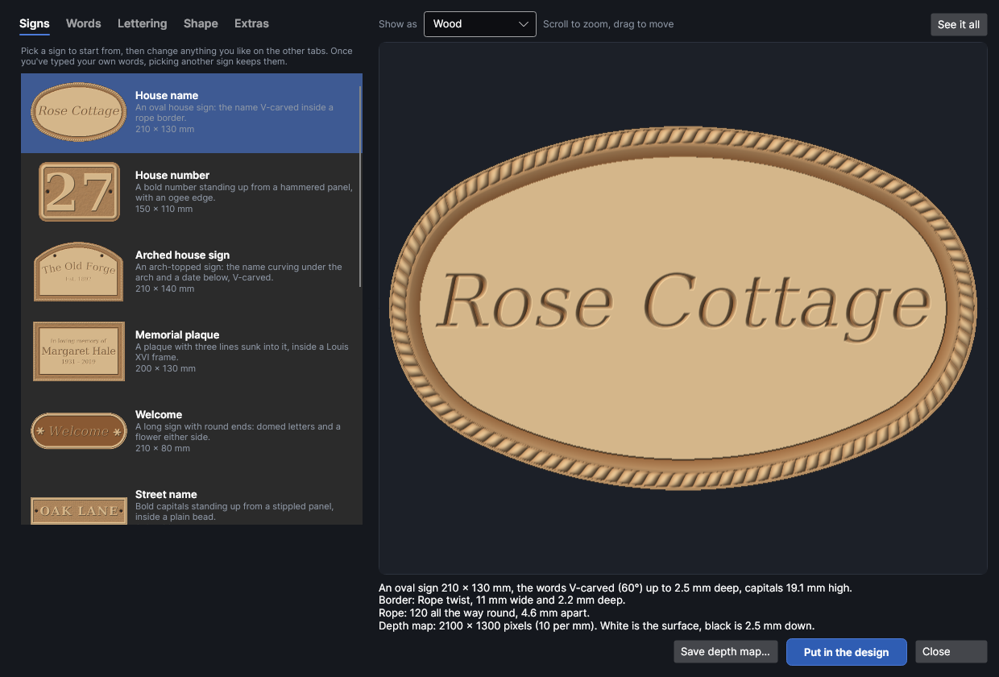
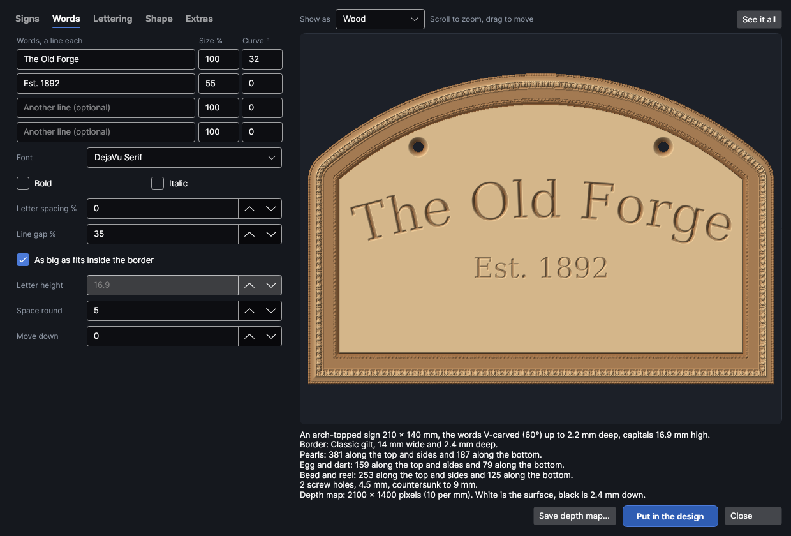
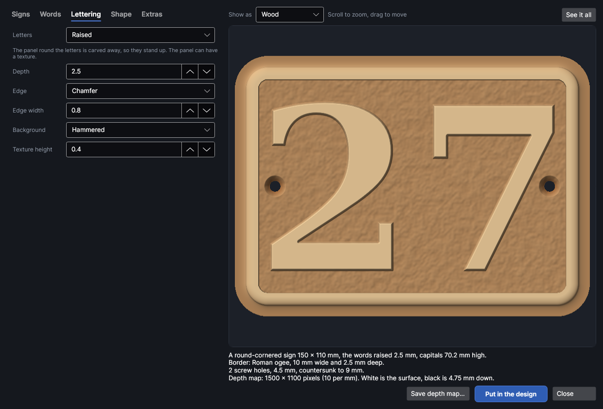
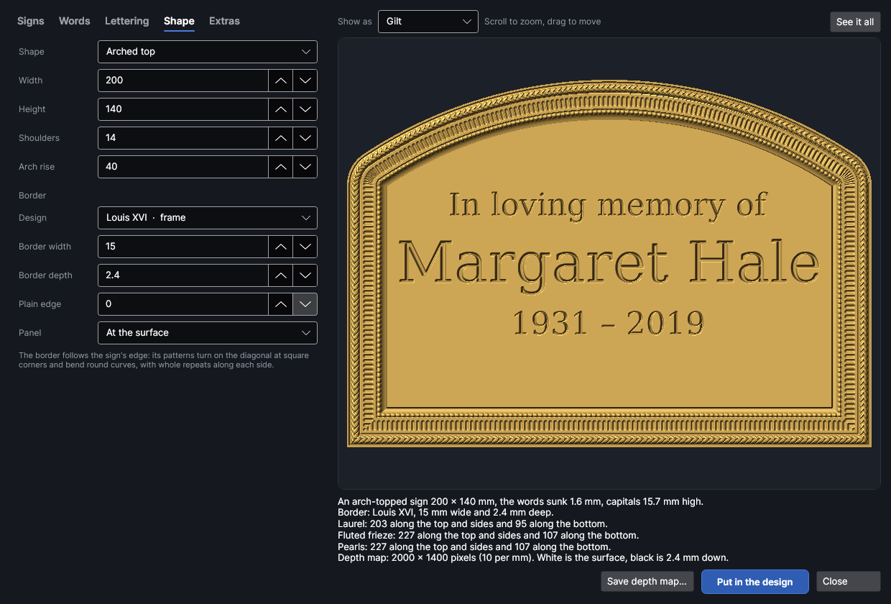
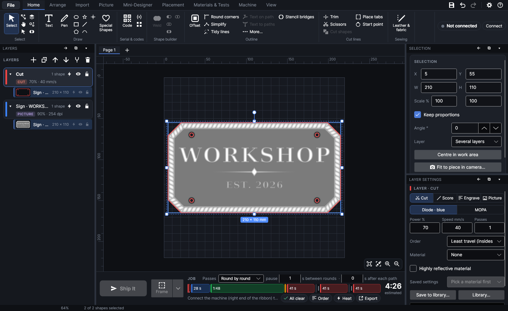

# Signs

An add-on (Settings → Add-ons → **Carved sign maker**): on when PhotonCanvas is installed, and can be turned off. It needs the **Border and moulding maker**, which draws its borders. Its button is **Import → Generate → Signs**, and **Edit sign…** is on the right-click menu of a sign it made.

**Signs** makes carved signs: house names and numbers, name plaques, memorial plaques, door, gate
and workshop signs. Pick one of the ready-made signs, type your words, and choose how they're
carved: **V-carved** like a V bit leaves them, **sunk** with a flat floor, or **raised** with the
panel round them carved away (plain, **domed** or **chiselled**). The sign can be a rectangle, have
rounded or cut corners, be an oval, a circle, arch-topped or round-ended, and have any border from
the [border maker](borders.md) carved round its edge, following it round curves and mitring at
square corners. Screw holes, countersunk if you like, and small motifs either side of the words
can be added. Then it goes in the design as a depth map (a greyscale picture, white the surface and
black the deepest) on its own Picture layer set to **Depth slices (relief)**, with cut lines round
the sign and its holes.

> **Note:** The signs have been checked on screen and in tests, but carving them as depth slices
> hasn't been tried on the machine yet. Carve a small sign on scrap first and measure how deep it
> goes.

## The Sign maker window
<!-- windows: SignsWindow -->

Click **Signs** on the **Import** tab (in the **Generate** group). The **Sign maker** opens over
the program.

- **Left:** five tabs. **Signs** picks a ready-made sign to start from, **Words** is what it says
  and how big, **Lettering** how the words are carved, **Shape** the sign's outline and its border,
  and **Extras** the motifs, screw holes and the depth map's detail.
- **Right:** the sign as it will carve. Under it, a summary: its size, how the words are carved and
  how high their capitals came out, the border and how many repeats of its pattern fit along each
  side, the holes, and the depth map's size in pixels. Warnings are in orange (bigger than the
  work area, words that don't fit, a font that isn't on this computer, very small letters).
- **Save depth map…** saves the depth map as a PNG picture (see [Save the depth map](#save-the-depth-map)).
- **Put in the design** puts it in your design (see [Put it in the design](#put-it-in-the-design)).
  **Close** (or `Esc`) closes the window. The settings you last made a sign with are kept for
  next time.

### The preview

**Show as** shows the sign lit from the top left as **Wood** (darker the deeper it's burned, as on
wood), **Gilt**, **Metal**, or as the **Depth map** itself. Scroll the wheel to zoom in on what's
under the pointer, drag to move, and click **See it all** (or double-click the picture) to see the
whole sign again. Whatever is in view is drawn again at the screen's full detail.

## Signs

Click a sign in the list to start from it; the line under it says what it is.

| Sign | What it is |
|---|---|
| **House name** | An oval, the name V-carved inside a rope border. |
| **House number** | A bold number raised from a hammered panel, an ogee edge, a screw hole each side. |
| **Arched house sign** | An arch-topped sign, the name curving under the arch and a date below it. |
| **Memorial plaque** | Three lines sunk into a plaque inside a Louis XVI frame. |
| **Welcome** | A round-ended sign with domed letters and a flower either side. |
| **Street name** | Bold capitals raised from a stippled panel. |
| **Door plaque** | A small round-ended plaque with sunk, rounded-in letters. |
| **Pet name** | A round sign: the name arched over the top, a heart either side, a line curving underneath. |
| **Workshop** | Chiselled capitals on a cut-corner board, a rule under the name, a hole in each corner. |
| **Garden sign** | Raised letters over fine level lines, a leaf either side, under an arch. |
| **Gate sign** | Two V-carved lines on a rounded board, a star either side. |
| **Plain plaque** | Just the words V-carved, no border. |

All of them fit a 220 mm bed. Picking a sign sets everything on the other tabs; once you've typed
your own words, picking another sign keeps them.

## Words

Type up to four lines, one in each box; an empty box is skipped. Beside each line:

- **Size %**: its letters' size against a line at 100%: 50 makes a line of capitals half as high.
- **Curve °**: bends the line round a circle, by how many degrees of the circle it spans. Above 0
  it arches up (for the top of an oval or an arch), below 0 it curves down like a smile (for the
  bottom of a round sign). 0 is straight.

| Setting | What it does |
|---|---|
| **Font** | Any font on this computer. Serif fonts such as Georgia or Times New Roman carve well; very thin fonts don't. If a sign asks for a font that isn't here, the nearest serif font that is here is used and a warning says so. |
| **Bold**, **Italic** | Bold and italic letters. Bold suits raised and V-carved letters, which need some width. |
| **Letter spacing %** | Extra space between letters, as a share of the capitals' height. Lines of capitals look better spaced out a little (10–15%). |
| **Line gap %** | Space between lines, as a share of the capitals' height. |
| **As big as fits inside the border** | Makes the words as big as they can be inside the border, keeping **Space round** clear. Untick it to set the size yourself. |
| **Letter height** | The capitals' height on a 100% line (mm). While the words are made as big as fits, it shows the height they came out. |
| **Space round** | Space kept clear between the words and the border, the sign's edge and the screw holes (mm). |
| **Move down** | Moves the words down (or up, below 0) from the middle of the sign (mm). |

## Lettering

**Letters** picks how the words are carved:

- **V-carved**: a V-shaped groove down each stroke, deepest in the middle, as a V bit carves it.
  The groove is as deep as the stroke's width allows at the **V angle**; wide strokes get a flat
  bottom at **Depth**. Crisp and traditional, and it hides small wobbles well.
- **Sunk (flat bottom)**: each letter carved down to a flat floor **Depth** mm deep.
- **Raised**: the panel round the letters is carved away **Depth** mm, so the letters stand up.
- **Domed (raised and rounded)**: raised letters rounded over like cushions.
- **Chiselled (raised with a ridge)**: raised letters with a ridge down the middle of each stroke,
  a V carving turned inside out.

| Setting | What it does |
|---|---|
| **Depth** | How deep the letters are carved, or how far raised letters stand up (mm). |
| **V angle** | V-carved and chiselled letters: the angle across the V (degrees). 60° is a usual V bit; a narrower angle carves deeper for the same width. |
| **Edge** | Sunk and raised letters: **Square** (straight walls), **Chamfer** (a bevel) or **Rounded** (rounded over). |
| **Edge width** | How wide the bevel or rounding is, in from the letter's outline (mm). For domed letters it's called **Rounding**: half the strokes' width or more rounds them fully. |
| **Background** | Round raised, domed and chiselled letters: the carved-away panel is **Smooth**, **Hammered** (soft dents), **Stippled** (little punched pits) or **Lines** (fine level grooves). |
| **Texture height** | How much the texture stands up from the panel (mm). |

## Shape

| Setting | What it does |
|---|---|
| **Shape** | **Rectangle**, **Rounded corners**, **Cut corners**, **Oval**, **Circle**, **Arched top** (straight sides and bottom, an arch over the top with rounded shoulders) or **Round ends** (half-round ends). |
| **Width**, **Height** | The sign's size (mm). A circle has a **Diameter** instead. An oval is drawn as a sign maker sets one out: four arcs meeting smoothly. |
| **Corner radius** / **Corner cut** / **Shoulders** | How round the corners are, how much is cut off each corner, or the radius of an arch's shoulders (mm). |
| **Arch rise** | Arched top: how far the top of the arch rises above where the straight sides start (mm). Half the width makes a round arch. |
| **Design** | The border round the edge: **No border**, or any design from the [border maker](borders.md): picture frames, cabinet and furniture edges, and every ornament on its own band. Edges suit the outside of a sign best, as they're made to sit on a board's edge. |
| **Border width** | How wide the border is across (mm). Picking a design sets it to the design's own width. |
| **Border depth** | How deep the border's deepest part is carved (mm). |
| **Plain edge** | A flat strip left between the sign's edge and the border (mm). 0 runs the border right to the edge. |
| **Panel** | Where the panel inside the border sits: **At the surface** of the board, or **Level with the border's inner edge** (sunk below the surface when the border falls toward the middle, like a door's panel). The words are carved into the panel. |

The border follows the sign's edge: its bands keep their width all the way round, its patterns
bend round curves and turn on the diagonal at square corners, and each side gets a whole number of
repeats with one in the middle, so nothing stops half way through a motif.

## Extras

| Setting | What it does |
|---|---|
| **Motif** | A small motif either side of the first line, carved the same way as the letters: **Star**, **Heart**, **Diamond**, **Leaf**, **Flower** or **Dot**. It sits level with the ends of the line, even an arched one. |
| **A rule under the first line** | A carved line with a diamond in its middle, between the first and second lines. |
| **Screw holes** | **None**, **One each side** (half way up), **Both top corners**, **All four corners** or **One at the top, to hang it**. They go inside the border, and the words keep clear of them. |
| **Hole size** | The holes' diameter (mm). 4.5 suits a No. 8 (4 mm) screw. |
| **Countersink them** | Carves a 90° cone round each hole, twice the hole's size, so a countersunk screw head sits flush. Round raised letters it starts from the carved-away panel. |
| **Pixels per mm** | The depth map's detail, 1–40 (10 to start, which is 254 dpi). A picture is kept within 6000 pixels a side and 30 million pixels in all: if it would be bigger, it's made at fewer pixels per mm and the summary says so. |
| **Soften (mm)** | Blurs the heights a little, rounding sharp walls off: kinder to wood. 0 = crisp. |
| **A cut line round the sign** | Puts a cut line round the sign on the design's **Cut** layer (a new one if there isn't one), to cut it out after carving. The screw holes are always cut. |

The depth map is a greyscale picture: white is the surface and black is the deepest. Outside the
sign and in the screw holes it's see-through, so nothing is burned there.

## Put it in the design

**Put in the design** makes the depth map and puts it in your design on a new Picture layer called
**Sign ·** and the words, in **Depth slices (relief)** mode, and makes that layer active. It goes in
the middle of the work area if it fits, otherwise at its top left corner. The cut lines go on the
Cut layer, grouped with the picture.

Then set the layer's **Slices**, power, speed and passes so it carves to the depth you made it (see
[Depth slices](layer-settings.md#depth-slices)), and try it on scrap first. Carve before you cut
it out, so the board stays where it was.

To change a sign later, right-click it and click **Edit sign…**: the Sign maker opens with its
settings, and the button reads **Update in the design**, which puts the new one where the old one
was, on the same layer.

## Save the depth map

**Save depth map…** saves the depth map as a PNG picture, named after the words, to carve in
another program or keep.

## Tutorials

- [Carve a house sign](tutorial:carve-house-sign)
