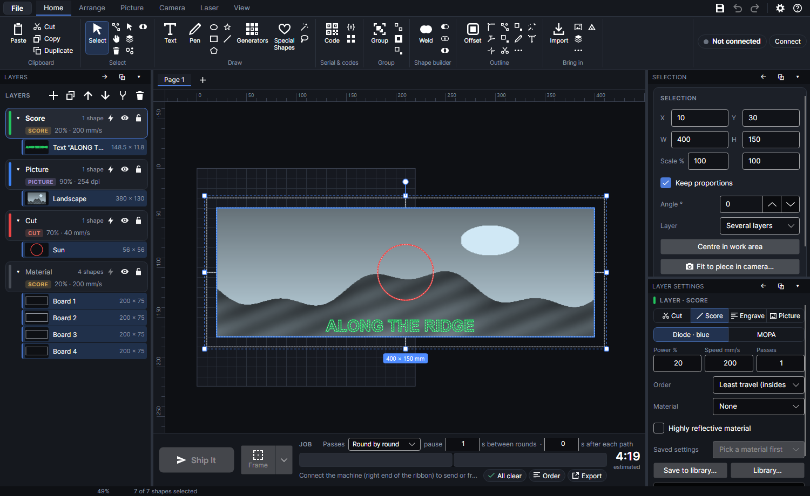
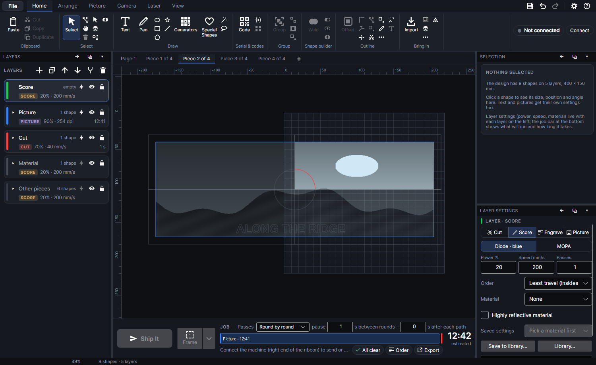
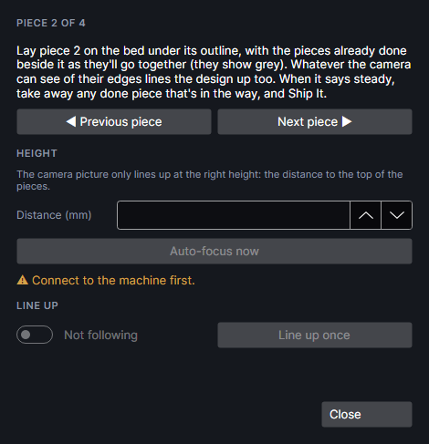

# Split onto pieces

This add-on marks one design across several separate pieces that go together afterwards. It adds **Split onto pieces** to the Laser tab's **Work area** group and the right-click menu, and **Line up pieces** to the Camera tab's **Place** group.

## Split onto pieces

**Split onto pieces** marks one design across several separate pieces that go together afterwards:
a 400 × 150 mm picture on four 200 × 75 mm boards, a sign across two planks. Each piece gets a page
of its own with its share of the design, moved into the work area. You mark the pieces one at a time,
and the camera lines each one up with the pieces done before it (see
[Lining the pieces up](#lining-the-pieces-up)).

It's the way to go when the pieces are separate. For one piece of material bigger than the bed,
slid along against a fence, use [Sections](work-area.md#sections).

### Setting it up

1. Draw each piece the size it really is: a 200 × 75 mm rectangle for a 200 × 75 mm board (or pick
   it from the camera with **Pick piece**). Right-click it → **Use as material outline**.
2. Lay the outlines out as the pieces will go together, edge to edge. It's fine for them to run off
   the bed.
3. Put the design over them where you want it, on the layers you'll mark with.
4. Select the design and the pieces (a box round everything does it), then click **Split onto
   pieces** in the **Work area** group of the **Laser** tab, or right-click → **Split onto
   pieces…**. With no piece selected, the outlines whose box overlaps the design's box are used.

### What it makes

A page for each piece, after the page you split from (which is left as it was): **Piece 1 of 4**,
**Piece 2 of 4** and so on, numbered row by row from the top left. On each page:

- **The piece** is the page's material outline (on the **Material** layer, never sent), named
  "Piece 1" and so on.
- **Its share of the design**, on your own layers, which is all that's sent. A shape wholly on the
  piece is copied as it is (text stays editable). One that runs across the edge is cut there:
  - On an **Engrave** layer, the part of its area on the piece.
  - On a **Cut** or **Score** layer, the stretch of its line on the piece (an open line, so a circle
    across the corner of four boards becomes four arcs).
  - A picture gets the piece as its image mask, and only that part is
    engraved; the rest may hang outside the work area.
- **Everything else**, greyed on a layer called **Other pieces** that's never sent: the other
  pieces' outlines and the whole design, so you can see how this piece fits with the rest. It can
  run off the bed.
- **The page is moved** as little as it takes to bring the piece into the work area, 5 mm in from
  the edge (so the camera still sees the piece's far edge when it lies a little off). A piece
  already at least 5 mm inside isn't moved; one closer to the edge than that is. A piece too big to
  sit 5 mm in from both edges is centred, and if it's bigger than the work area a note says only
  its middle can be marked.

Each page is a job of its own: show it, line it up and **Ship It**. The page you split from still
holds the whole design, but its job can't be built while the design runs off the bed.

### Lining the pieces up
<!-- windows: LineUpWindow -->

**Line up pieces** (Camera tab, **Place** group) opens **Line up the pieces**, which also opens
by itself after a split. While it's following, the camera looks every second or two, finds the
page's piece and moves the whole page onto it, so the design lands exactly on the piece. The parts
of the other pieces that the camera sees in the work area count too: lay the pieces you've already
done beside this one, as they'll go together, and the design lines up with them. You don't click
anything while you place the pieces.

- **Previous piece** and **Next piece** show the next piece's page.
- **Distance (mm)** is the distance from the laser to the top of the pieces, as for **Fit to piece**
  ([Camera](camera.md)). **Auto-focus now** measures it. The camera must be calibrated at that height.
- **Following the pieces** (a switch, on when the window opens and the camera is ready) keeps
  looking. **Line up once** looks once.
- The line under them says what it found: "Moved onto the pieces (86% of the edges found, about 0.21
  mm off)", then "✓ Lined up and steady" once two looks in a row agree. Once steady it holds still
  and only follows a move of more than 0.4 mm (a piece bumped), so taking a finished piece away
  doesn't shift it.
- It waits while the machine is busy (a job running, framing) and never moves the design then.
  Nothing is sent from this window.

For each piece:

1. Show its page (**Next piece**).
2. Lay it on the bed under its outline. For the pieces after the first, lay the ones already done
   beside it where they'll go: the greyed outlines show where.
3. Wait for "✓ Lined up and steady". If it says it can't see the piece, check it lies under its
   outline, isn't covered, and is lit.
4. Take away any finished piece that's in the laser's way, **Ship It** and press the machine's
   button.

The camera only sees the work area well (it's calibrated there), so only the parts of the other
pieces inside it help. How closely the pieces meet depends on the camera's calibration (its
"typically … mm off"): this hasn't been measured on the machine yet. Try two scrap pieces first.

## Tutorials

- [One design across several pieces](tutorial:area-pieces)
