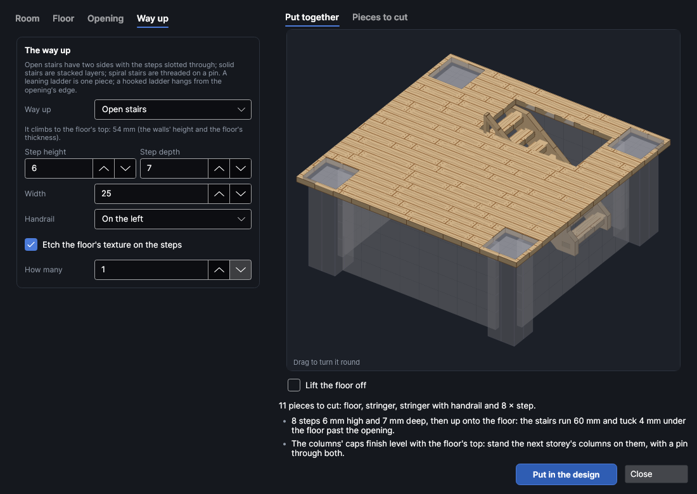
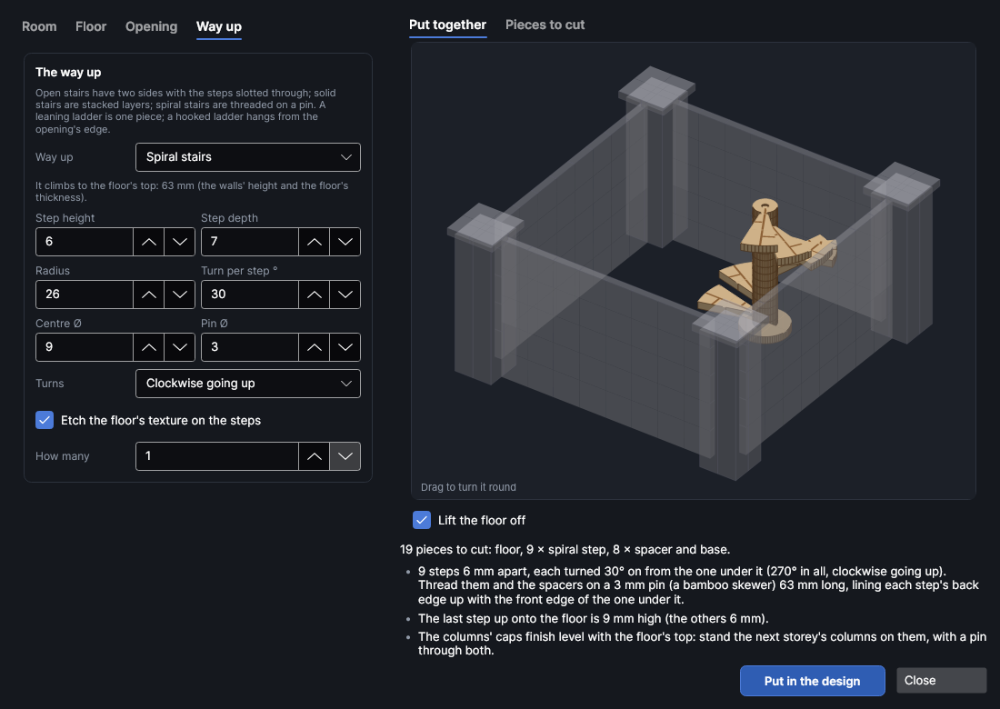
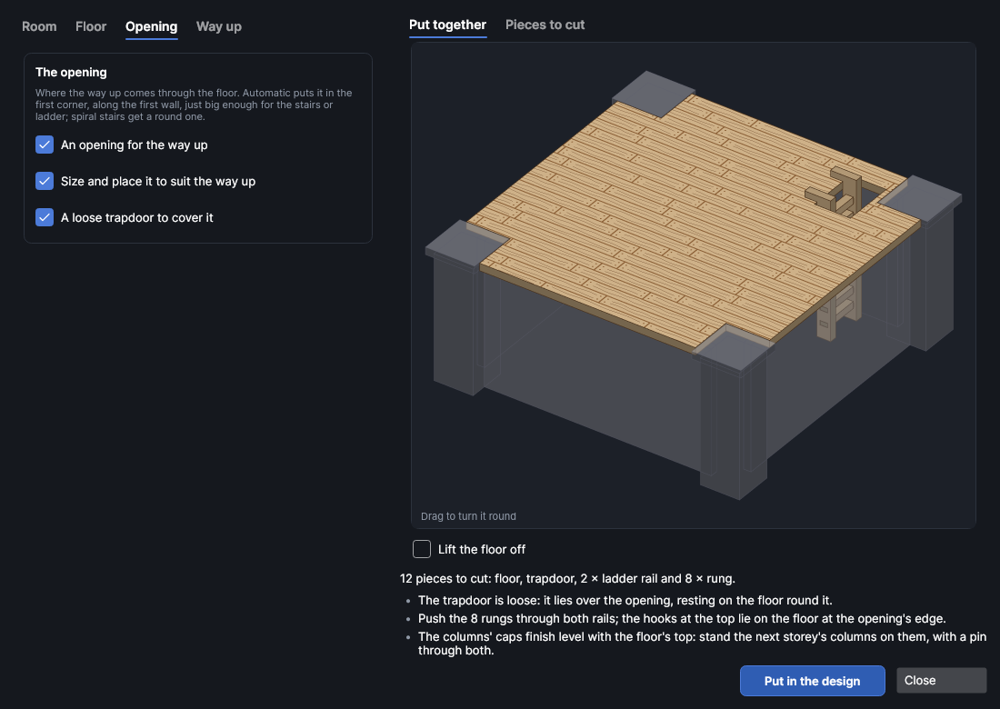

# Floors and stairs

An add-on (Settings → Add-ons → **Stairs, ladders and floors**): on when PhotonCanvas is installed, and can be turned off. It works with the [Textured walls](walls.md) add-on and needs it on. Its button is **Mini-Designer → Buildings → Stairs & floors**, and **Edit floor and stairs…** is on the right-click menu of the pieces it made.

**Stairs & floors** makes an upper floor for a room built with the wall maker, and the way up to
it, for tabletop games and model buildings. The floor is a plate that rests on the walls' tops:
the wall maker's columns poke up through holes in it, so it can't slide about, and the next
storey's walls stand on it. An opening in the floor lets the way up through: open stairs, solid
stairs, spiral stairs, a leaning ladder or a ladder that hooks over the opening's edge. Each is
sized to climb exactly to the floor's top. You can also make stairs or a ladder on their own, to
reach a wall's top or a walkway.

> **Note:** The floors and stairs have been checked on screen and in tests (every piece is put
> together in 3D and checked for clashes), but not yet cut on the machine. Cut one stair side and
> one step first and check how the step's tab fits its slot; change **Slot fit** if it's too
> tight or too loose.

## The Floors and stairs window
<!-- windows: StairsWindow -->

Click **Stairs & floors** on the **Mini-Designer** tab (in the **Buildings** group). The **Floors and stairs**
window opens. If there are walls from the wall maker in the design, the window starts with the
floor made to fit them. The settings are on the left in tabs. On the right, **Put together** shows
the floor and the way up in the room, with the walls and columns faint around them: drag it to
turn it round, scroll to zoom in on a part, middle-drag or the arrow keys to move it, press **F** to see
it all again, and tick **Lift the floor off** to see under the floor. **Pieces to cut** shows one
of each piece, with how many there are. Under the picture are the number of pieces and any
problems: a red ✕ has to be fixed before the pieces can go in, a yellow ! is worth a look, and a
grey • is just for your information.

Press **Put in the design** and the pieces go on a page of their own, nested onto the bed (more pages
if they need more than one bed). To change them later, select any of the pieces, right-click and
choose **Edit floor and stairs…**, change the settings and press **Update in the design**: the old
pieces are replaced wherever they are.

## The room

The **Room** tab describes the walls the floor sits on. **Match the walls in the design** fills it
in from the wall maker's settings: the walls you selected, or the first walls in the design. Or type
them in:

| Setting | Default | What it does |
|---|---|---|
| **Wall height** | 50 mm | How high the walls are. The floor rests on their tops. |
| **Wall sheet** | 3 mm | The sheet the walls are cut from. With **The walls are two panels back to back** the walls are twice as thick. |
| **Wall length**, **Walls along** | 108.5 mm, 1 | One wall along the room, from the centre of the column at one end to the centre of the one at the other, and how many walls end to end. |
| **Wall width**, **Walls across** | 108.5 mm, 1 | The same for the walls across the room. |
| **The walls are joined by columns** | on | The floor gets a hole for every column: one in each corner and one at each joint between walls along the sides. |
| **Column width**, **Column shape** | 16 mm, Auto | As in the wall maker (Auto makes square columns for a square room). |
| **The columns have caps** | on | The holes are made big enough for the caps. |
| **Thickness** | 3 mm | The sheet the floor and the way up are cut from. |
| **Slot fit** | 0.15 mm | Added to slots so tabs slide in, and round the columns in their holes. |
| **Cut with**, **Etch with** | | Settings from your material library: their kerf goes on the cut layer, and the material's thickness and slot fit from your cut test are filled in. |

With the 100 mm walls the wall maker starts with, the columns' centres are 108.5 mm apart.

### Where the columns finish

The wall maker stacks its columns from whole layers of the sheet, so they can stand a little above
the walls. The list under the picture says where the columns' tops end up against the floor's top.
With caps on the columns and walls a whole number of sheets high (51 mm walls of 3 mm sheet, say),
the caps finish level with the floor: the next storey's columns stand on them, with a pin through
both.

## Themes

**Theme**, at the top of the **Floor** tab, is a look to start from, the same as the wall maker's: it
sets the floor's texture and the way up to match walls made in that theme. A way up of *None* is left
as it is. Change anything afterwards.

| Theme | Floor | Way up |
|---|---|---|
| Medieval | Wood planks | Open stairs |
| Dungeon | Dungeon blocks | Solid stairs |
| Cave | Cave rock | Solid stairs |
| Sci-fi | Sci-fi panels | A ladder |
| Desert | Sandstone | Solid stairs |
| Gothic | Tiles | Spiral stairs |

## The floor

| Setting | What it does |
|---|---|
| **Make a floor** | Untick it to make only the way up (see [On its own](#on-its-own)). |
| **Edge** | *Over the columns* reaches 2 mm past the columns, covering them. *Flush with the walls* stops at the walls' outsides, with notches round the columns. *Overhanging the walls* reaches **Overhang** mm past the walls' outsides: a jettied upper storey, or a ledge to stand figures on. |
| **How many** | How many floors like this to cut: one for each storey. |
| **Pieces along**, **Pieces across** | Cuts the floor in pieces joined with dovetails, for a floor bigger than the bed. A floor of two 100 mm walls each way is about 240 mm across, too big for a 220 mm bed: cut it in 2 × 2. The dovetails keep clear of the holes; where one can't fit, the list says so. |

The floor's texture is etched on its top. It uses the wall maker's textures (and your own textures
from the wall maker): **Wood planks (across)** makes floorboards, **Stone blocks** or **Tiles** make
flagstones. **Groove**, **Variation** and **Etch as** work as in the wall maker. **Turn the texture a
quarter turn** runs the planks across the room instead of along it.

## The opening

**An opening for the way up** cuts a hole in the floor. With **Size and place it to suit the way up**
ticked, it's just big enough for the stairs or ladder, in the first corner (beside the first column),
along the first wall; spiral stairs get a round opening. Untick it to place it yourself: **From the
corner** and **From the side** are its near corner, measured from the first corner column's centre,
and **Length** and **Width** its size (for a round one, **Length** is its diameter).

**A loose trapdoor to cover it** cuts a lid 2.5 mm bigger all round, planked like the floor, that
lies over the opening.

If the opening runs into a column's hole, or cuts the floor in two, it's refused with a red ✕.

## The way up

Open, solid and spiral stairs share the climb out in equal steps of about **Step height**, and each
step is **Step depth** deep. Solid and spiral stairs are stacked from the sheet, so their steps are a
whole number of layers; if the climb doesn't divide evenly, the last step up onto the floor is a
little higher or lower, and the list says so.

| Way up | How it's made |
|---|---|
| **Open stairs** | Two side pieces (stringers) with a slot for each step. Each step is a board with a tab at each end that pushes through the slots; shoulders on the tabs keep the sides apart. The top of the sides tucks 4 mm under the floor past the opening. **Handrail** adds posts and a rail to one side or both (left and right as you go up), cut as part of the side piece. **Width** is between the sides: 25 mm takes a figure on a 25 mm base. |
| **Solid stairs (stacked layers)** | A stack of layers, each one step shorter than the one under it, glued together. Two pin holes (for cocktail sticks) through the top step line the stack up; the top layer has none, so they don't show. The lower layers reach under the floor past the opening. |
| **Spiral stairs** | Wedge-shaped steps round a round middle, with round spacers between them, threaded on a pin (**Pin Ø**: a bamboo skewer is about 3 mm) that stands on a wider base. Each step is turned **Turn per step °** on from the one under it: line each step's back edge up with the front edge of the one below. **Radius** is the length of the steps; **Centre Ø** the size of the middle and spacers. The list warns when a figure wouldn't fit under the step a full turn above. |
| **Leaning ladder** | One piece: two rails and the rungs between them, **Rung spacing** apart (measured straight up). It leans at **Lean °** with its underside on the opening's far edge, and the rails go 6 mm past the floor for figures to hold. |
| **Hooked ladder** | Stands straight up against the opening's far edge. The two rails are cut side-on, with a hook at the top that lies on the floor; the rungs push through slots in the rails, with shoulders that stop them sliding sideways. |

**Etch the floor's texture on the steps** puts the floor's planks or stones on each step.
**How many** cuts more than one.

### On its own

With **Make a floor** unticked, the way up is made on its own, to climb **Climb** mm: to a wall's top,
a walkway behind battlements or a ledge. A hooked ladder then hooks over a wall's top (as thick as the
walls on the **Room** tab).

With a floor but no opening, the way up stands outside the room and reaches the floor's edge.

## Layers and order

The pieces go on three layers, run in this order: **Floors · lines** (light scoring) and **Floors ·
etch** (the texture, a Fill layer) first, while the sheet is whole, then **Floors · cut**. Set the
etch layer's power and speed for the depth you want.

## Try it

- [Make an upper floor with stairs](tutorial:make-floor-and-stairs)
