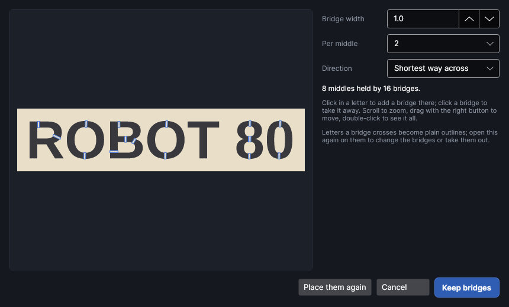

# Stencil bridges

An add-on (Settings → Add-ons → **Stencil bridges**): on when PhotonCanvas is installed, and can be
turned off. Its button is **Home → Outline → Stencil bridges**; **Stencil bridges…** and **Take
stencil bridges out** are on the right-click menu.

## Stencil bridges

<!-- windows: StencilWindow -->

Cut letters out of a sheet to make a stencil and the middle of every O, A, R, B, D, P, Q, 4, 6, 8,
9 and 0 falls out with the letter: the cut goes all the way round it. **Stencil bridges** finds
every such middle and keeps short strips of the sheet (bridges) across the letter, so the middle
stays joined to the rest of the stencil.

Select the letters (a text, or any shapes with holes, on a Cut layer) and click **Stencil
bridges**. The window shows the stencil as it will come out: the sheet light, the letters (what
falls out) dark, the bridges edged in colour. The design on the work area changes with it.
**Keep bridges** keeps them; **Cancel** puts the letters back.

| Setting | What it does |
|---|---|
| **Bridge width** | How wide each bridge is, mm (0.2–10, default 1). Wider is stronger but shows more. About 1 mm suits card and thin plastic; 1.5–2 mm suits 3 mm wood. |
| **Add the beam width** | Shown when the letters' Cut layer has a beam width (kerf): the beam burns away about that much of each bridge, so ticked, the bridges are drawn that much wider and come out at the width typed. On by default. |
| **Per middle** | How many bridges hold each middle (1–4, default 2). One holds it; two hold it from both sides, spread round it, so it can't twist or flap. A middle too small for two bridges well apart gets one. |
| **Direction** | **Shortest way across**: straight across the letter where it's thinnest (default). **Up and down**: vertical, like classic stencil lettering. **Across**: left–right. **At an angle**: the **Angle** typed (0 = left–right, positive turns clockwise). |
| **The outline round everything is the stencil's edge** | Shown when one of the selected shapes is a single outline round all the others (the stencil's own edge). Ticked, the stencil is what's inside it; unticked, it's treated as a letter like the rest. |

How the bridges are placed:

- Each middle is joined to the sheet the shortest way it can be, across one letter. A middle inside
  another middle (a ring inside an O, a letter inside a frame) is joined to that middle, which is
  joined to the sheet.
- A bridge only goes where it crosses the letter cleanly: not at a corner or the very end of a
  stroke. It reaches a little way into the sheet at both ends so nothing thin is left at the joins.
- Letters no bridge crosses are left as they are.

### Changing them by hand

- **Click in a letter** (the dark part) to add a bridge there, straight across the letter (the
  shortest way, or the direction chosen).
- **Click a bridge** to take it away. Pointing at a bridge shows how long it is.
- **Place them again** forgets the bridges added or taken away by hand.
- Scroll to zoom, drag with the right button to move, double-click to see it all.
- Changing a setting places the bridges again but keeps your clicks: bridges you added are made
  again at the new width, and ones you took away stay away.

### What the window warns about

- **Middles in red** would still fall out: no bridge reaches them (a click across their letter adds
  one).
- **Bridges in orange** are more than 8 times as long as they are wide and may bend or snap: make
  them wider.
- **Slivers** where overlapping outlines cross (joined script letters) fall out too. Weld
  overlapping letters first ([Editing shapes](editing-shapes.md)).
- Letters on a Fill, Score or Image layer: a stencil is cut out, so put them on a Cut layer.

### After keeping them

- Each letter a bridge crosses becomes a plain outline, on its own layer and in its group. A middle
  drawn as a shape of its own (the inside of an O drawn as a separate circle) becomes one shape with
  its letter, so the cut goes round the bridge.
- The letters remember what they were. Select them and open **Stencil bridges** again to change the
  bridges (it starts from the ones they have), or click **Take the bridges out** there, or choose
  **Take stencil bridges out** on the right-click menu: a text comes back as a text, where it now
  is, even after it was moved or turned.
- The width and other settings are remembered for next time.

## Tutorials

- [Stencil bridges](tutorial:stencil-bridges)
