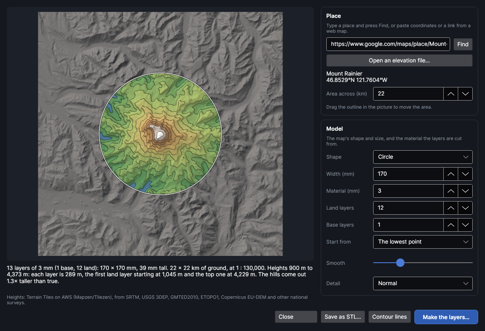
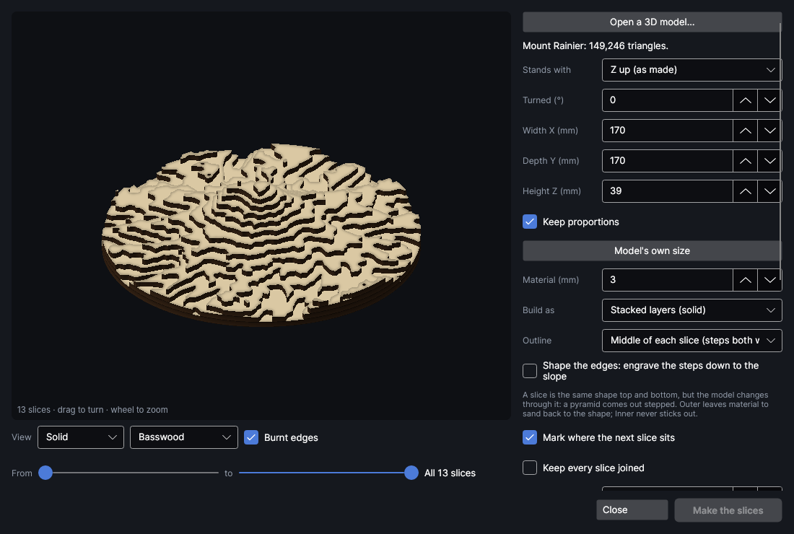

# Topo map stacks
<!-- windows: TopoWindow -->

An add-on (Settings → Add-ons → **Topo map stacks**): on when PhotonCanvas is installed, and can be turned off. Its button is **Import → 3D & maps → Topo map**. It needs **3D to slices**, which does the slicing: turning that off turns this off too.

**Topo map** makes a layered relief map of any place on Earth: a mountain, a lake and the hills
round it, an island, your town. Find the place, choose how much ground the map covers, its shape
and size and how many layers of material, and the terrain is cut into stacked contour layers:
each one the land above a height, numbered, with the outline of the layer that sits on it marked
so the stack glues up in the right place. The heights come free from the internet, or from an
elevation file you've downloaded.

## Open the Topo map window

Click **Topo map** in the **3D & maps** group of the **Import** tab (or search the commands for
"Topo map"). The window has the ground on the left and the settings on the right.

## Find a place

Type into the box under **Place** and press **Find** (or `Enter`). It understands:

- **A name**: "Mount Rainier", "Lake Tahoe", "Isle of Skye", "Grand Canyon Village". It's looked up
  with OpenStreetMap; when there's more than one place of that name, a list appears under the box:
  pick the one you mean. Add the country or state when the first answer is the wrong one.
- **Coordinates**: `46.8523, -121.7603` (latitude first, as maps give them), or degrees, minutes and
  seconds such as `46°51′08″N 121°45′37″W`.
- **A link from a web map**: copy the address from Google Maps, OpenStreetMap, Apple Maps or Bing
  Maps while it shows the place. A Google Maps link to a named place gives the map its name too.

The area starts round the place: its own size with a margin when the search knows it (a lake,
a park, an island), else about as much as the web map showed, else 10 km. The heights for the area
and the ground round it are fetched (a few seconds), and the picture shows them.

## Or open an elevation file

**Open an elevation file…** reads heights you've downloaded, often finer than the free tiles:

| File | Where from |
|---|---|
| GeoTIFF (`.tif`) | The USGS National Map (3DEP, down to 1 m in much of the USA), Copernicus DEM, OpenTopography, national mapping agencies, or saved from QGIS. Uncompressed, LZW, Deflate or PackBits, whole or floating-point numbers. |
| SRTM (`.hgt`) | NASA Earthdata and its mirrors: one degree square, 30 or 90 m. The file's name (like `N46W122.hgt`) says where it is. |
| ESRI ASCII grid (`.asc`) | Many survey sites, and QGIS's Export. |
| Heightmap picture (`.png`) | A grey picture, white high (16 bits a pixel keeps the most detail), or coloured elevation tiles (Terrarium; Mapbox terrain-RGB when the name says terrain-rgb or mapbox). |

GeoTIFFs and ASCII grids say how big they are on the ground; SRTM files are worked out from their
name. A picture doesn't: set **Picture across (km)** to how wide the whole picture is on the ground.
**Heights in** says what the heights are measured in (a GeoTIFF in feet says so; others are taken
as metres): it only changes the heights shown and how much taller than true the hills come out. A
grey picture's heights are **Just levels**.

Files bigger than 2400 points a side are averaged down to that as they're read. JPEG-, LERC- and
ZSTD-compressed GeoTIFFs and BigTIFFs aren't read: save them again from QGIS (Export → Save As)
uncompressed, LZW or Deflate, cutting out the part you want.

## Choose the area

The white outline in the picture is the map. **Drag it** to move it, and turn the **mouse wheel**
over the picture to make the area bigger or smaller (or type **Area across (km)**: the ground the
map covers, west to east). With downloaded heights you can drag it anywhere: when you let go
outside the ground shown, or zoom a long way in or out, the heights round the new area are fetched.
With a file, the area stays on the file.

Inside the outline the picture shows the map as it will be stacked: each place in the colour of
its top layer, from green low down to white at the top, with a dark line where one layer ends and
the next begins. Blue-grey is the base showing through (the lowest ground, or the sea).

## The model

| Setting | Range (start) | What it does |
|---|---|---|
| **Shape** | Rectangle, Circle, Hexagon (Rectangle) | The map's outline. The area on the ground takes the same shape. |
| **Width (mm)** | 10 to 2000 (80% of the bed, at most 300) | Across, west to east. A circle's diameter; a hexagon's width from corner to corner (it's √3/2 as deep). |
| **Depth (mm)** | 10 to 2000 (as wide) | Front to back, south to north. Rectangles only. |
| **Material (mm)** | 0.3 to 30 (3) | The thickness of your sheets: one layer each. |
| **Land layers** | 1 to 120 (10) | Layers from the start height up to the highest point. More layers: taller hills, finer steps, more cutting. |
| **Base layers** | 0 to 10 (1) | Whole layers of the map's shape under everything, for it to stand on. |
| **Start from** | The lowest point, Sea level, A height I choose (The lowest point) | Where the first land layer starts. **Sea level** keeps the sea flat on the base and leaves the sea bed out; **A height I choose** (**Start height**) leaves everything below it on the base, for a lake's water or a valley floor. |
| **Smooth** | 0 to 4 (1) | Evens out the ground first: smoother layer edges and fewer tiny islands. 0 follows every gully. |
| **Detail** | Coarse, Normal, Fine (Normal) | How finely the ground is sampled across the map: about 180, 300 or 450 points along its longer side. Fine follows small valleys better; Coarse slices faster. |

The text under the settings says how tall the stack stands, the scale (1 : 120,000 means a
millimetre on the map is 120 m), each layer's height, where the first and the top land layer start,
and how much taller than true the hills come out. Real ground is flatter than most people picture
it: a map of hills often looks best 1.5 to 4 times taller than true. Past about 8 times it says
so: use fewer layers or a bigger area. A warning shows when the map is bigger than the bed.

## Make the layers

**Make the layers…** hands the terrain, as a solid, to **3D to slices** (its window opens over this
one, called Stacked slices and the place's name). It's set up for a map: your material's thickness,
and **Keep every slice joined** off, because a hill standing alone on a layer is a part of its own
that you glue where the layer below shows its outline. From there everything is as for any model:
numbering, marks for where the next layer sits, pin and dowel holes, cutting the pins from a dowel,
your cut test's kerf, the assembly booklet, and **Make the slices** to lay the parts out on the
work area. See [3D models and stacked slices](3d-slices.md#stacked-layers).

Things that suit maps there:

- **Outline**: the middle of each slice is the usual contour map. **Inner** keeps every layer inside
  the ground (nothing overhangs the real slope).
- **Shape the edges** engraves each layer's top down to the slope, so the steps become hillsides.
- **Pin holes** line separate hills up with the layer below.
- The **Cut from** list puts the parts on a board you've outlined in the camera picture.

Close the Stacked slices window to come back to the map and change it.

## Contour lines

**Contour lines** puts the map on this design flat instead, in the middle of the work area: a line
at each layer's height on a new Score layer (**Contours** and the place's name), and the map's
outline on a new Cut layer (**Outline** and the name). The lines stop at the map's edge. Engrave
them on a board, or on the base of the stack, or use them for an inlay.

## Save as STL

**Save as STL…** saves the terrain as a 3D model, in millimetres at the size set here, with the base
underneath: for a 3D printer, or to open in **3D to slices** another time.

## Where the heights come from

Heights for a place are Terrain Tiles on AWS, free with no account: a world-wide mix put together
by Mapzen (now Tilezen) from SRTM, USGS 3DEP (formerly NED), GMTED2010 and ETOPO1, with Copernicus
EU-DEM, Canada's CDEM, Mexico's INEGI, Australia's DEM, Norway's Kartverket, the UK's Ordnance
Survey, New Zealand's LINZ, ArcticDEM and others where they have them. Detail goes down to about
10 m in the USA and parts of Europe, and about 30 m elsewhere; the sea bed is much coarser. Place names
are found with Nominatim, © OpenStreetMap contributors. The credit line under the picture says what
the map in front of you was made from. The full list of sources and their credits is on
[Tilezen's attribution page](https://github.com/tilezen/joerd/blob/master/docs/attribution.md).

What goes out: pressing **Find** with a name sends that name to OpenStreetMap's search; fetching
heights asks Amazon's servers for the tiles round the area (which says roughly where you're looking).
Nothing else, and nothing until you press **Find** or move the area. Fetched tiles are kept in the
add-on's folder in PhotonCanvas's data folder (up to about 300 MB, the oldest go first), so looking
at the same place again needs no internet. A file you open stays on your computer.

> **Tip:** Lakes are flat in the heights, so a lake comes out as a flat floor on its layer. For the
> water itself as a separate piece (blue acrylic, say), set **Start from** to **A height I choose**
> at the lake's level, so the lake is a hole down to the base, and cut the base from the blue.

## Tutorial

- [Make a topo map stack](tutorial:topo-map)
