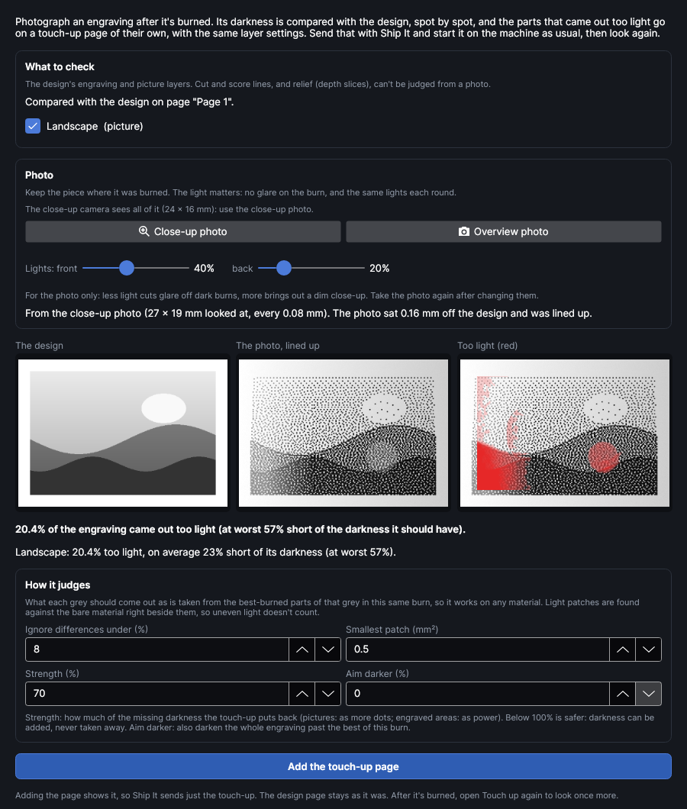

# Burn, look, touch up

Engravings rarely come out perfectly even: the focus drifts across a warped board, a knot or a
glue line takes the heat differently, the material was a little damp in one corner. **Touch up**
photographs an engraving after it's burned, compares it with the design spot by spot, and makes a
touch-up job that goes over only the parts that came out too light. Burn it, look again, and repeat
until it matches.

It works on **pictures** (dithered or grey-level) and **engraved areas** (Fill layers), on wood,
leather, card, anodised and painted metal, and on metals where the mark comes out lighter than the
plate. It can't judge cut or score lines, or relief (depth slices): a photo shows how dark something
is, not how deep.

<!-- windows: TouchUpWindow -->

> **Safety:** Touch up never moves the head or fires the laser. It reads a photo and adds a page to
> your design. The touch-up is a job like any other: you send it with **Ship It** and start it with
> the machine's button.

## Before you start

- **Keep the piece where it was burned.** The photo is lined up with the design, so the touch-up
  lands on the same spots only if the piece hasn't moved. (A small shift of the camera's placement,
  up to a millimetre, is found and allowed for.)
- **The close-up camera** gives the best results: it's sharp enough to see single dots and lines.
  It needs its position at this focus height (**Machine → Close-up position**), and it only sees a
  small patch under the head, so it suits engravings up to about the size of that patch. For bigger
  work use the **overview photo**: it covers the whole bed but is coarser, so only bigger light
  patches are found.
- **Light.** No glare on the burn, and the same lights for every look. The window remembers the
  lights you used and offers them again on the next round.
- **Aim slightly light the first time.** Darkness can be added, never taken away, so a first burn
  that's a touch light leaves room to even it up.

## Using it

1. Burn the engraving as usual and leave the piece where it is.
2. **Placement → Touch up.** The window opens on the design page (if you're on a touch-up page, it
   compares with the design page before it).
3. Under **What to check**, tick the layers to compare: every engraving and picture layer is ticked.
4. Click **Close-up photo** (or **Overview photo**). The photo is compared with the design and three
   pictures appear: **The design**, **The photo, lined up**, and **Too light (red)**, redder where
   more is missing. The line under them says how much came out too light, and by how much.
5. Change the settings below if you like; the comparison updates as you do.
6. Click **Add the touch-up page**. A new page, **Touch-up 1**, is added after the design and shown.
   It holds one layer for each layer that needs it, named **Touch-up 1: (layer name)**, with the
   same settings, and only what needs going over again.
7. **Ship It** sends the touch-up page alone. Start it on the machine.
8. Open **Touch up** again and take another photo to look once more. Each round adds the next page
   (**Touch-up 2**, …). When it's done, go back to the design page (**Back to the design page**, or
   the page tabs) and delete the touch-up pages if you don't want to keep them.

## How it judges

- **What each grey should look like** is learned from the same burn: for each shade in the design,
  the best-burned part of that shade (its darkest third) shows what that shade can be. The rest of
  that shade is compared with it. So it needs no test or calibration, and works on any material.
- **Against the bare material beside it.** Each spot's darkness is measured against the bare
  material around the engraving, as the light falls there, so light that falls off across the bed
  or a vignetting close-up doesn't count as a light patch.
- **Over a few dots or lines.** The photo is looked at over a few of the layer's dots or scan lines
  at a time, so the gaps between dots and lines aren't counted as light patches.
- **Not at edges.** Where the design changes sharply, and along the engraving's outline, a hair's
  misplacement looks like a fault, and a dithered picture's first dots come late there by their
  nature. Those parts aren't judged.

## Settings

| Setting | What it does |
|---|---|
| **Ignore differences under (%)** | Spots less than this much short of the darkness they should have are left alone: the photo's noise, wood grain, the dots themselves. A share of the darkest tone's darkness, 2–40%, 8% to start. Raise it if grain or texture shows up as red. |
| **Smallest patch (mm²)** | Light patches smaller than this are left alone. 0–50 mm², 0.5 mm² to start. |
| **Strength (%)** | How much of the missing darkness the touch-up puts back. On pictures it sets how many dots go over a light patch (a patch 30% short at 100% gets 30% of the dots); on engraved areas it sets the touch-up layer's power as a share of the original's. 10–100%, 70% to start: below 100% is safer, and another round can always add more. |
| **Aim darker (%)** | 0 evens the engraving up to its own best-burned parts. Above 0 also darkens everything, aiming that much darker than the best of this burn: use it when the whole burn came out too light. 0–60%. |

## What the touch-up page holds

- **Pictures** come back as a picture of how much more each spot needs, darker where more is
  missing and see-through where nothing is added, on a copy of the picture layer (same power, speed,
  resolution and dithering). The material's tone correction (**Tone test**) is left off it: the
  touch-up picture already says how much to add. A threshold layer becomes error-diffusion, so
  patches less than half short still get some dots.
- **Engraved areas** come back as the outlines of the light patches, filled with the Fill layer's
  settings at **Strength** of its power (outline-after is left off).
- Its own page means its own job: **Ship It** sends just the touch-up, and the design page is left
  exactly as it was.

## When it can't tell

The window says so instead of guessing:

- **The engraving isn't in this photo**: the close-up camera doesn't see that part of the bed from
  where the head is. Use the overview photo.
- **The photo doesn't look like the design here**: the piece has moved since it was burned, or glare
  hides the burn. Turn the lights down, and check the piece is where it was.
- **The engraving can't be seen in the photo**: the burn barely differs from the material in this
  light. Change the lights and take it again.
- **Too little of it is in the photo**: only a sliver of a layer is in view.

## Add-on

Touch up is an add-on: turn it off or on in **Settings → Add-ons**. Touch-up pages already in a
design stay there (they're ordinary pages and layers) whether it's on or not.
