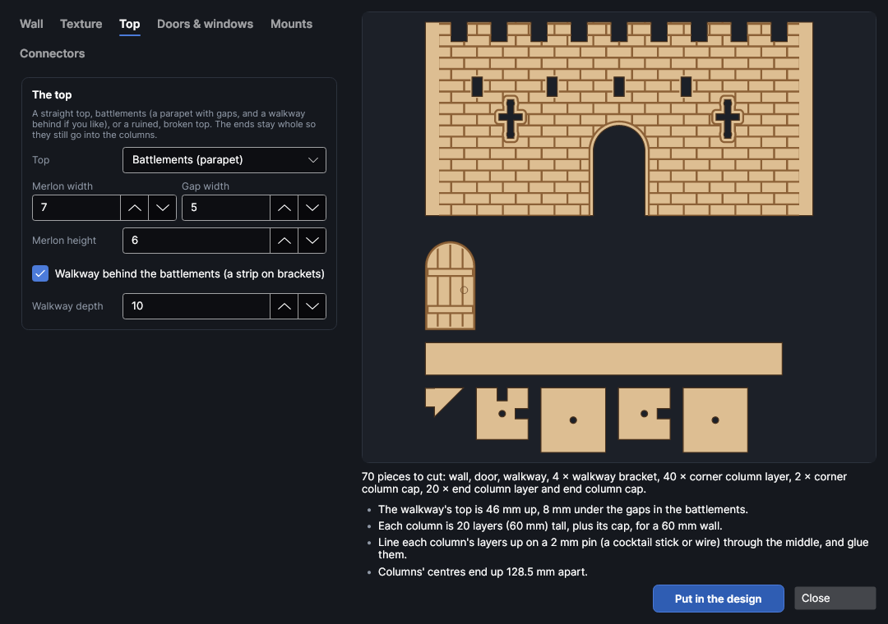
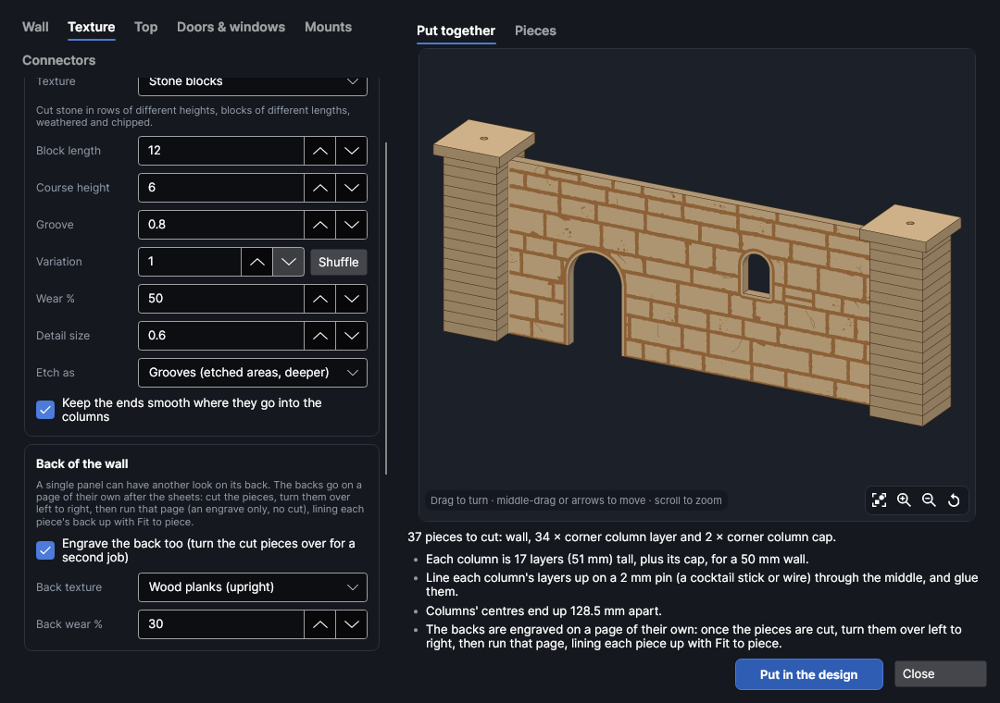
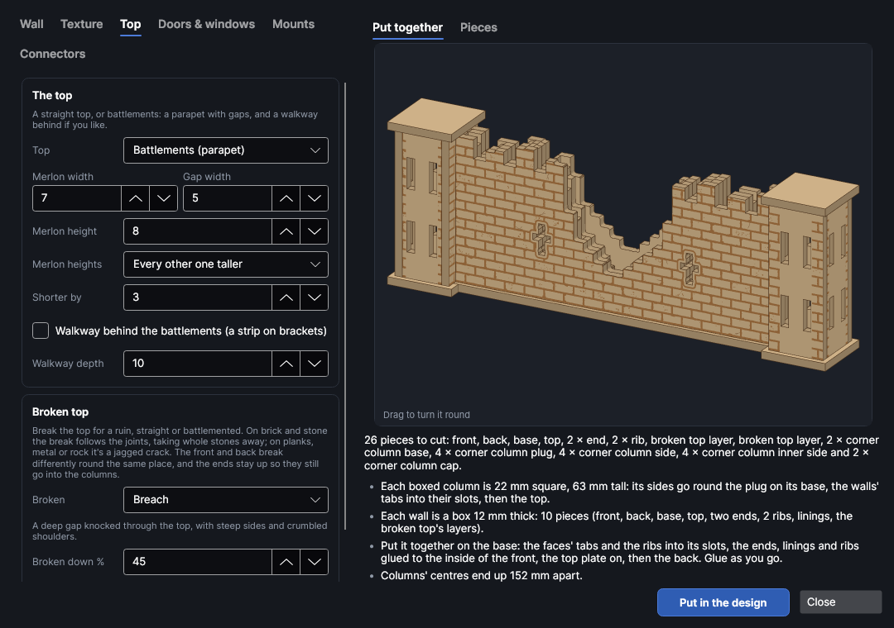
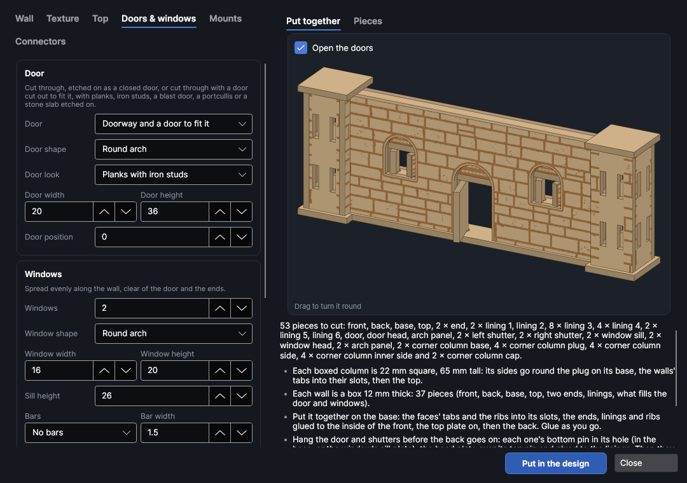
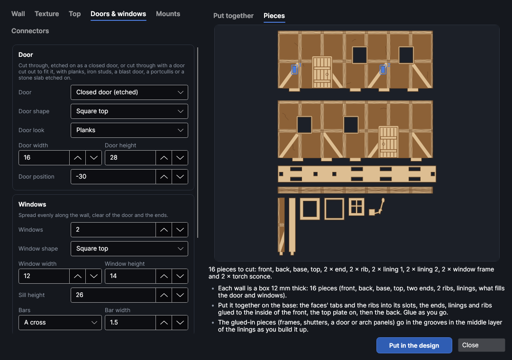
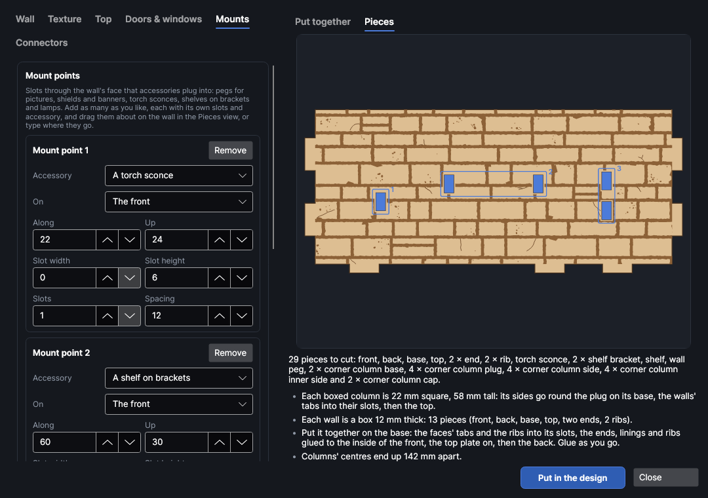
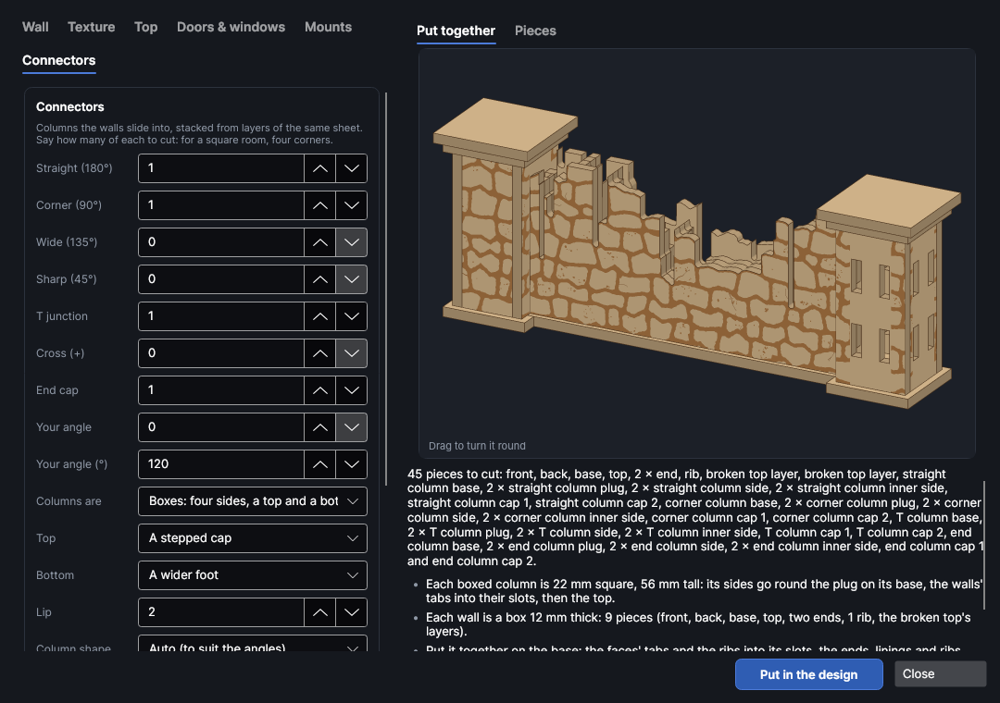
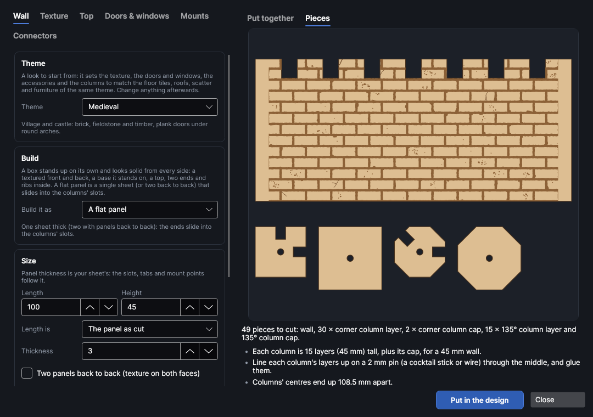

# Textured walls

An add-on (Settings → Add-ons → **Textured wall maker**): on when PhotonCanvas is installed, and can be turned off. Its button is **Home → Draw → Walls**, and **Edit walls…** is on the right-click menu of the pieces it made.

**Walls** makes walls for tabletop games, dioramas and model buildings, cut from sheet material with
a texture etched on: brick, stone, wood, metal, or a pattern of your own. A wall is built as a
**box** (a textured front and back, a base it stands on, a top, two ends and ribs inside) so it
stands up on its own and looks solid from every side, or as a **flat panel**. A wall can have
battlements (with a walkway behind) or a ruined top, a door, windows and mount points for
accessories. Columns cut from the same sheet join the walls: straight on, at corners, at 45° and
135°, as T junctions and crosses, or closing off an end.

> **Note:** The walls have been checked on screen and in tests, but not yet cut on the machine. Cut
> one short wall and a column first and check how the tabs go into the slots before cutting a whole
> set; change **Slot fit** if they're too tight or too loose.

## The Textured walls window
<!-- windows: WallsWindow -->

Click **Walls** on the **Home** tab (in the **Draw** group). The **Textured walls** window opens. The
settings are on the left in tabs; the preview on the right updates as you change things:

- **Put together** shows one wall built, in 3D, with a column at each end (the first kind of column
  you're cutting at its left, the second at its right), its door, accessories and walkway in place.
  Drag it to turn it round; scroll to zoom in on a part, middle-drag or the arrow keys to move it, and press **F** or the first button in its corner to see it all again.
- **Pieces** shows every piece at the same scale, as it will be cut: the wall's front on top, then
  one of each other piece.

Under the preview are the number of pieces and any problems: a red ✕ has to be fixed before the
walls can go in, a yellow ! is worth a look, and a grey • is just for your information.

Press **Put in the design** and the pieces go on a page of their own, nested onto the bed (more pages
if they need more than one bed). To change a set later, select any of its pieces, right-click and
choose **Edit walls…**, change the settings and press **Update in the design**: the old pieces are
replaced wherever they are.

## The wall

**Build it as** picks how each wall is made:

- **A box: front, back, top, bottom and ends** (new walls start like this). The wall is as thick as
  **Wall thickness**, made from panels **Panel thickness** thick: a textured front and back, a base
  plate they stand on, a top plate between them, an end at each end, and ribs inside that hold the
  faces apart. It stands up on its own, its ends can be finished and textured, and doors and
  windows are lined right through (see [Boxed walls](#boxed-walls)).
- **A flat panel**: one sheet thick (or two glued back to back), its ends sliding into the columns'
  slots. This is how the first walls were made, and walls made that way open as they were.

| Setting | Range (default) | What it does |
|---|---|---|
| **Length** | 10 to 2000 mm (100) | How long the wall is: a box wall's faces, from column to column. |
| **Length is** | The panel as cut | *The face as cut*, or *Column centre to centre*: the distance between the middles of the columns at each end. Use centre to centre to lay walls out on a grid (50.8 mm for two 1-inch squares). |
| **Height** | 5 to 1000 mm (50) | How high the wall is from the table, to the top of any battlements. |
| **Wall thickness** (box) | 1 to 200 mm (12) | The whole wall, front face to back face. It must be at least three panels. Two faces plus a whole number of panels between them fits exactly (12 mm, 15 mm or 18 mm for 3 mm sheet); other thicknesses work, and the list says how much room the layers inside leave. |
| **Plinth** (box) | 0 to 20 mm (1.5) | How far the base sticks out past the faces, like a footing course. At 0 the faces' tabs show as notches in the base's edge. |
| **Ribs every** (box) | 15 to 500 mm (45) | The most room between the ribs inside. Ribs keep clear of doors, windows and mount points. |
| **Ends go into columns** (box) | on | The faces have tabs at their ends that go into slots in the columns, and the wall stops at the column's side. Off, the ends are closed: the base goes round them as a plinth, and they can be textured. |
| **Panel thickness** (box), **Thickness** (flat) | 0.5 to 20 mm (3) | Your sheet's thickness. Slots, tabs and mount points are sized from it. |
| **Two panels back to back** (flat) | off | Cuts a mirror-image second panel to glue to the back of each wall, so both faces are textured. The wall is then twice as thick and the slots are made to fit. |
| **How many walls** | 1 to 100 (1) | How many walls like this one to cut. |
| **Cut with** | As set on the cut layer | Cut settings from your material library. Their kerf goes on the cut layer, so the slots come out the width they're drawn, and the material's thickness and slot fit from your cut test are filled in. |
| **Etch with** | As set on the etch layer | Engrave (fill) settings from your library for the texture. |

## Themes

**Theme**, at the top of the **Wall** tab, is a look to start from. Picking one sets the texture and
its sizes, the door's shape and look, the windows' shape, size and bars, the frame round them, the
accessories and the columns' shape. The size, the top, how many walls and the fit stay as they are,
and anything can be changed afterwards. Every terrain maker has the same themes (floor tiles, roofs
and towers, floors and stairs, ruins, bridges, scatter, furniture, the game accessories and whole
buildings), so pieces made in one theme go together on the table.

| Theme | Texture | Door | Windows | Accessories, columns |
|---|---|---|---|---|
| Medieval | Brick | Round arch, planks | Round arch | As set |
| Dungeon | Dungeon blocks | Round arch, iron studs | Small and square, upright bars | Torch sconces, square columns |
| Cave | Cave rock | A rough cave mouth | Rough holes, no frame | Torch sconces, round columns |
| Sci-fi | Sci-fi panels | Angled corners, a metal blast door | Wide, angled corners | Wall lamps |
| Desert | Sandstone | Square top, planks | Small and square, a wide frame | Shelf brackets, square columns |
| Gothic | Fine stone blocks | Pointed arch, iron studs | Tall pointed arches with a cross | Torch sconces, octagonal columns |

Accessories only change when some are being cut: *None* stays *None*.

## Textures

Pick one in **Texture**. The sizes it asks for change with it; the defaults suit 28 mm figures.

| Texture | Sizes (defaults) | What it looks like |
|---|---|---|
| Brick | length 8, height 3.5 mm | Bricks in running bond, each row moved along half a brick: worn edges, knocked corners, the odd spalled or cracked brick. |
| Stone blocks | length 12, course 6 mm | Cut stone in rows of different heights, weathered and chipped. |
| Fieldstone | size 9, course 6 mm | Rough, rounded stones of uneven shapes and sizes. |
| Tiles | 6 × 6 mm | Square tiles or blocks in straight rows, the odd one chipped or cracked. |
| Wood planks (upright) / (across) | width 5, length 35 mm | Boards with butt joints, flowing grain that bends round knots, splits and nail holes. |
| Timber frame | beam 3, bay 20 mm | Tudor style: posts, rails and braces stand out with their grain; the plaster between them is etched. |
| Corrugated metal | pitch 2.5 mm | Upright ridges, dented and scratched, with riveted sheet overlaps. |
| Metal plates | 20 × 14 mm | Riveted plates with the odd patch plate or weld seam, scratches and rust pits. |
| Hexagons | 8 mm | Hexagonal tiles or armour, some with an inset face. |
| Dungeon blocks | length 14, course 8 mm | Big, worn blocks: chipped, spalled, pitted and cracked. |
| Cave rock | rock 16, layer 10 mm | Rough rock in uneven, tilted layers with bedding lines, split by cracks and pitted. |
| Sci-fi panels | panel 16, band 12 mm | A corridor wall, drawn from a concept reference: wide bays between tall bolted pillars, each pillar with a slotted vent, a light and a small grille. Every bay has a kick plate and a skirt with a big vent along the floor, a deep recess with a stepped armour plate standing in it, and a cornice of angled plates along the top on taller walls. Above the plate the recess shows its services: bent pipes running into a control box, or bundled cables clamped to a junction box. The two bay designs take turns, mirrored, with a maintenance hatch or a console now and then. **Panel width** sets the bay (about half of it), **Panel height** sets the bands. In relief the recess carves deepest and the plate stands proud of it. |
| Hab concrete | panel 18, course 12 mm | A cyberpunk hab block's outside: precast panels in courses with tie holes, stains and patches, a plinth along the bottom, and its services: air-con units beside the windows, downpipes, cable runs, junction boxes and vents. |
| Steel cladding | bay 20, rail 16 mm | An industrial block's outside: a steel frame of posts and rails with gussets, corrugated sheet in the bays, patch plates and the odd cross brace. |
| Shopfront | panel 18, course 12 mm | A street-level wall in a cyberpunk city: big panels, a roller shutter, a sign box, posters and tags, with its services. |
| Glass facade | mullion 12, band 24 mm | A corp tower's curtain wall: mullions and spandrel bands, glass sunk between them with transoms, lights and blinds. |
| Sandstone | length 16, course 7 mm | Long, soft-cornered blocks eaten by the wind: rounded edges, wind lines and clusters of pits. |
| Adobe | patch 14, brick 3 mm | Smooth mud plaster with ragged patches fallen away to show worn bricks, and spreading cracks. |
| Plain | | No texture: just the outline, doors, windows and mounts. |

- **Groove**: how wide the etched gaps between bricks, stones or planks are.
- **Variation**: stones, blocks and planks are laid out at random; each number gives a different
  layout, and **Shuffle** picks the next one. The same number always gives the same wall.
- **Wear %**: how weathered the texture looks. 0 is new and crisp (straight edges, nothing broken),
  50 is the usual look, 100 is ancient and battered. More wear means more nicked edges (so the gaps
  between stones vary in width), knocked-off corners, bites out of the edges, clusters of pits,
  weathered patches, cracks (the worst etched open, the rest scored), and on metal scratches, dings
  and rust pits. Some stones stay almost smooth and others are badly worn, and how worn the wall is
  drifts slowly along it, as on a real wall. Changing the wear doesn't move any stones: the layout
  comes from **Variation** only.
- **Detail size**: the size of the smallest marks, in mm: pits, nicks, wood grain, bolts, vent slats,
  pipes and greebles. Each texture picks a sensible size when you choose it. Make it bigger for a big
  wall or a coarse material (the marks stay clear), smaller for fine work.
- **Etch as**: *Grooves* etches the gaps as filled areas (deeper and the most real). *Lines* scores
  round each brick or stone instead, which is much quicker. Grain, rivets and door handles are always
  scored lines, on a light **Walls · lines** layer.
  *Relief* carves the texture in depth instead of etching it all at one depth. Each wall gets a
  greyscale depth map (dark is deep) on a **Walls · relief** picture layer, carved in depth slices
  before anything is cut. The mortar and grooves go deepest, with floors that aren't quite flat. Pits,
  chips and nail holes go part of the way, each its own depth, and grain, scratches and small cracks
  are cut shallow. Every brick, stone, plank or plate stands at a height of its own and leans a
  little, its edges round over into the grooves, and worn surfaces are gently uneven. More **Wear %**
  makes all of that stronger; metal plates stay nearly level. It's the most real look and much the
  slowest. Set how deep it goes on the relief layer (its **Slices**, power and speed): run a depth
  test on your material first.
- **Keep the ends smooth** (flat walls): leaves the ends of the wall (as far as the slots are deep)
  without texture, so they slide into the columns at full thickness. On by default.
- **Texture the back face too** (box walls): on by default. The back is laid out differently from
  the front, so the two faces don't match stone for stone.
- **Texture the ends and the top too** (box walls): the texture on the top plate (or the walkway),
  on closed ends and on the back of a parapet. The courses on the ends line up with the faces'.

### Your own texture

Make a texture from shapes you've drawn or from an SVG drawing. One copy of the shapes is a tile;
the tiles are repeated in rows over the face. Closed shapes are etched as areas, open ones are
scored as lines.

1. Draw the tile (or open the SVG you want). For shapes on the canvas, select them before opening
   **Walls**.
2. On the **Texture** tab, type a **Name**, and set **Gap** (space between tiles) and **Row shift %**
   (50 moves every other row along half a tile, like bricks).
3. Press **From the selected shapes** or **From an SVG file…**. The texture joins the list, marked
   "(yours)", and stays there next time. **Tile width** scales it.

**Delete this texture** takes one of yours off the list. Walls you already made with it keep it:
your texture is saved in the design too, so it can be opened and changed on another computer.

### The back of a single panel

A flat wall cut as a single panel (not two back to back, not a box) can have another look on its
back: brick on the outside of a house and wood panelling inside, say. The back is engraved in a
second job after the pieces are cut and turned over.

On the **Texture** tab, under **Back of the wall**:

| Setting | Choices | Default | What it does |
|---|---|---|---|
| **Engrave the back too** | on, off | off | Engraves each panel's back as well, in a second job. |
| **Back texture** | the presets | the front's | The texture on the back. It's laid out on its own, so it never matches the front stone for stone. |
| **Back wear %** | 0 to 100 | the front's | How weathered the back looks. |

The section only shows for a flat panel with **Two panels back to back** off: two panels back to
back and box walls already have a separate back piece, so it takes the back's look without turning
anything over.

**Put in the design** adds a page after the sheets, named "… · backs (turn the pieces over)" (one
for each sheet that has backs). On it:

- **Walls · back etch** (and **Walls · back lines** or **Walls · back relief**, as the front has):
  each panel's back. Only engraving, nothing is cut.
- **Walls · back outline (guide)**: each panel's outline, with its door and window holes. Its
  **Output** is off, so it's never burned. It's what **Fit to piece** lines the engraving up by.

Everything on the page is mirrored across the bed's middle, so it lies where the pieces are when
you turn the sheet over left to right in the same place. Each piece's outline and engraving are
grouped.

1. Run the sheet's page as usual: the front texture, then the cut.
2. Turn the pieces over left to right (the top edge stays at the top) and lay them on the bed.
3. Show the backs page. With the camera picture on, drag each piece's group roughly onto its piece.
4. Select the group and click **Camera** → **Fit to piece**. Because the group has its outline on a
   guide layer, only that outline is matched to the piece's edges, and the whole engraving moves
   with it. **Apply**, then do the next piece.
5. Run the backs page.

## The top

- **Straight**: a flat top.
- **Battlements (parapet)**: gaps along the top. **Merlon width** is the raised blocks, **Gap width**
  the gaps between them and **Merlon height** how deep the gaps go. The ends stay full height.
  **Merlon heights** can be *All the same height*, *Every other one taller* or *Taller at the ends*
  (like towers at the corners); **Shorter by** is how much lower the shorter merlons are. The wall's
  **Height** is the top of the tall ones.
  **Walkway behind the battlements** adds a strip, **Walkway depth** deep, that sits on brackets
  behind the wall 8 mm below the gaps; the brackets' tabs plug into slots cut through the wall under
  it. The walkway is as long as the wall between the columns.

## Broken tops

**Broken** breaks the top for a ruin, whether it's straight or has battlements, so a castle wall can
have its battlements and a breach through them. On brick, stone blocks, fieldstone and the other
stone textures, the break follows the joints: whole stones are taken away, so the edge runs round the
stones like real fallen masonry. On planks, metal and the like it breaks in a jagged line instead.

| Broken | What it looks like |
|---|---|
| *Crumbled* | Stones fallen out along the top, most of them in one place. |
| *Breach* | A deep gap knocked through the top, with steep sides and crumbled shoulders. |
| *Fallen end* | Standing to full height at one end, falling away towards the other. |
| *Weathered* | Worn down unevenly all along, with a few deeper gaps. |
| *Shattered* | Jagged cracks rather than stones, for concrete, rock or metal. |
| *Stepped* | The first broken top: a dip in stone-sized steps (walls made before keep it). |

**Broken down %** is how far down the break goes, as a share of the height, and **Where** is where
it's deepest (*Anywhere*, *Left*, *Middle* or *Right*); for a fallen end it's which end has fallen.
**Variation** on the Texture tab breaks it another way. On a box wall the front and back break round
the same place, each its own way, and a break is never so deep there's no room for the box under it
(the wall's checks say when it's been made shallower). Behind a walkway only the parapet breaks. The
ends stay up to the top of their tabs into the columns; with a fallen end those tabs are kept low.

## Doors and windows

| Setting | What it does |
|---|---|
| **Door** | *Doorway* cuts it through. *Closed door* etches a door on (planks, braces and a ring handle) instead. *Doorway and a door to fit it* cuts the doorway and the door too, with the door etched on. In a box wall the door hangs on pins and opens (see [What fills the openings](#what-fills-the-openings)); in a flat wall it's a loose door 0.3 mm smaller all round: glue it open or shut, or hinge it with a strip of tape or cloth. |
| **Door shape** | Square top, round arch, pointed (Gothic) arch, angled corners (sci-fi), or rough: a ragged cave mouth, different for every **Variation**. |
| **Door look** | What's on the door: *Planks* (braces and a ring handle), *Planks with iron studs* (iron bands and studs), *Metal blast door* (a seam down the middle, hazard chevrons and panels), *Bars (a portcullis)* or *Stone slab*. A door cut out with bars has the gaps between them cut through, and is called a portcullis. |
| **Door width**, **Door height** | Its size (mm). |
| **Door position** | Where its middle is, in mm from the middle of the wall: less than 0 moves it left. |
| **Windows** | How many. They're spread evenly along the wall, clear of the door and the ends. If they don't all fit, the list under the preview says how many did. |
| **Window shape** | Square top, round arch, pointed arch, round, an arrow slit (a narrow slit with a cross slit; type a small width, such as 2 mm), angled corners (sci-fi) or rough (cave). |
| **Sill height** | How high the bottom of the windows is. |
| **Bars**, **Bar width** | Material left across the window: a cross, or upright bars. Keep bars 1.5 mm or wider in plywood. |
| **Frame** | A smooth band round each door and window, edged with a groove, where the texture stops. 0 = none. |

A door or window that would cut the wall into pieces, or that doesn't fit its height, is refused
with a red ✕. In a box wall a door stands on the base (the base runs under it as a threshold), and
every opening is lined between the faces (see [Boxed walls](#boxed-walls)). In a flat wall, or a box
wall whose windows are left open, the bars are left in the front face and the back face's window is
open.

### What fills the openings

In a box wall the door and the windows' insides are cut out too and sit between the faces, in the
middle of the wall. These settings, under **Inside the openings** on **Doors & windows**, are only
shown for box walls:

| Setting | What it does |
|---|---|
| **The door opens** | Ticked (the usual), the door hangs on two square pins cut on its hinge side: the bottom pin turns in a round hole in the base, the top one in a **Door head** plate across the doorway inside the wall. It swings out to the front, all the way round to square, and shuts against a strip behind its latch side. An arched or pointed doorway gets an **Arch panel** over the head plate, glued into a groove. Not ticked, the door is glued into a groove round the doorway instead. A portcullis (door look *Bars*) slides up a channel inside the wall instead of swinging, and drops back down on its own. |
| **Hinges** | Which side the door turns on (and a window's shutter, when there's only room for one). |
| **In the windows** | *Nothing*: open windows, with the bars left in the front face. *A frame with its bars* (the usual): a frame glued into a groove round the window with the bars in it, set back from the face. *A shutter, glued in*: a solid planked shutter. *Shutters that open*: a pair that swing open (one when the window is narrow), hanging on pins between a **Window sill** plate and a **Window head** plate, with an **Arch panel** over an arched window. Round windows and arrow slits get a glued shutter. |
| **Open the doors** | Over the **Put together** view: swings the door and shutters open and lifts a portcullis, to see how they work. |
| **Groove depth** | How far the glued-in pieces reach past the opening's edge into the groove cut in the lining (0.8 to 2 mm, 1.2 to start). |

A door or shutters need a wall at least about 2 panels plus 5 mm thick (12 mm for 3 mm sheet) for
their pins to turn, a sill plate's room under the windows, and room inside the wall over the opening
for the head plate. Where there isn't, they're glued in, and the list under the preview says why.

**Hanging them**: before the back goes on, stand the door's bottom pin in its hole in the base (or
a shutter's in its sill plate), slip the head plate over the top pin and glue the head plate to the
linings either side. Don't get glue on the pins. Glued-in pieces go into the grooves in the middle
layer of the linings as you build the linings up.

## Mount points

**Mount points** are small slots through the wall's face that accessories plug into. **Add a mount
point** adds one to the list; each has its own card:

| Setting | What it does |
|---|---|
| **Accessory** | What plugs into it: *Just the slots* (for something of your own), *A peg* (glue a picture, shield or banner to its end), *A torch sconce*, *A shelf on brackets* or *A wall lamp*. |
| **On** | A box wall's *front*, or its *back* for the inside of a room. A flat wall's slots go right through. |
| **Along**, **Up** | Where the middle of its slots is: from the wall's left end, and above its bottom (mm). |
| **Slot width**, **Slot height** | Each slot's size (mm). A width of 0 is your sheet's thickness plus the slot fit, which suits the accessories cut here; type your own for something else. |
| **Slots**, **Spacing** | How many slots, and from the middle of one to the next (mm). |
| **Slots are** | *One above another*: one accessory with a tab in each, held firm. *Side by side*: an accessory in each. A shelf's are always side by side, a bracket in each. |

**Drag a mount point about on the wall** in the **Pieces** view (it opens, showing just the face, bigger, when you go to the Mounts
tab): its number and where it is show as you drag, and its card's **Along** and **Up** change when
you let go. Clicking one picks its card. Ones on the back are marked with a dashed line. A mount
point past the end of the wall, too high or low, in a door or window, on top of another, or with its
slots run together is left out and the checks say which.

**A shelf on brackets** cuts a bracket for each slot and the shelf they hold: each bracket's top has a
tab that goes up through a slot in the shelf, so it sits square. **Shelf depth** is how far the shelf
and its brackets stick out. **Etch them with** etches a texture on the accessories and shelves,
smaller than on the wall: wood planks suit shelves, metal plates suit lamps. Their tabs, inside the
wall, are left plain.

A box wall's ribs keep clear of the mount points, so a tab has room inside. The accessories stand out
from the wall at right angles, so they're drawn side-on. A wall saved before this kept just a number
of mount points; opened again, they're listed where they were spread.

## Boxed walls

A box wall is cut as these pieces (the **Pieces** view shows each one):

| Piece | What it is |
|---|---|
| **Front**, **Back** | The faces, textured. Tabs along the bottom go into the base; tabs at the ends go into the columns. The back is cut as seen from behind. |
| **Base** | What the wall stands on: the faces' footprint plus the plinth, with slots for the faces', ends' and ribs' tabs. It runs under a doorway as a threshold. |
| **Top** | A plate between the faces at the top. Where a window runs through it, it's cut in two. With a walkway, it's the **Walkway**. |
| **End** | Across the gap at each end, from the base to the top plate. |
| **Rib** | The same, inside, every **Ribs every** or less. |
| **Lining** | Layers of sheet between the faces round each door and window, 3 mm wide: from any side the opening looks cut through solid wall. One per layer that fits between the faces; the middle layer is cut back to make a groove where something is glued into the opening. |
| **Door**, **Door head**, **Shutter**, **Window frame**, **Window sill**, **Window head**, **Arch panel**, **Portcullis** | What fills the doors and windows (see [What fills the openings](#what-fills-the-openings)). |
| **Merlon filling** | Battlements: the gap between the faces' merlons filled with layers, sitting on the top plate at the bottom of the gaps. |
| **Parapet backing**, **Walkway** | Battlements with a walkway: the front face goes up as the parapet with a second layer behind it, the back face stops under the walkway, and the top plate is the walkway. A walkway deeper than the wall reaches back over the back face on **Walkway brackets** plugged into slots in the back face. |
| **Broken top layer** | A broken top: the front and back break in the same place but each its own way, and the layers between them break a little lower here and there, so the top looks broken right through. |

**Putting it together**: stand the faces' bottom tabs in the base. Glue the ends, the ribs and the
linings to the inside of the front, with the ribs' and ends' tabs in the base too; set the glued-in
frames and shutters in their grooves and hang the door and shutters as you go; put the top plate on,
then glue the back on. With battlements, glue the merlon filling or the parapet's backing onto
the top plate.

## Connectors

The columns the walls go into. Type how many of each kind to cut: for a square room, four
**Corner (90°)**; for a long straight run, **Straight (180°)** between the walls and an **End cap** at
each end.

| Kind | Slots |
|---|---|
| **Straight (180°)** | Two, opposite each other: the walls carry on in a line. |
| **Corner (90°)** | Two at right angles. |
| **Wide (135°)** | Two, 135° apart: the wall turns by 45° (for octagonal towers and diagonals). |
| **Sharp (45°)** | Two, 45° apart: a sharp point. |
| **T junction** | Three: a straight run with a wall off one side. |
| **Cross (+)** | Four. |
| **End cap** | One: finishes the end of a wall. |
| **Your angle** | Two, **Your angle (°)** apart. |

### Columns for box walls

A box wall's faces butt against the column's side, their end tabs in its slots (**Slot fit** wider
than the sheet). **Columns are** picks how they're made:

- **Boxes: four sides, a top and a bottom**, for straight runs, corners, T junctions, crosses and
  end caps. Two sides are the column's full width and two fit between them. They go round a plug on
  the base (a square that fits inside them) and another under the top, which line them up. The sides
  are textured like the walls, except where a wall covers them. A boxed column must be at least the
  wall's thickness, two sheets and 2 mm wide (the list says if it's narrower); 22 mm suits a 12 mm wall.
- **Stacks of layers**: each layer has the two slots for each wall. Columns at angles other than a
  right angle (135°, 45° and your angle) are always stacks.

| Setting | Choices (default) | What it does |
|---|---|---|
| **Top** | A wider cap | *Flush with the sides*: a plate inside the top. *A wider cap*: a plate **Lip** wider all round, on top. *A stepped cap*: two plates, the upper one wider, like a cornice. *A stepped point*: plates getting smaller, a stepped pyramid. *Battlements*: the sides go up past the top with a gap in the middle of each, like a turret. |
| **Bottom** | A wider foot | *Flat*: a plate the column's size. *A wider foot*: a plate **Lip** wider all round. *A stepped plinth*: two plates, the lower one wider. Where a wall comes in, the plates are notched so the wall (and its base) reaches the column's side. |
| **Lip** | 2 mm | How far each step of a cap, foot or plinth sticks out. |

### Columns for flat walls

Each column is a stack of layers cut from the same sheet: as many as it takes to reach the top of
the wall (the list under the preview says how many). Each layer has a slot for every wall, as wide
as the wall plus **Slot fit**, **Slot depth** deep, and a **Pin hole Ø** up the middle: push a
cocktail stick or a piece of wire through the stack to line the layers up while the glue sets.
**A wider cap on top** adds a layer 2 mm bigger all round that sits over the walls; **A wider foot
at the bottom** makes the bottom layer 2 mm bigger all round.

- **Column shape**: *Auto* makes square columns for straight runs, corners, T junctions and crosses,
  octagons for 45° steps and round ones for other angles, so each wall meets a flat side. *Hexagon*
  suits walls 60° or 120° apart, *Chamfered square* is a square with its corners cut off (right
  angles), and *Fluted* is a round column with grooves down it, kept clear of where the walls go in.
- **Column width**: across the flats.
- If the slots would run into each other or the pin hole, or leave the column too thin, the list
  says so: make the column wider or the slots shallower.

## Layers and order

The pieces go on three layers, run in this order: **Walls · lines** (light scoring) and **Walls ·
etch** (the texture, a Fill layer) first, while the sheet is whole, then **Walls · cut**. Single
panels engraved on the back too get a page of their own for the backs (see
[The back of a single panel](#the-back-of-a-single-panel)); its etch layer takes the same **Etch
with** settings. Set the
etch layer's power and speed for the depth you want (Laser → Tests → Material test helps); a deeper
etch shows more but takes longer.

## Try it

- [Make a brick wall with a door and columns](tutorial:draw-walls)
- [Engrave both sides of a single-panel wall](tutorial:draw-walls-backs)
