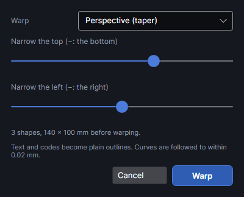
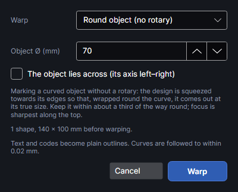
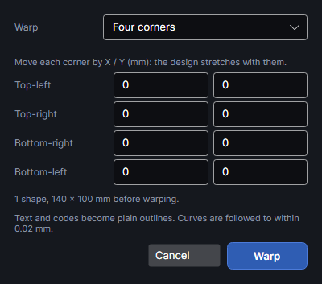

# Warp

An add-on (Settings → Add-ons → **Warp**): on when PhotonCanvas is installed, and can be turned off. Its button is **Arrange → Transform → Warp**, and **Warp…** is on the right-click menu.

## Warp

<!-- windows: WarpWindow -->

**Warp** bends the selected shapes, all together: a taper, an arch, a bulge, a wave, a correction
for marking round objects, or the four corners moved freely. The result shows on the work area as
you change it. **Warp** keeps it; **Cancel** puts the shapes back.

Choose the kind under **Warp**. The sliders run from −100 to 100.

| Warp | Settings | What it does |
|---|---|---|
| **Perspective (taper)** | **Narrow the top (−: the bottom)** (default 30), **Narrow the left (−: the right)** (default 0) | Narrows one side so the design tapers, as if seen at an angle. At the far right of the first slider the top is a tenth of its width. |
| **Arch** | **Arch up (−: down)** | Bends the design into an arch: the middle rises by up to half the design's height, the left and right ends stay put. |
| **Bulge or pinch** | **Bulge (−: pinch)** | Swells the middle up to 1.5 times (or pinches it to half), leaving the edges. |
| **Wave** | **Wave height**, **Waves across** (0.5–20, default 2) | Ripples it up and down, by up to a quarter of its height. |
| **Round object (no rotary)** | **Object Ø (mm)** (5–500, default 70), **The object lies across (its axis left–right)** | For marking a mug, pen or bottle lying on the bed without a rotary: the design is squeezed towards its edges so that, wrapped round the curve, it comes out at its true size. Keep it within about a third of the way round; focus is sharpest along the top. Unticked, the object's axis runs up and down the work area. |
| **Cone (tapered tumbler)** | **Top Ø**, **Bottom Ø** (5–500 mm, defaults 80 and 65) | For tapered tumblers and cups marked from above: each row of the design is corrected for the diameter at its height, so it wraps at its true size. |
| **Four corners** | X and Y for **Top-left**, **Top-right**, **Bottom-right** and **Bottom-left** (−500 to 500 mm) | Moves each corner of the box round the design by the amounts typed; everything in between stretches in proportion. |

- The warp works on the box round all the selected shapes; the line under the settings gives how
  many shapes there are and their size before warping.
- Text, codes and editable shapes become plain outlines. Curves are followed within 0.02 mm.
- Pictures aren't warped.
- Each shape keeps its layer and group; hand-placed tabs and start points are dropped.

## Tutorials

- [Warp a design](tutorial:arr-warp)
